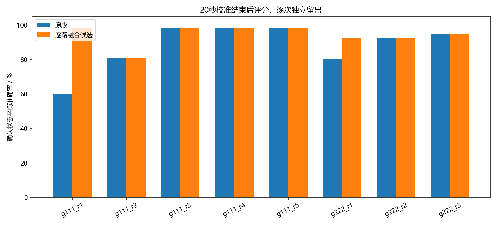

# 逐路健康监测与融合候选版

本轮已实现：12个芯片各自判断启停 → 当前健康状态筛查 → 训练期可靠性加权融合 → 连续确认 → 输出状态与逐路退出/恢复记录。仅处理启停，暂未把30/50 Hz细分加入本候选。

## 实际结果

|指标|原版|本轮候选|
|---|---:|---:|
|确认状态平衡准确率|87.74%|93.99%|
|稳定关态误报时间比例|17.78%|8.28%|
|运行漏判或无有效证据比例|6.75%|3.75%|
|计划启停事件命中|15/16|16/16|
|未匹配事件数|6|4|



首次记录停机后持续误报已在候选回放中消除；g222_r1运行漏判消除；g111_r2仍有运行漏判与4次未匹配切换。候选没有解决所有问题。16/16事件命中也不表示每秒都正确；成功停机仍在计划指令后9–15秒确认。

| case_id   |   confirmed_BA |   off_false_positive |   on_miss_or_unknown |   unknown_fraction |   events_hit |   unmatched_events |
|:----------|---------------:|---------------------:|---------------------:|-------------------:|-------------:|-------------------:|
| g111_r1   |          0.980 |                0.040 |                0.000 |              0.000 |            2 |                  0 |
| g111_r2   |          0.810 |                0.080 |                0.300 |              0.000 |            2 |                  4 |
| g111_r3   |          0.980 |                0.040 |                0.000 |              0.000 |            2 |                  0 |
| g111_r4   |          0.980 |                0.040 |                0.000 |              0.000 |            2 |                  0 |
| g111_r5   |          0.980 |                0.040 |                0.000 |              0.000 |            2 |                  0 |
| g222_r1   |          0.922 |                0.156 |                0.000 |              0.000 |            2 |                  0 |
| g222_r2   |          0.922 |                0.156 |                0.000 |              0.000 |            2 |                  0 |
| g222_r3   |          0.944 |                0.111 |                0.000 |              0.000 |            2 |                  0 |

评价口径与上一轮相同：只用20秒以后、排除斜坡的稳定窗口，记录等权，所有测试记录整次留出。只有8次实验且这批数据已用于选择研究方向，因此仍是探索结果，需冻结方案后在新记录上确认。

## 融合与选路怎样避免偷看测试结果

每个外层测试记录完全留出。其余7次内部再轮流留出，用于估计每一路模型的启停平衡准确率；然后在这7次上拟合12个逐路模型。可靠性不来自当前测试记录的标签。

可靠性低于0.55的路不参与候选融合；其余基础权重与exp(12×可靠性)成正比，每秒选当前可用且权重最高的至多3路，再归一化权重融合运行概率。数字0.55、12、3是本轮固定的工程参数，没有声称最优。本轮没按外层成绩反复调参数。

没有硬编码第8路必须使用；training_only_weights.csv保留每折权重与选型依据。数据映射假定相同接线和通道顺序，换芯片位置或增益后需要重新验证。单路备用时标记single_channel_fallback，不能把它当成三路一致同意。

## 动态坏道处理目前覆盖什么

|情形|当前动作|
|---|---|
|某路当前1秒块出现非有限特征|立即退出该路，并从其余候选补位；记录nonfinite|
|某路当前1秒内全部0.1秒块RMS≤10⁻⁸ V|以持续平坦/卡死退出，记录flat_raw；此阈值仅适用于当前量纲与数据级别|
|退出路重新得到连续3秒有效数据|恢复可用，按训练权重决定是否重新参与；前两秒记录recovering_3s|
|初始基准已经无效|本次记录不启用该路；不能借用其他芯片的基准，需重新采集有效基准|
|所有可参与路都不可用|输出unknown/无有效证据，清除连续确认计数，不保持旧“运行/关”作为当前有效判定|
|恢复后重新获得连续3次相同判定|标记state_reacquired，与正常状态变化state_transition区分|

“健康/可用”只表示通过当前数据完整性规则，不证明芯片物理正常。±5 V附近波形、偏置漂移、持续下冲不能只靠这个规则判坏；芯片输出量程未知时，本版没有擅自按绝对电压判饱和。结构性缺道、TDMS中断、采样率/通道名称不符仍会停止输入并报错，不是已实现硬件断流自动重连。

**这8份真实数据中，健康规则产生的非正常通道秒记录数为0。本轮准确率改善来自逐路建模与融合，不能归功于已经自动找出了真实坏芯片。** 动态退出/恢复能力由下面的软件故障测试另外验证。

## 故障注入测试，与真实实验成绩分开

基于g111_r3真实特征的副本，原始数据不变：

1. 第8路40–45秒人为加入NaN，首个受影响窗口即退出；恢复数据后的前2秒仍观察，第3秒重新可用。其他路补位，日志记录当前权重。
2. 全部通道70–74秒人为把RMS置零，输出无有效证据；恢复期间不伪装成已知状态，重新确认后标记为证据恢复。
3. 修改未来故障区，不改变故障发生前的预测；读取接口默认仍严格拒绝非有限值，仅新候选显式开启逐路处理。

这些测试不是新实验、不是硬件坏道检出率，也不计入93.99%或16/16。当前全部6项相关测试通过。

## 原始文件接入与回放

已直接用排除了g111_r1的模型读取其完整原始TDMS。读取、提取和推理耗时14.85秒，处理约119秒记录，结果写盘与HTML生成不在计时内。原始回放的概率和状态另与缓存回放逐秒核对。

HTML页面显示当前12路健康状态、参与融合与否、权重和各自运行概率。它回放已计算数据，不是已经连接采集设备。

```powershell
Set-Location 'C:\Users\17584\Documents\ALearning\Project\tools\DataProcess'
$env:OPENBLAS_NUM_THREADS='2'
D:\Anaconda\python.exe scripts/health_fusion_recognizer.py --predict 'E:\实际路径\新数据.tdms' --output analysis/20260922_health_fusion/new_run --initial-off-confirmed
```

新文件仍须首20秒为停泵校准、变频器保持通电、同12路接线、400 kHz电压数据。默认model.joblib用8次训练，不能在这8次上冒充独立测试。已知训练路径会拒绝；应使用相应heldout模型验证历史记录。新输出目录不要与先前结果重名。

## 改动和复现

新增scripts/health_fusion_recognizer.py、scripts/report_health_fusion.py、tests/test_health_fusion.py。共享读取函数scripts/state_recognizer.py新增allow_nonfinite参数，默认False，原版识别行为保持不变；候选显式启用后按通道记录无效值，没有填补原始采样。原始文件、原版模型和旧报告未修改。

```powershell
D:\Anaconda\python.exe scripts/health_fusion_recognizer.py
D:\Anaconda\python.exe -m pytest tests/test_health_fusion.py tests/test_state_recognizer.py -q
D:\Anaconda\python.exe scripts/health_fusion_recognizer.py --predict 'E:\Lab\raw\9.21\111\20260921104403.351724-1.tdms' --model analysis/20260922_health_fusion/g111_r1_heldout.joblib --output analysis/20260922_health_fusion/raw_g111_r1 --initial-off-confirmed
D:\Anaconda\python.exe scripts/report_health_fusion.py
```

输出validation.csv、events.csv、training_only_weights.csv及每次predictions.csv、events.csv、channel_health.csv、run.json和回放页面。优先继续检查g111_r2的弱响应误判，并补芯片输出量程后扩展物理坏道规则；不要仅为提高本批成绩把候选固定成只用第8路。
