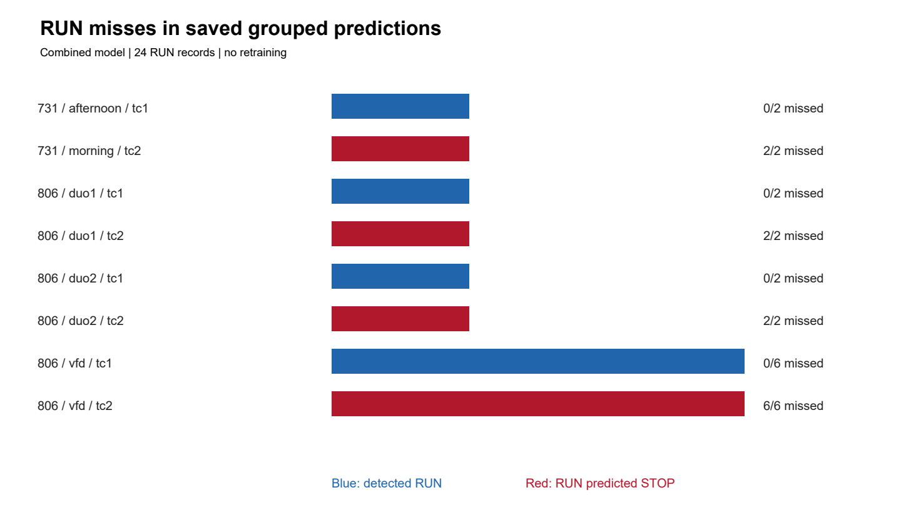
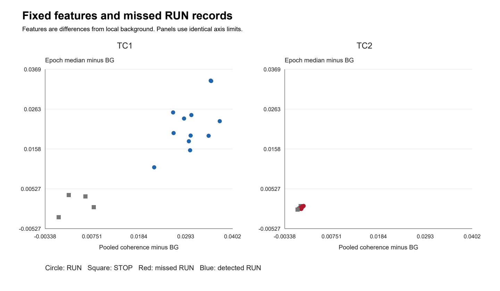
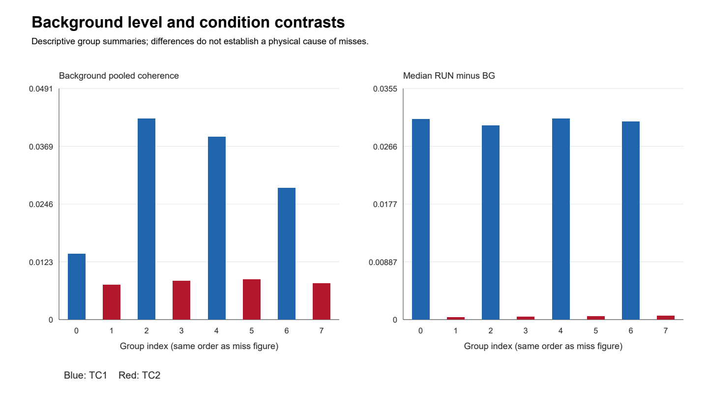

# 结果主表与漏判分析

2026年9月8日。只复用既有特征和组外预测，没有重训模型或新增实验。

结果主表收录50项可追溯数字，CSV保留来源定位与哈希。

## 主要发现

固定共同健康通道合并模型：24条RUN正确12条、漏判12条；8条STOP全部正确。BA=0.75，普通准确率=20/32=0.625。

合并模型在TC1记录中漏判0/12条RUN。这里按测试记录探测器分组，不是重新训练的单探测器模型。

合并模型在TC2记录中漏判12/12条RUN。这里按测试记录探测器分组，不是重新训练的单探测器模型。

| 分层 | RUN正确 | RUN漏判 | 单探测器模型RUN正确 |
|---|---:|---:|---:|
|20260731 / afternoon / tc1|2/2|0/2|2/2|
|20260731 / morning / tc2|0/2|2/2|1/2|
|20260806 / duo1 / tc1|2/2|0/2|2/2|
|20260806 / duo1 / tc2|0/2|2/2|2/2|
|20260806 / duo2 / tc1|2/2|0/2|2/2|
|20260806 / duo2 / tc2|0/2|2/2|1/2|
|20260806 / vfd / tc1|6/6|0/6|5/6|
|20260806 / vfd / tc2|0/6|6/6|5/6|

合并模型与单探测器模型使用不同训练集及训练折尺度，因此不能把其预测混在一起计算一个成绩。

8层RUN−STOP同向是层内对比；分类输入是RUN或STOP相对本地背景的特征差，跨层幅度和背景会变化。存在同向差异并不保证一条跨层规则能识别全部记录。图中差异属于描述性线索，不据此断言误判的物理原因。

## 使用范围

本分析不重新筛选频段、阈值、通道或分类器。只有两个旧日期，未计算把窗口当独立实验的置信区间。当前分组保持原定义；同步探测器是否对应同一真实采集单元仍需记录核实。

完整逐记录表为record_predictions.csv，12条漏判单列在missed_run_records.csv；主表为result_registry.csv。