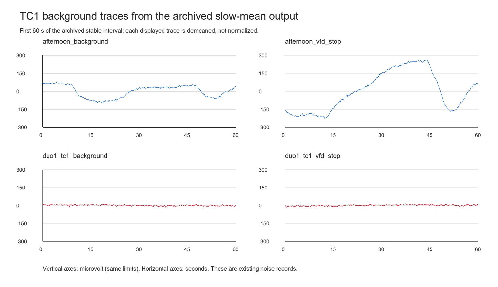
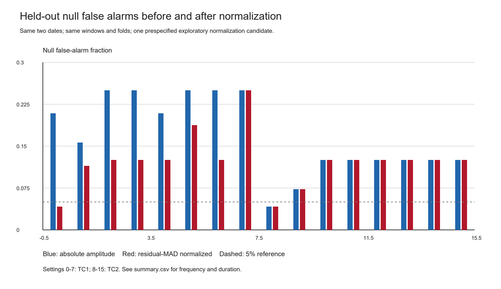
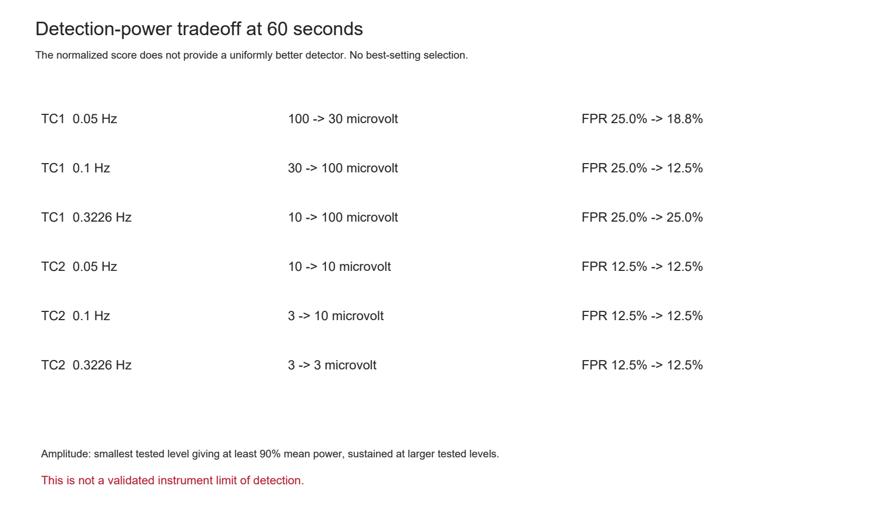

# 背景阈值转移复核

2026年9月9日。本轮沿用此前16条既有BG/STOP记录、共同健康通道、窗口和留组划分，没有新增物理实验，也没有改动原分类器。任务是定位误报，检查一种预先指定的尺度归一化是否能改善跨工况阈值转移。

## 误报定位与背景差异

60 s条件下，TC1三个固定频率的基线误报全部来自7月31日下午的afternoon_background和afternoon_vfd_stop。它们不只是单个频点幅值偏大，时域中也有明显的慢变化。以0.05 Hz拟合为例，这三段60 s窗口的残差MAD尺度约46.53—151.89 µV，8月6日TC1对应窗口约4.21—6.24 µV。背景记录的第二个窗口拟合趋势跨60 s变化约630.82 µV，其他窗口和峰峰值保留在window_diagnostics.csv。

这说明“其他工况的绝对微伏阈值”不适合直接套用到该组旧记录，但现有记录不足以把慢变化归因于温漂、供电、环境或某一硬件故障。分析没有删除这组困难记录，也没有把它重新标成信号。

TC2的60 s误报分布不同：0.05 Hz来自duo2_tc2_background，0.1 Hz来自duo1_tc2_background，约0.3226 Hz来自duo1_tc2_vfd_stop。并非所有频率都由同一异常工况造成。完整位置见false_alarm_records.csv，其中包含两个方法的结果，需按method筛选。

## 本轮比较的方法

基线仍为已知频率最小二乘谐波峰值幅度。候选方法将该幅度除以拟合残差的稳健MAD尺度。拟合同时包含截距、线性趋势、余弦和正弦；MAD为残差相对残差中位数的绝对偏差中位数乘1.4826。这里的系数用于尺度约定，没有假设真实低频噪声已经是独立高斯噪声。

每个测试窗口使用自身的拟合残差计算尺度，这是候选算法预定的计算步骤，不是在测试标签上调阈值。由于注入信号恰好位于拟合的正余弦子空间，理想线性计算中残差不随注入幅值改变；已通过直接波形注入检查这一性质。真实信号频率失配、瞬态、饱和或模型不匹配时，不保证这种不变性。

两个方法都仅使用同探测器的其他工况作为阈值标定集，阈值为等记录权重的95%经验分位数。窗口、频率、12档幅值和64个相位均与原协议一致。候选在结果计算前写入protocol.json，只比较这一项，没有按测试成绩挑选多个算法中的最好者。不过，这仍是对同一批已观察数据的探索性复核，不是新日期的独立验证。

## 结果与取舍

16个探测器—频率—时长设置中，候选方法的误报在7个设置下降、9个不变，没有形成全面改善的检出器。

| 探测器 | 频率 Hz | 60 s误报 基线→归一化 | 平均90%检出最小测试幅值 基线→归一化 µV峰值 |
|---|---:|---:|---:|
| TC1 | 0.05 | 25%→18.75% | 100→30 |
| TC1 | 0.10 | 25%→12.5% | 30→100 |
| TC1 | 0.3226 | 25%→25% | 10→100 |
| TC2 | 0.05 | 12.5%→12.5% | 10→10 |
| TC2 | 0.10 | 12.5%→12.5% | 3→10 |
| TC2 | 0.3226 | 12.5%→12.5% | 3→3 |

TC1在0.05 Hz时有改善，但在约0.3226 Hz时没有降低误报，90%平均检出所需的最小测试幅值反而由10增至100 µV。因此不能根据某一频率的好结果把归一化整体替换为新主方法。较大的残差尺度会使高噪声窗口需要更大的绝对信号幅值才能超过归一化阈值，这是应同时评价误报和检出曲线的原因。

表中的幅值来自离散测试网格，不是精确的90%交点。每个探测器只有8条旧噪声记录，且同组记录、窗口之间存在依赖；95%标定分位数不能被解释成已经证明未来5%误报。当前仍不报告“5%误报下的仪器检出限”。

## 对论文和下一步的影响

建议保留原绝对幅度方法为基线，把本轮归一化作为局限分析或消融比较：阈值失败不仅与总噪声尺度有关，慢变化形态和频谱结构也会影响固定频率估计。不要继续在这16条记录上反复搜索到“零误报”再把它当成泛化能力。

后续无新实验时，可进一步核对7月31日下午的归档、硬件与采集记录，区分其噪声背景是否具有已记录的工况变化；这一步不能靠看曲线擅自重标数据。若要研究本地背景校准，需要先把背景在时间上划分为独立标定段和评价段，保持真实使用时可获得的信息，不能用整段测试噪声选择阈值。已有同日数据可以检验实现，但新的泛化结论仍需留出日期或新的实际记录。

## 文件与核验

计算入口为scripts/noise_transfer_audit_20260909.py，绘图入口为scripts/plot_noise_followup_20260909.py。summary.csv保留全部32行方法—设置结果；record_power.csv保留记录级曲线；window_diagnostics.csv保留幅值、趋势、残差尺度与峰峰值；thresholds.csv保留每个留组折的阈值。

原基线检出概率已逐记录重现，最大差异见verification.json；16条源归档SHA256均核对通过，标定与测试记录无交集，注入后残差不变性通过数值检查。仅新增本轮脚本和结果，没有覆盖原始数据、原模型或9月8日的结果表。
