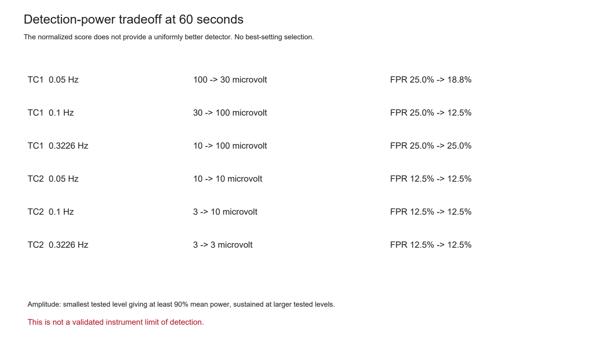
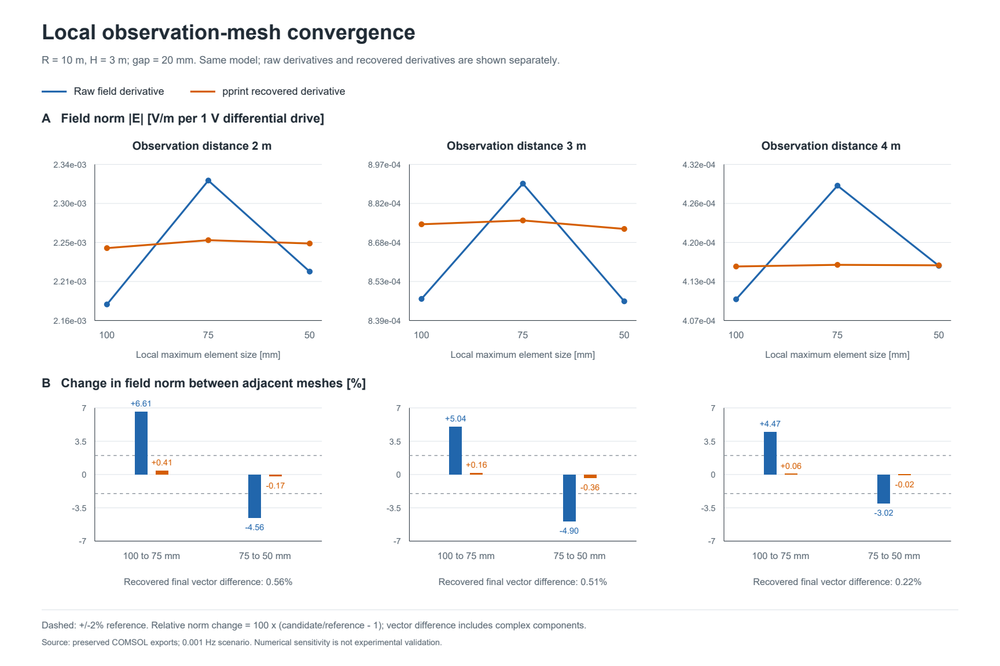
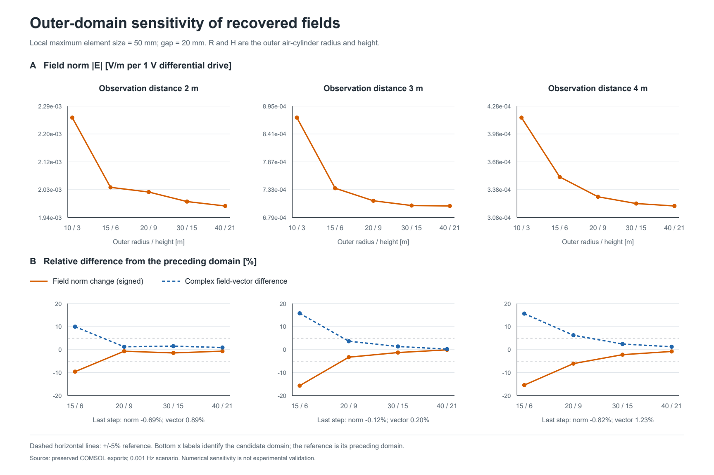
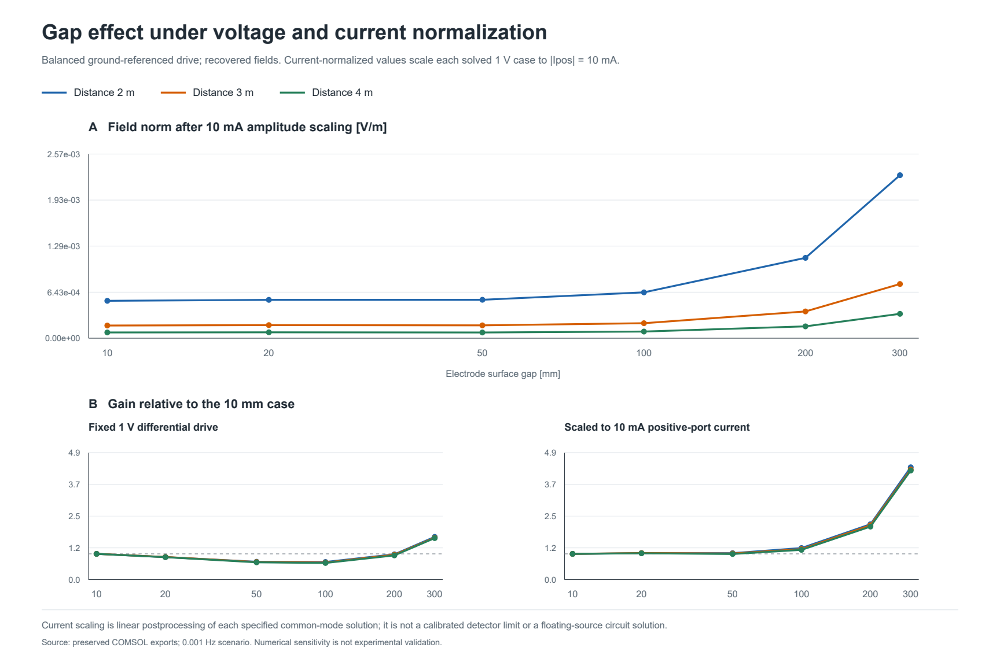
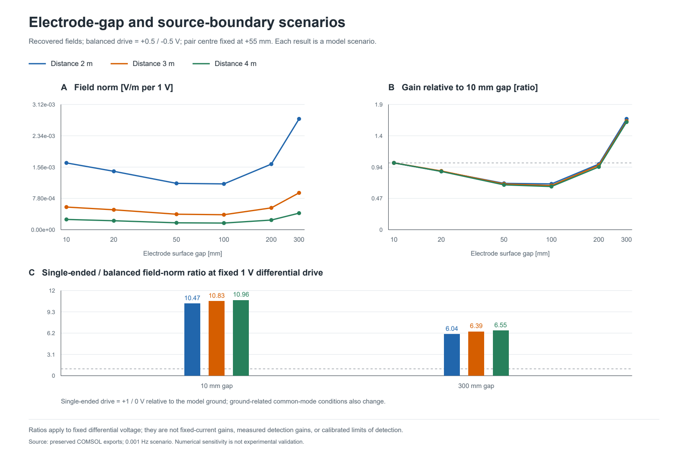

# 研究进展与间隙检出分析报告

本报告面向下一阶段论文写作与实验安排，汇总截至2026年9月18日已经完成的数据分析和COMSOL计算。当前最可靠的新结论有两项。第一，简单的残差MAD归一化不能稳定解决旧数据中的跨工况误报，因此应保留绝对谐波幅值作为基线，并把归一化结果写成局限分析。第二，在明确的平衡接地参考、导线分层走线和10 mA幅值缩放情景下，电极表面间隙由10 mm增加到300 mm，桶外2至4 m的计算场强约提高4.24至4.36倍。这个结果已通过端点网格细化，但仍是条件仿真，不是实测检出距离。

本轮没有新增物理实验，没有修改原始TDMS数据或主处理流水线，也没有把软件注入结果与COMSOL场强强行换算成仪器检出限。

## 当前研究证据

现有论文材料已经形成三条能够相互配合的证据线。

- **状态辨识结果** 已完成固定规则下的RUN与STOP分类、记录级结果主表和漏判定位。组合模型的主要失败集中在TC2的RUN，说明论文不能只报总体准确率，应把探测器差异和漏判组作为结果重点。
- **低频检出分析** 已完成已知频率最小二乘谐波估计、软件注入检出曲线、背景误报定位和一种预先指定的稳健尺度归一化比较。该部分能说明算法在已有输出域中的能力和失效方式。
- **物理场仿真** 已完成水中电阻与功率趋势、外部电场几何修复、解析基准、网格与外域敏感性、六档间隙、两种源边界以及固定电流幅值缩放。该部分能解释几何和供电方式如何改变桶外场，但不能替代实验标定。

这三条证据适合支撑一篇以系统表征、低频特征与状态辨识为主的毕业论文。论文暂时不应把重点放在“已经实现远距离定量测量”或“已经得到实际检出限”，因为输入电场到采集电压的实测幅相传递仍然缺失。

## 背景阈值转移复核

本轮沿用16条既有BG和STOP记录、固定共同健康通道、20至60 s窗口和三个目标频率。绝对谐波幅值仍是基线；候选方法把目标频率谐波幅值除以同一窗口拟合残差的稳健MAD尺度。阈值仅由同探测器的其他工况组估计，标定与测试记录无交集。

独立复算核对了16个低速归档的哈希、通道索引、全部阈值和记录曲线。128个方法与留组折均没有标定和测试记录交叉；从归档重算217行窗口与频率组合的谐波系数和MAD，并完成651次直接波形注入检查。计算没有发现需要推翻原结果的错误。

统计口径需要严格说明。217行是窗口与频率的组合，按记录、起点和时长去重后为90个窗口，而且不同分析时长仍有重叠；独立采集记录只有16条。误报率先在每条记录内部按窗口计算，再对8条记录等权平均。例如TC1在60 s和0.05 Hz下，基线误报窗口为3/9，但来自两条记录，因此等记录误报率为25%，不能写成33.3%。

| 探测器 | 频率 Hz | 60 s误报 基线到归一化 | 平均90%检出最小测试幅值 基线到归一化 µV峰值 |
|---|---:|---:|---:|
| TC1 | 0.05 | 25% 到 18.75% | 100 到 30 |
| TC1 | 0.10 | 25% 到 12.5% | 30 到 100 |
| TC1 | 0.3226 | 25% 到 25% | 10 到 100 |
| TC2 | 0.05 | 12.5% 到 12.5% | 10 到 10 |
| TC2 | 0.10 | 12.5% 到 12.5% | 3 到 10 |
| TC2 | 0.3226 | 12.5% 到 12.5% | 3 到 3 |

在16个探测器、频率和时长设置中，归一化有7个设置降低误报、9个不变；达到持续不低于90%平均检出率的最小离散测试幅值有2个降低、5个升高、9个不变。TC1在0.05 Hz有所改善，但约0.3226 Hz的误报仍为25%，最小测试幅值由10 µV升到100 µV。归一化还会把误报转移到其他记录，因此它改变的不只是某一条困难记录的尺度，而是不同工况统计量的相对排序。

论文中可以写成：简单尺度归一化不足以一致改善旧记录中的跨工况阈值转移。结果限于既有两日输出归档、固定已知频率和同频软件注入，不代表独立日期泛化、实时报警能力或实际仪器检出限。共同健康通道来自包含已有RUN记录的旧组数据，因此“无记录交叉”只适用于阈值标定层，不能扩展成端到端完全独立验证。

## COMSOL模型核验

外部电场模型采用三维电准静态频域求解，频率0.001 Hz，作为低频数值情景。水电导率为0.05 S/m，测点位于桶壁外2、3、4 m和高度0.5 m处。平衡激励把正负导体分别规定为+0.5 V和−0.5 V；单端激励规定为+1 V和0 V；地板及电源机壳为0 V。两者差模电压相同，但相对地共模不同。

本轮修复了原模型中缺失的桶内液面上方空气域、钢管与胶带间0.1 mm未赋域缝隙、空气圆柱与地板恰好相切造成的病态网格，以及电极组偏移后异极铜引线可能相交的问题。六档间隙统一采用负支路高度0.90 m、正支路高度0.92 m的分层走线。有限线段与铜芯半径组成的保守胶囊检查给出最小异极净距约2.757 mm。

原始一阶场导数对测点网格较敏感。本轮保留原始导数，同时采用COMSOL的pprint域内多项式保持导数恢复。球壳解析基准中，细档网格的三个测点最大相对误差由原始场强的约4.71%降到恢复场强的约0.67%，因此后续比较使用恢复场强，并保留原始表格供追溯。

在半径30 m、高15 m外域中，测点局部最大单元由50 mm细化到25 mm，2、3、4 m处恢复场强模变化分别约−0.037%、−0.209%、−0.587%，复矢量差不超过0.620%。外域进一步扩大到半径40 m、高21 m时，场强模变化不超过0.818%，复矢量差不超过1.229%。这些数字说明相邻设置已经稳定到足以开展条件比较，但它们不是相对真实解的严格误差上界。

10 mm与300 mm间隙还分别进行了全局网格0.8 m到0.6 m、测点局部网格50 mm到25 mm的联合细化。恢复场强模最大变化1.272%，复矢量最大变化1.495%，通过本轮预先采用的2%数值筛选。所有场矢量分量与场强模一致性、源表哈希、三端反应电流守恒和走线净距均写入verification_final.json。

## 电极间隙比较

六档模型的电极表面间隙为10、20、50、100、200、300 mm，电极组中心统一放在x等于+55 mm的位置。外域为半径30 m、高15 m，采用分层引线、明确桶内空气和紧贴胶带情景。以下数值均为恢复场强模。

固定1 V差模电压时，增大间隙不会单调提高外场。10 mm到100 mm期间场强先降低，200 mm以后上升。300 mm相对10 mm在2、3、4 m处分别为1.659、1.626、1.611倍。原因是间隙增大同时降低端口电流；只比较固定电压会把几何效应和电流变化混在一起。

| 间隙 mm | 1 V端口阻抗幅值 Ω | 2 m场强 mV每m | 3 m场强 mV每m | 4 m场强 mV每m |
|---:|---:|---:|---:|---:|
| 10 | 31.33 | 1.665 | 0.565 | 0.256 |
| 20 | 36.76 | 1.456 | 0.497 | 0.223 |
| 50 | 46.42 | 1.155 | 0.386 | 0.172 |
| 100 | 56.03 | 1.142 | 0.373 | 0.166 |
| 200 | 68.59 | 1.635 | 0.545 | 0.241 |
| 300 | 82.37 | 2.762 | 0.918 | 0.413 |

把每个1 V解按照本模型正端反应电流幅值线性缩放到10 mA后，10至50 mm结果接近，100 mm开始增加，200至300 mm提升明显。300 mm相对10 mm在2、3、4 m处分别为4.361、4.274、4.236倍。端点联合细化通过，说明这一数量级不是测点网格偶然波动。

| 间隙 mm | 2 m场强 mV每m | 3 m场强 mV每m | 4 m场强 mV每m | 2 m相对10 mm |
|---:|---:|---:|---:|---:|
| 10 | 0.522 | 0.177 | 0.080 | 1.000 |
| 20 | 0.535 | 0.183 | 0.082 | 1.026 |
| 50 | 0.536 | 0.179 | 0.080 | 1.028 |
| 100 | 0.640 | 0.209 | 0.093 | 1.226 |
| 200 | 1.122 | 0.374 | 0.165 | 2.150 |
| 300 | 2.275 | 0.756 | 0.340 | 4.361 |

固定10 mA缩放使用同一外部模型提取的正端反应电流，没有借用旧水域模型的电阻。但它仍是对指定共模解的线性后处理，不等于求解了真实浮地恒流电源，也没有包含电极极化、电缆阻抗和真实控制器限压。论文中应使用“在规定模型条件下”或“仿真表明”，不要写成实际装置已经提高4.36倍。

## 供电边界影响

单端与平衡激励的差模电压均为1 V，但单端情景相对模型地具有更大的共模。单端场强与平衡场强之比，在10 mm间隙的2、3、4 m处为10.47、10.83、10.96；在300 mm处为6.04、6.39、6.55。正端电流幅值几乎不变，因此该差异主要来自地相关共模边界，而不是水中差模电流突然增大。

这项结果比单纯的间隙增益更需要谨慎。模型把地板和机壳规定为0 V，却没有求解真实隔离电源的浮动电位。它说明外部场预测对共模条件非常敏感，因此下一轮实验必须记录电源接地、机壳连接、电缆屏蔽和两端对地电压。论文可以把它写成敏感性或边界条件研究，不能据此推荐单端供电来人为获得十倍信号。

## 检出能力能够说明什么

目前算法检出结果的单位是采集输出域的µV峰值，COMSOL结果的单位是V/m。两者之间缺少实测传递系数，包括传感器方向、前端增益、频率响应、相位、环境耦合和安装重复性。因此现在不能给出“300 mm间隙可检出到多少米”，也不能把软件注入的3至100 µV阈值直接除以仿真场强。

当前能够做的是条件比较。在同一传感器、方向、频率和背景下，如果输出电压与局部场强近似线性，而且其他条件不变，那么300 mm相对10 mm的约4.24至4.36倍场强可被理解为相同背景下信号幅值的潜在增益。实际检出率是否相应提高，还取决于噪声是否随布置和供电方式变化。旧数据已经表明背景分布会跨工况变化，所以不能只按信号增益推断误报率。

要把两条证据线连接起来，至少需要一次受控标定：在已知频率和稳定背景下记录源端差模电压、正负端对地电压、端口电流、传感器位置与方向，同时获得传感器输出幅相。得到输出电压除以局部参考场强的传递系数后，才能把输出域检出曲线换算成条件电场阈值。若使用COMSOL作为局部场强参考，还要报告模型参数和不确定度；更可靠的做法是使用可追溯的参考场源或近场对照测量。

## 论文写作安排

第四章可以按“已有数据上的状态辨识与低频检出”组织。先给出固定规则、记录级主结果和TC2 RUN漏判，再介绍已知频率最小二乘谐波估计和软件注入检出曲线，最后用背景阈值转移复核说明局限。归一化方法适合作为消融比较，不应替换主方法。

第五章可以按“电极间隙与外部电场条件仿真”组织。先写几何、材料和边界条件，再写缺失空气域、胶带缝隙、地板相切和引线相交等模型审查；随后给出球壳基准、网格与外域敏感性；最后呈现固定电压、固定10 mA缩放和供电边界对比。这样能够让读者先相信模型数值实现，再阅读间隙趋势。

讨论章需要把两部分连接起来。最重要的论点不是已经得到绝对检出距离，而是系统性能由源几何、源电流与共模边界、传播场、传感器传递和背景统计共同决定。当前研究已经定量描述了其中几项，并明确定位了无法由现有数据解决的连接环节。

## 下一阶段工作

第一优先级是完成新间隙实验。建议至少保留10、100、200、300 mm四档；如果时间允许再加入20和50 mm，使实验与仿真六档一致。每档保持电极组中心、浸没深度、传感器坐标和方向一致，同时记录差模电压、正负端对地电压与电流。每档应包含源开、源关和独立背景段，并打乱或交替间隙顺序，避免把时间漂移当成间隙效应。

第二优先级是做输入到输出的幅相标定。先选一个主频率和一个稳定距离完成最小闭环，再扩展频率或距离。校准段与评价段要在时间上分开，避免用同一段背景选择阈值并评价阈值。

第三优先级是冻结论文可复现材料。保存参数表、模型版本、脚本哈希、主结果表和图的源CSV；把“固定电压”“固定电流缩放”“平衡接地参考”“单端接地参考”写成不同情景，避免后续汇报时混用。

如果短期内不能做新实验，论文仍可继续推进：完成第四章结果与局限、第五章模型方法与数值核验、讨论章的证据链和实验设计。此时结论应限定为已有数据上的状态辨识、输出域检出分析以及条件外场仿真，不增加实际检测距离或实际检出限的主张。

## 文件和复现位置

本轮噪声复核详见[背景阈值转移复核修订版](背景阈值转移复核_修订版.md)及[独立计算复核](noise_review.md)。COMSOL假设和修复详见[模型核验说明](COMSOL模型核验说明.md)。外部场汇总、数值比较、电流缩放、走线净距和最终核验位于external目录；可直接用于论文作图的PNG和矢量PDF位于figures目录。

COMSOL批处理使用6.4.0.293和4线程。六档主情景、两档供电边界、两档端点细化均成功求解；失败的早期相切地板模型保留在9月9日日志中，不计入最终结果。原始模型、原始数据、9月8日结果表和主分析流程均未覆盖。
