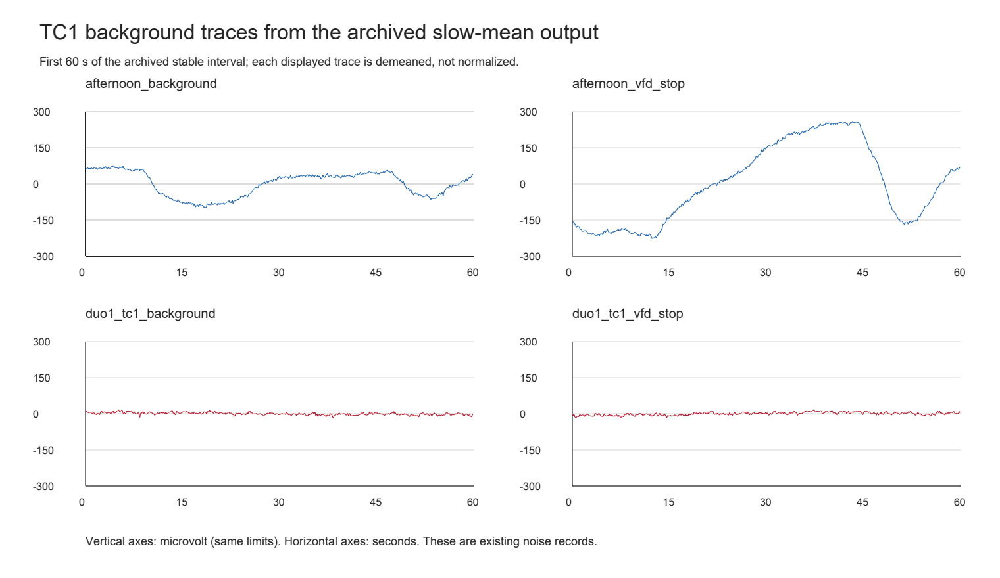
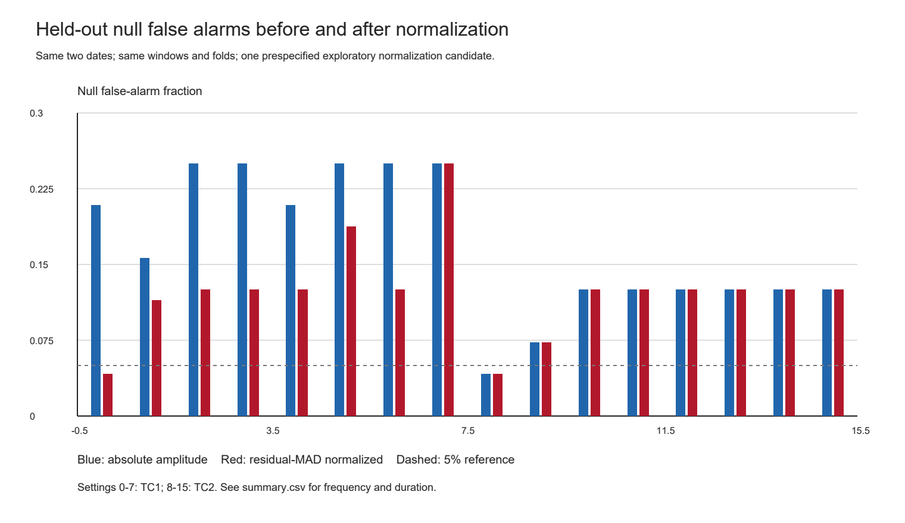
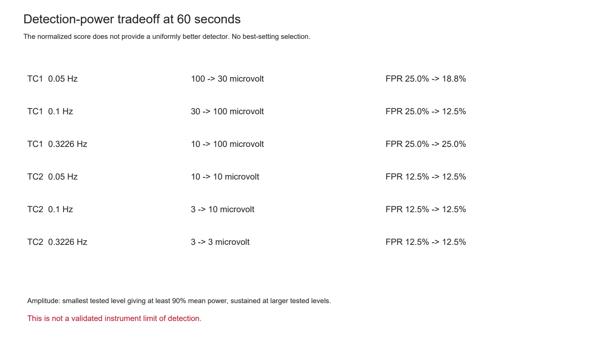

# 背景阈值转移复核（修订版）

原计算日期：2026年9月9日；本版修订日期：2026年9月16日。

本轮沿用此前16条既有BG/STOP记录、共同健康通道、窗口和留组划分，没有新增物理实验，也没有改动原分类器。任务是定位误报，检查一种固定的尺度归一化是否能改善跨工况阈值转移。本版依据独立复核补充统计分母、上游通道规则的数据依赖以及归一化后的误报位置变化，原数值结果保持不变。

结果表明：归一化在部分设置下降低了误报，但没有一致改善检出能力，现阶段不宜据此替换绝对幅度基线，也不能将软件注入曲线称为仪器检出限。

## 误报定位与背景差异

60 s条件下，TC1三个固定频率的基线误报全部来自7月31日下午的afternoon_background和afternoon_vfd_stop。它们不只是单个频点幅值偏大，时域中也有明显的慢变化。以0.05 Hz拟合为例，这三段60 s窗口的残差MAD尺度约46.53—151.89 µV，8月6日TC1对应窗口约4.21—6.24 µV。背景记录的第二个窗口拟合趋势跨60 s变化约630.82 µV，其他窗口和峰峰值保留在window_diagnostics.csv。

这说明“其他工况的绝对微伏阈值”不适合直接套用到该组旧记录，但现有记录不足以把慢变化归因于温漂、供电、环境或某一硬件故障。分析没有删除这组困难记录，也没有把它重新标成信号。

TC2绝对幅度基线的60 s误报分布不同：0.05 Hz来自duo2_tc2_background，0.1 Hz来自duo1_tc2_background，约0.3226 Hz来自duo1_tc2_vfd_stop。并非所有频率都由同一异常工况造成。这里描述的是基线方法；归一化后的误报位置见下文。完整位置见原结果目录中的false_alarm_records.csv，需按method筛选。

## 本轮比较的方法

基线仍为已知频率最小二乘谐波峰值幅度。候选方法将该幅度除以拟合残差的稳健MAD尺度。拟合同时包含截距、线性趋势、余弦和正弦；MAD为残差相对残差中位数的绝对偏差中位数乘1.4826。这里的系数用于尺度约定，没有假设真实低频噪声已经是独立高斯噪声。

每个测试窗口使用自身的拟合残差计算尺度，这是候选算法固定的计算步骤，不是在测试标签上调阈值。由于注入信号恰好位于拟合的正余弦子空间，理想线性计算中残差不随注入幅值改变；独立复核通过651次直接波形注入检查确认了这一实现，残差最大改变约9.21×10⁻¹² µV。真实信号频率失配、瞬态、饱和或模型不匹配时，不保证这种不变性。算法使用完整的20、40或60 s窗口，当前结果也不代表无延迟实时报警。

两个方法都仅使用同探测器的其他工况作为阈值标定集，阈值为等记录权重的95%经验分位数。每个设置每探测器有4个工况组，留出1组的2条记录进行评价，其余3组的6条记录用于标定。阈值计算没有使用该折测试记录，标定与测试的记录ID无交集。

这一结论限于阈值标定层。上游共同健康通道来自既有分析：先计算每条记录的健康通道，再对同组BG、STOP及RUN记录取交集。本轮固定使用该集合，没有按本轮成绩重新挑通道，但它仍依赖同组已有记录。因此不能将“阈值标定与测试记录无交集”扩写为“全流程完全不接触留出数据”。

窗口、频率、12档幅值和64个相位均与原协议一致。代码先写出protocol.json，再计算这一个候选方法，没有多个候选搜索后只保留优胜者的实现。不过，普通协议文件的写出顺序不是不可变的预注册证据，而且这批记录此前已经被分析。因此，本轮属于对同一批已观察数据的探索性复核，不是新日期的独立验证。

## 结果与取舍

16个探测器—频率—时长设置中，候选方法的等记录加权误报在7个设置下降、9个不变；达到持续不低于90%平均检出率的最小测试幅值在2个设置降低、5个升高、9个不变，没有形成全面改善的检出器。这里“持续”仅指该档及所有更大的已测试幅度。

本报告的误报率按两步计算：先求每条记录中误报窗口的比例，再对8条记录等权平均。注入检出率则先在每条记录内对窗口和64个相位平均，再对记录等权平均。这样避免窗口较多的长记录占据更大权重；不能将所得百分比直接解释为所有窗口汇总后的计数比例。

| 探测器 | 频率 Hz | 60 s等记录误报 基线→归一化 | 平均90%检出最小测试幅值 基线→归一化 µV峰值 |
|---|---:|---:|---:|
| TC1 | 0.05 | 25%→18.75% | 100→30 |
| TC1 | 0.10 | 25%→12.5% | 30→100 |
| TC1 | 0.3226 | 25%→25% | 10→100 |
| TC2 | 0.05 | 12.5%→12.5% | 10→10 |
| TC2 | 0.10 | 12.5%→12.5% | 3→10 |
| TC2 | 0.3226 | 12.5%→12.5% | 3→3 |

TC1在0.05 Hz时有改善，但在约0.3226 Hz时没有降低误报，90%平均检出所需的最小测试幅值反而由10增至100 µV。因此不能根据某一频率的好结果把归一化整体替换为新主方法。较大的残差尺度会使高噪声窗口需要更大的绝对信号幅值才能超过归一化阈值，这是应同时评价误报和检出曲线的原因。

表中的幅值来自离散测试网格，不是精确的90%交点。每个探测器只有8条旧噪声记录，且同组记录、窗口之间存在依赖；95%标定分位数不能被解释成已经证明未来5%误报。当前仍不报告“5%误报下的仪器检出限”。

以TC1的60 s基线为例，afternoon_background有2个窗口且全部误报，afternoon_vfd_stop有1个窗口且误报，其余6条记录无误报。因此等记录误报为(1+1)/8=25%，而所有窗口汇总是3/9。归一化0.05 Hz时，前一条记录变为1/2窗口误报，后一条仍为1/1，对应等记录误报(0.5+1)/8=18.75%。18.75%是加权比例，并非有“1.5条记录误报”。

| 探测器 | 频率 Hz | 60 s基线误报窗口/总窗口 | 60 s归一化误报窗口/总窗口 |
|---|---:|---:|---:|
| TC1 | 0.05 | 3/9 | 2/9 |
| TC1 | 0.10 | 3/9 | 1/9 |
| TC1 | 0.3226 | 3/9 | 2/9 |
| TC2 | 0.05 | 1/8 | 1/8 |
| TC2 | 0.10 | 1/8 | 1/8 |
| TC2 | 0.3226 | 1/8 | 1/8 |

window_diagnostics.csv的217行是窗口—频率组合；按记录ID、起点、时长去重后为90个窗口，且跨时长仍存在重叠。它们不能当成217或90次独立实验。64个注入相位也不是64次独立采集；在零注入条件下，64个相位对应完全相同的判定。

归一化还会改变误报位置。TC1在0.10 Hz的误报转到vfd_tc1_background，在约0.3226 Hz转到duo2_tc1_background和duo2_tc1_vfd_stop；TC2三个60 s频率的误报率虽然均未降低，但0.05 Hz的误报转到morning_background，另两个频率转到vfd_tc2_background。因此，误报率不变也不意味着误报的是同一批噪声窗口。归一化改变了工况之间统计量的相对排序，不能简单描述为消除了某条异常背景。

软件注入位于已经归档的slow_mean输出域，没有经过实际前端、原始采样及完整预处理链。这里的µV是条件性输出幅值，不能直接换算为实际桶外电场强度或仪器输入检出限。

## 对论文和下一步的影响

建议保留原绝对幅度方法为基线，把本轮归一化作为局限分析或消融比较：阈值失败不仅与总噪声尺度有关，慢变化形态和频谱结构也会影响固定频率估计。不要继续在这16条记录上反复搜索到“零误报”再把它当成泛化能力。

后续无新实验时，可进一步核对7月31日下午的归档、硬件与采集记录，区分其噪声背景是否具有已记录的工况变化；这一步不能靠看曲线擅自重标数据。若要研究本地背景校准，需要先把背景在时间上划分为独立标定段和评价段，保持真实使用时可获得的信息，不能用整段测试噪声选择阈值。已有同日数据可以检验实现，但新的泛化结论仍需留出日期或新的实际记录。

## 可用于论文的表述

为考察输出域已知频率检出统计量的跨工况稳定性，在16条既有背景与停机记录上开展同探测器留组复核。阈值由其他工况记录的等记录加权95%经验分位数确定，并比较绝对谐波幅值与谐波幅值/残差MAD两种统计量。残差MAD归一化在16个探测器—频率—时长设置中的7个设置降低了等记录加权零注入误报率，但平均90%检出所需最小测试幅值在5个设置升高，未表现出一致优势。以60 s、TC1为例，0.05 Hz的该幅值由100降至30 µV峰值，而约0.3226 Hz由10升至100 µV峰值，且后者误报率仍为25%。结果表明，简单尺度归一化不足以解决这些旧记录中的跨工况阈值转移问题。上述结论限于既有通道规则、输出归档、固定已知频率及同频软件注入条件，不能替代独立日期验证或实际仪器检出限标定。

建议图注说明：“误报率按记录等权汇总；每探测器8条记录。不同频率/时长重复使用既有记录，窗口数和注入相位数不代表独立实验数。”

## 文件与核验

计算入口为scripts/noise_transfer_audit_20260909.py，绘图入口为scripts/plot_noise_followup_20260909.py。summary.csv保留全部32行方法—设置结果；record_power.csv保留记录级曲线；window_diagnostics.csv保留幅值、趋势、残差尺度与峰峰值；thresholds.csv保留每个留组折的阈值。

9月16日独立复核重新读取既有统计表和16个低速归档，对全部阈值、记录曲线及217行系数/MAD进行核对：阈值与记录曲线的最大复算差异为6.94×10⁻¹⁷；绝对幅度基线与9月8日记录曲线一致；16条源归档envelopes.npz的SHA256及一基/零基通道索引转换均核对通过；阈值标定与测试记录无交集；651次直接波形注入检查通过。完整证据和限定条件见同目录的[独立复核报告](noise_review.md)。

本版仅修订说明文字及统计口径，没有更换算法、重算形成新的分析结果或覆盖原文件。原报告和图片仍保存在results/thesis_followup_20260909/noise/，本版图片通过相对路径引用。
