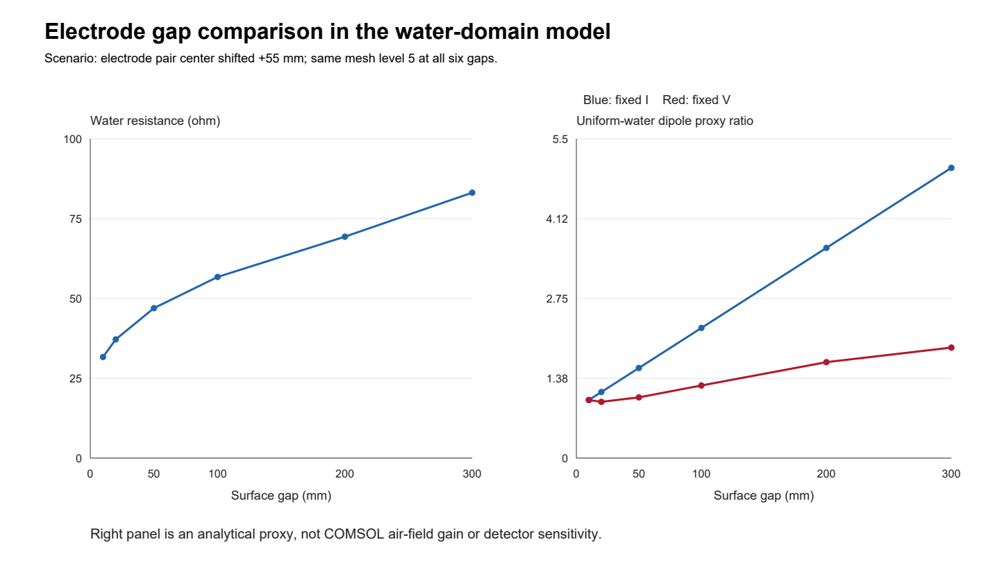

# COMSOL仿真执行计划书

> 2026-09-08历史专项计划，非当前完成状态（2026-09-26标注）。后续外部场复核已有9月18日结果；当前总纲见[论文总体判断与写作主线](论文总体判断与写作主线.md)。文末引用的旧全局路线图已转入[规划清理快照](../snapshots/thesis_planning_20260926/README.md)，仍可按ZIP内原路径追溯。

## 1 任务目标与本轮结论

本计划服务于毕业论文中的“可控水中源与测量能力”部分。优先回答三个问题：电极间隙改变后，水中的电流路径如何变化；不同供电与接地条件下，桶外测点可能受到怎样的电场激励；这些激励能否与已有采集系统的输出噪声建立可核验的联系。计划按尽快形成完整初稿安排，不以模型数量或云图数量作为完成标准。

本轮已经完成六种表面间隙的水域计算、历史位置对照及两端网格核验，共保存11个成功求解工程和对应CSV。另有两项粗网格失败，保留失败记录。间隙由10 mm增至300 mm时，统一网格下的水路电阻由31.65 Ω增至83.13 Ω。这说明恒电流与恒电压实验不能混用同一种增益解释。

本轮还完成了已有泵系统背景及停机记录的条件软件注入。它给出采集输出域中的已知频率检出曲线，尚未形成场强标定，也不代表新阴极保护实验的噪声分布。阈值跨工况转移出现明显误报，是后续工作应优先解决的问题。

| 工作 | 当前状态 | 论文用途 |
|---|---|---|
| 六种间隙水路电阻与水域平均场 | 已计算 | 条件模型下的几何趋势 |
| 10与300 mm的三级网格对照 | 已计算 | 数值敏感性证据 |
| 恒电流与恒电压偶极源矩比值 | 已解析推算 | 解释两种输入约束的差别 |
| 桶外场随间隙变化 | 待执行 | 需要修正几何和边界后计算 |
| 外部场到采集电压的转换 | 缺接收链路标定 | 不能预写真实检出距离 |

建议把水域结果先写入论文作为“条件仿真”，把外部模型核验列为下一项计算。已有分类结果、软件注入、解析近似和COMSOL仿真分别标注，避免在同一段中相互替代。

<!-- PAGE -->
## 2 参数定义与几何准备

间隙指两电极表面最短距离，不是轴线距离。当前模型中，钢管外半径50 mm，石墨半径12.5 mm，因此轴线距离比表面间隙大62.5 mm。10 mm和20 mm分别对应不同的情景或历史材料，不能在模型、图注和实验记录中互换。

| 参数 | 本轮采用值 | 来源或性质 |
|---|---|---|
| 水体电导率 | 0.05 S/m，即500 µS/cm | 沿用旧V3与V4材料 |
| 桶外直径与壁厚 | 560 mm与5 mm | 沿用源模型 |
| 钢管长度与外半径 | 400 mm与50 mm | 沿用源模型 |
| 石墨半径 | 12.5 mm | 沿用源模型 |
| 绝缘层厚度 | 1.5 mm | 沿用源模型 |
| 表面间隙 | 10、20、50、100、200、300 mm | 本轮比较条件 |
| 电极对中心横向位置 | 相对桶中心+55 mm | 为容纳最大间隙设定的情景位置 |
| 单位求解电流 | 10 mA | 线性水域求解基准 |

最大间隙下，若把电极对中心固定在桶中心，长钢管的端部可能与圆桶内壁相交。本轮因此把六个间隙统一放在+55 mm位置，并同步移动实体及其切除几何。这个位置没有被当成实测摆放位置。另算20 mm、中心0 mm的历史位置对照，用来区分整体平移与间隙改变。

外场模型开始前，应把正负引线的起点、终点和支路方向也参数化。不能只修改electrode_gap而沿用旧代码中已经算成常数的引线坐标，否则可能出现线缆与电极脱离。检查桶、钢管、石墨、绝缘层和引线之间的几何关系后，再生成网格。

观察点沿用旧V4的“距桶外壁2、3、4 m，离地0.5 m，朝门方向”定义；应同时导出全局坐标。其他模型采用离地1 m或从设备中心计距时，单独标记，不能直接拼接为同一距离曲线。真实摆放尺寸暂缺的项目在参数表中写“情景”，后续拿到测量值再替换。

<!-- PAGE -->
## 3 已完成的间隙比较

源工程为cathodic_protection_tank_3d_current_sweep_v3.mph。本轮只求解水中的稳态欧姆导电，采用同一材料和边界定义。六个主算例统一采用自动网格等级5；恒电压数据由线性解缩放，并非另外六次物理实验。

| 表面间隙 mm | 水路电阻 Ω | 10 mA压降 V | 1 V电流 mA |
|---|---:|---:|---:|
| 10 | 31.6451 | 0.31645 | 31.6005 |
| 20 | 37.1679 | 0.37168 | 26.9049 |
| 50 | 46.9591 | 0.46959 | 21.2951 |
| 100 | 56.7242 | 0.56724 | 17.6292 |
| 200 | 69.3411 | 0.69341 | 14.4215 |
| 300 | 83.1319 | 0.83132 | 12.0291 |

图左为COMSOL水路电阻。图右采用均匀水体远场偶极近似，以电流乘轴线距离作为源矩：10至300 mm时，恒电流源矩比为5.00，恒电压源矩比约为1.90。图右没有水气界面、桶壁、引线和接地影响，因此不能写成空气场增益，更不能写成接收电压或检出距离增加倍数。

细网格结果在10 mm和300 mm处分别为31.9943 Ω和83.7557 Ω。网格5相对网格3的电阻差为1.09%和0.745%；网格4相对网格3为0.382%和0.298%。这些是相对所测最细网格的差异，不是真解误差，也不能证明所有局部场都已收敛。

<!-- PAGE -->
## 4 物理方程与源边界的选择

水域模型使用电流守恒和欧姆定律：电场等于电势负梯度，电流密度等于电导率乘电场，稳态电流密度的散度为零。石墨端施加总电流，钢管裸露窗口提供回流端；水接触绝缘表面采用电绝缘。单一水域中的回流电势零点可作为求解参考，不能据此声称真实供电系统接地。

外部空气场涉及电势相对地的分布。旧V4把正负端固定为+0.5 V与−0.5 V，并把地板和机壳设为0 V；这规定了零共模的平衡差模激励。它可以作为明确的比较基准，但不能概括所有浮地供电。真正的浮地情形必须保留两端的源约束，同时确定整个回路的电荷、寄生耦合或回流条件。[1]

| 边界情景 | 具体含义 | 应导出的量 |
|---|---|---|
| 平衡差模基准 | 两端对地±0.5 V | 每1 V差模的复数场分量 |
| 明确接地的单端驱动 | 一端对地0 V，另一端1 V | 与平衡差模的方向及幅值差 |
| 实际浮地回路 | 两端保持给定电压差或电流；共模由完整回路决定 | 两端对地电势、源电流及外场 |

不要把两个通电电极分别设置成零净电流的孤立导体。这样会消除应有的注入和回流通道。Floating Potential功能的净电流约束，应与整个源回路连接方式一起确定。[1]

低频外场先核验电准静态适用性，比较导电和位移电流的重要程度；空气中不能仅凭水的高导电率忽略介电耦合。[2] 旧V4的1 mHz只是近静态代理。计划先对代表几何比较1 mHz、0.05 Hz、0.1 Hz和约0.3226 Hz；只在目标量的变化有记录时，才说明近似适用范围。它不自动代表通断瞬态，更不能与高频相干指标直接对应。

若受实际接地资料限制，先保留前两种明确边界的对照，把真实浮地列为待核参数。论文可以比较不同边界情景，不需要为了得到唯一曲线而猜测真实共模。

<!-- PAGE -->
## 5 数值可信度的执行顺序

第一步核对几何和命名选择集。每个算例保存几何参数、参与求解的域、激励与回流面、网格等级和版本。已完成水域算例的体积相对跨度约4.61×10⁻⁶，功率与电流乘端电压的最大相对残差约2.31×10⁻¹¹。这支持体积与功率一致性，但不是外部场正确性的证明。

第二步用简单解析问题检查单位、符号和边界实现。可建立均匀导体中的平行板基准，以电阻等于长度除以电导率和截面积的乘积进行对照；外场另用已知电势边界的球体或偶极远场检查衰减。基准只检验实现，不替代复杂水桶模型验证。

第三步检查网格。水域已完成两个端点的等级5、4、3对照；等级6的两个失败算例保留在验证记录中。外场选择一个基准间隙，固定同一外域比较三档网格，优先细化电极、介质界面和线缆附近。关注位置场投影、端电流与积分功率分别比较，不以尖角场最大值作为唯一收敛指标。[3]

第四步单独检查外域尺寸。V13此前7.5 m到10 m的单位传递仍有约29%至42%的变化，不能直接沿用“10 m足够大”的结论。外域加大时同时检查高度、地板范围及边界位置；只增大半径而保留过低顶边界，不能完整证明外域收敛。局部网格尽量保持相近，避免把网格变化混入外域变化。

| 核验项 | 建议初始判断尺度 | 未达到时的处理 |
|---|---|---|
| 几何合法性与连通性 | 不相交、不悬空、选择集对应预期 | 修正几何后重新求解 |
| 端电流和功率 | 相对残差先检查至10⁻³量级以内 | 核对积分范围和电流定义 |
| 网格目标量变化 | 代表观测量优先争取2%以内 | 加密或报告剩余差异 |
| 外域目标量变化 | 优先争取5%以内 | 扩域或明确域截断不确定性 |

以上百分数是本项目的初始工程判断尺度，不是普适标准。若增大间隙造成的效果与数值差异相当，应继续核验或降低结论强度。不能因为达到某个百分数就忽略边界设错，也不必对不影响结论的微小差异无限加密。接近零的分量应比较绝对变化，避免除以极小值产生虚假的巨大百分比。

<!-- PAGE -->
## 6 外场间隙比较的最小计算批次

完成边界和代表算例核验后，再执行六间隙主表。先使用一套明确的1 V平衡差模条件，输出距桶壁2、3、4 m处的电场分量及方向投影。接收方向未知时保留三个分量和场模，不把任意选取的最大分量写成传感器响应。

| 批次 | 建议配置 | 结果文件与目的 |
|---|---|---|
| A 基准复现 | 历史20 mm、中心0 mm | 核对旧工程和后处理一致性 |
| B 数值核验 | 代表间隙的三档网格与三档外域 | 分开估计离散化与截断影响 |
| C 间隙主表 | 固定+55 mm中心，六种间隙 | 比较单位输入外场和方向 |
| D 供电边界对照 | 10及300 mm，明确单端接地对照 | 分离间隙效应与共模效应 |
| E 低频敏感性 | 一种几何，1 mHz及三个目标频率 | 核验近静态代理 |

基准相同的算例复用，不为凑数量重复计算。线性模型下，先求单位电压传递；需要恒电流条件时，结合同一边界模型导出的复数端口阻抗换算。不能在包含介质与寄生回路的外场模型中，未经核对就用水域直流电阻代替完整端口阻抗。

每个观测点保存坐标、频率、输入相量、Ex、Ey、Ez的实部和虚部、沿探测方向的投影、端口电流及模型状态。峰值与RMS写在表头；不同幅值约定统一后再比较。相位相关的源贡献若要叠加，应先有同一参考下的复数源幅值，不能直接把两个场模相加。

材料、浸水面积和线缆走向的敏感性在主表后做。优先挑会改变结论的两三个参数；范围来自已有记录时给出处，缺范围时称“参数情景”。如果线缆走向或共模改变的效果大于间隙改变，应据实把“源回路和环境边界”写成主要限制，而不是只展示间隙最有利的一条曲线。

V10已有水流脉动参数扫描，V13和V14已有代表电学源计算，本计划不重复这些扫描。先补可信度，再提取能与本论文问题对应的少量图表即可。

<!-- PAGE -->
## 7 与检出能力分析的衔接

本轮使用7月31日和8月6日的16条既有背景或停机记录，每个探测器8条。沿用已冻结的共同健康通道，读取10 Hz的双精度slow_mean序列，按归档设置剔除起止不稳定区间，再在健康通道均值上做注入。注入发生在慢均值输出之后，因此不测量原始采集、滤波或传感器的传递衰减。

固定分析0.05 Hz、0.1 Hz和约0.3226 Hz，窗口20、40、60 s；不足两个周期的组合不计算。用同时包含截距、线性趋势、正弦和余弦的最小二乘拟合估计峰值幅值。对测试工况，阈值只由同探测器的其他工况背景和停机记录确定，采用等记录权重的95%经验分位数。每条记录内使用不重叠窗口及64个等间隔相位，最终按记录等权平均。

| 探测器 | 频率 Hz | 60 s平均90%最小测试幅值 µV峰值 | 留组空白误报 |
|---|---:|---:|---:|
| TC1 | 0.05 | 100 | 25.0% |
| TC1 | 0.10 | 30 | 25.0% |
| TC1 | 0.3226 | 10 | 25.0% |
| TC2 | 0.05 | 10 | 12.5% |
| TC2 | 0.10 | 3 | 12.5% |
| TC2 | 0.3226 | 3 | 12.5% |

这些幅值是离散测试网格上的最小合格值，不是精确求出的90%交点。TC2在0.1 Hz、60 s下，平均检出达到90%的最小测试幅值为3 µV，但要使每条记录都达到90%，需要10 µV。平均水平和最不利记录应同时保留。窗口和注入相位不构成新增独立实验。

留组空白误报明显高于标定分位数暗示的5%，说明旧背景之间存在转移问题。当前不能宣称“5%误报下的检出限”。下一步应先分析高误报对应的具体噪声记录和低频漂移，保留当前协议作为基线；任何稳健归一化或阈值更新，都需要独立留组评价，不能在测试记录上挑出最优阈值再回报成绩。

COMSOL给出的是源到场的传递，软件注入给出的是输出电压的条件检出概率。两者中间仍缺场到电压的接收传递函数。没有独立标定前，不把上述微伏值换算为V/m，也不计算真实最远检出距离。新增间隙实验将来可以提供验证，但本文件没有预写新实验结果。

<!-- PAGE -->
## 8 写作安排与交付标准

第一周优先完成外部模型的几何连接、源边界和代表算例核验，同时把本轮水域结果、漏判明细及软件注入限制写入现有章节。第二周在核验通过的模型上完成间隙和少量边界对照，并形成连续可读的第6章。第三周完成与第4、5章的符号、单位、图表编号和证据边界统一。进度按实际问题调整，目标是尽快成稿，不等全部探索完成后才开始写作。

预计12月答辩尚不等于正式送审时间。尽量在9月底至10月初形成完整初稿，给导师修改和学院流程留出时间。若外场核验短期内不能收敛，可以保留水域模型和明确边界情景，把未验证的定量外推删除或转为讨论，不用假数据补齐章节。

每项图表应能追溯到模型、脚本、参数、CSV和单位。COMSOL计划完成的最低条件是：几何与源边界能讲清；至少一套代表观测量具有网格和外域敏感性记录；间隙主表明确输入约束；与接收电压之间未验证的环节在结论中保留。是否支持更强的论文结论，还应由实际验证和导师审阅决定。

本轮交付包括50项结果主表、32条组外预测及12条漏判明细、六间隙水域表和11个成功MPH工程、16种条件检出汇总与完整记录级曲线。新增脚本独立保存，没有覆盖原始TDMS、历史模型或主处理流程。数值图同时保存PNG和矢量PDF；重复计算入口见本轮结果目录中的综合报告。

旧V4中，20 mm模型水路电阻约37.49 Ω，而材料列示四个工作点的表观端电阻约20、10、7、6 Ω。这一差异未解决。本轮没有调电导率或添加极化参数强行拟合。需要先核对是否同批数据、导电面积、间隙、电导率及电源显示定义，再决定模型修订。

参考资料与本地依据

[1] COMSOL 6.4 Floating Potential，净电流与未知等电位边界说明。https://doc.comsol.com/6.4/doc/com.comsol.help.acdc/acdc_ug_electric_fields.07.085.html

[2] COMSOL An Introduction to Electroquasistatics Theory，电准静态近似及导电和位移电流。https://www.comsol.com/multiphysics/electroquasistatics-theory

[3] COMSOL Performing a Mesh Refinement Study，关注量的网格细化比较和尖角场限制。https://www.comsol.com/support/knowledgebase/1261

本地依据：comsol/docs/阴极保护四档恒流与外部电场V4说明.md；comsol/docs/minimal_credible_electric_v13_report.md；docs/毕业论文非实验工作路线图_20260908.md。当前计算数据位于results/thesis_completion_20260908的gap与detection子目录。编制与核验日期为2026年9月8日。
