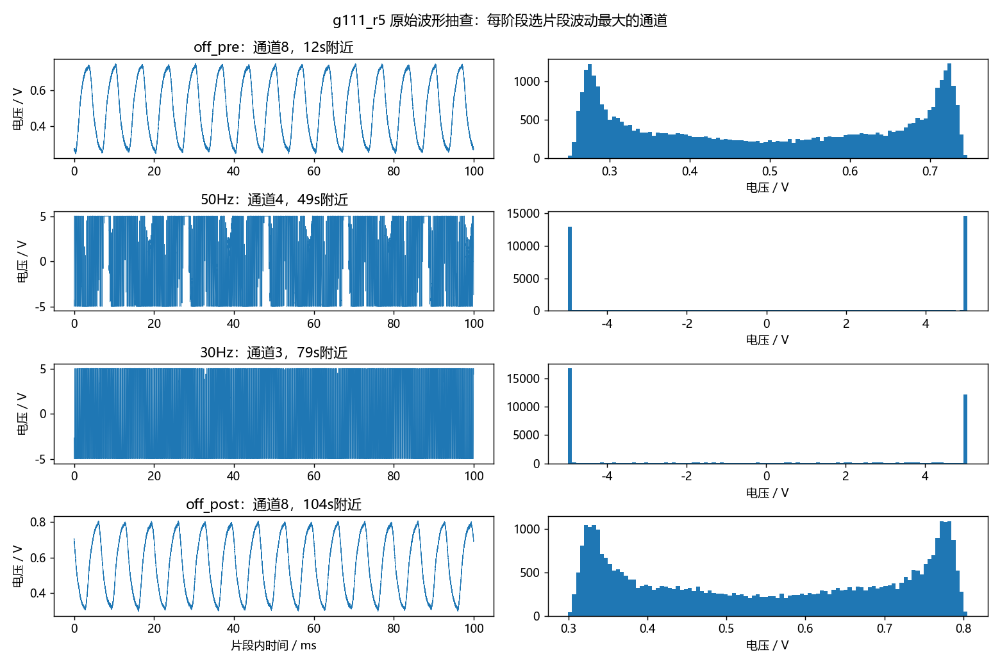
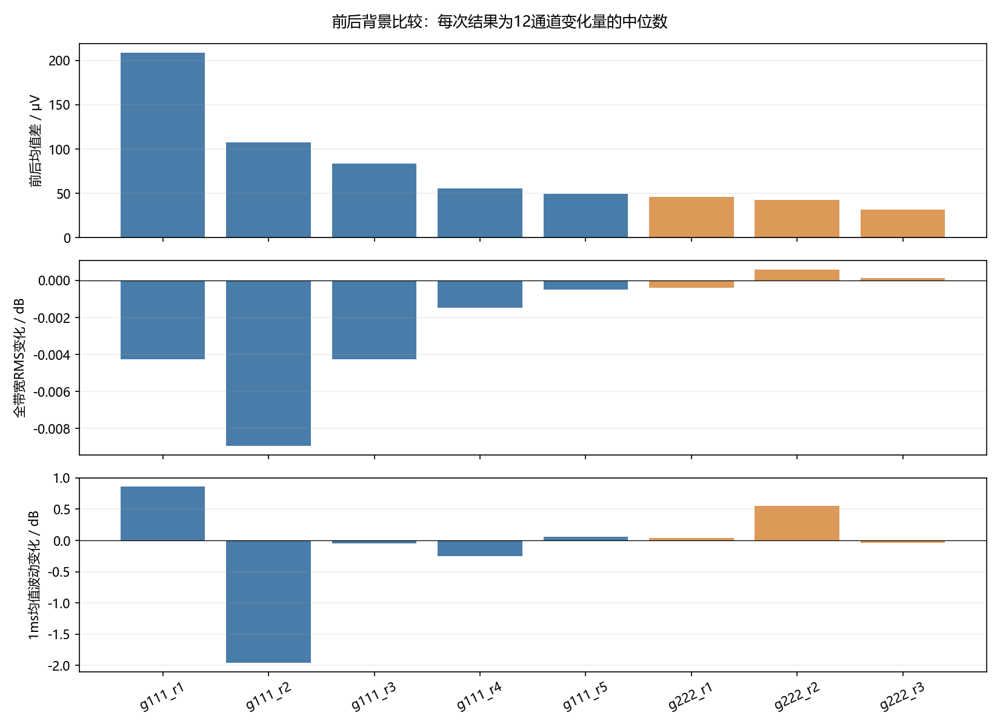
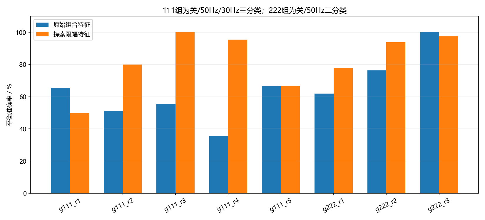
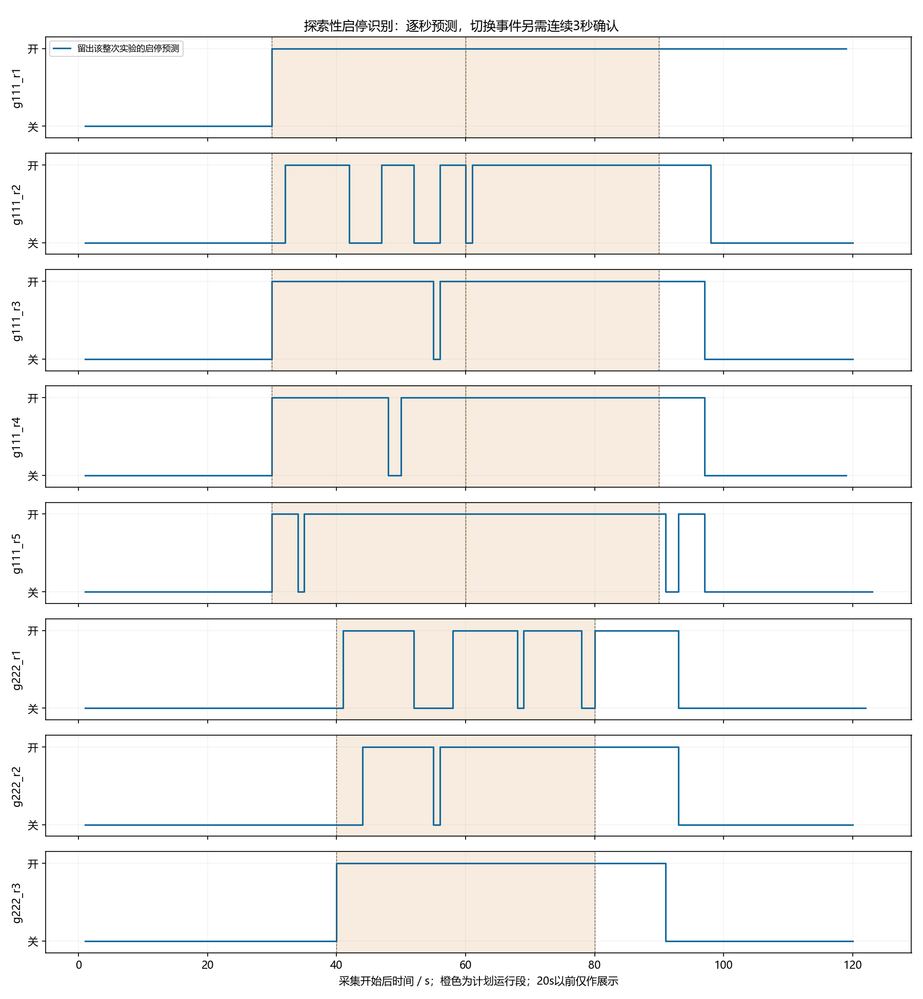
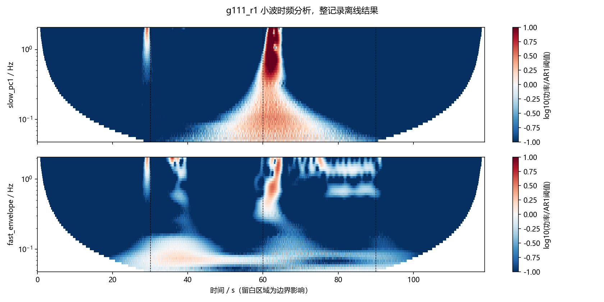

# 9月21日变频器启停与变频实验：背景一致性和动态检出分析

分析日期：2026年9月21日。对象：E:/Lab/raw/9.21 下111目录5次、222目录3次，共8份TDMS记录。报告所有数值来自本批实测文件；实验指令时刻采用用户提供的时间表。

## 1. 先看结论

**这批数据能继续做，而且已经得到可用于讨论的启停识别结果；目前最有价值的进展是“操作状态是否能被检测到”，其次才是30 Hz与50 Hz的区分。**

1. 前后“关”都表示变频器通电、泵停机，不能叫断电背景。全带宽RMS的通道中位数前后变化很小，但慢变均值、部分通道和低频波动有差异；不能把两段整体视为同一统计背景。
2. 原始组合特征、留出整次实验验证的启停平衡准确率为79.8%。针对强弱响应差异加入限幅与通道90%分位特征后，探索性结果为91.5%；三分类111组由54.9%改善到78.4%。后者使用本批数据观察后确定的特征，需新批次确认，不能作为已经独立证实的性能。
3. 探索性启停检测在16个计划启停事件中命中15个，启动8/8、停机7/8；同时有6次未匹配状态切换，不能只报15/16而隐去误报。稳定窗口的平均关态误报比例9.0%、运行态漏判比例8.1%。
4. 原始电压中存在接近正负5 V的大幅摆动与平台。这些变化足以帮助分类，但在通道用途、量程、传感器输出定义未确认前，不能直接解释为弱物理场、流体效应或电化学效应。
5. 小波、模态分解、熵、递归分析、耦合与事件拟合都已复算；复杂方法暂未显示比简单时域/频带特征更明确的实用收益。先解决输入信号的物理含义和误判来源，比继续堆算法更重要。

## 2. 实验条件、时间表与输入检查

已确认：变频器全程不断电，启动过程约10 s，关闭过程约5 s。50→30 Hz的实际调速斜坡时间尚未单独给出，本轮保守留出12 s再取稳定窗口。探测器型号、距离、载波设置、各通道对应设备及量程未知；未自行补填。采集零点与人工指令是否严格同步未知，因此以下延迟是**相对于计划指令时刻的估计**，不是已标定的真实物理响应时间。

|组别|计划顺序|本轮稳定统计窗口（s）|
|---|---|---|
|111，5次|0–30关，30–60为50 Hz，60–90为30 Hz，90以后关|前背景5–25；50 Hz为42–57；30 Hz为72–87；后背景97–117|
|222，3次|0–40关，40–80为50 Hz，80以后关|前背景5–35；50 Hz为52–77；后背景87–117|

稳定窗口不等于实际工况已完全稳定，只是按已知斜坡设置的排除规则。统一背景校准仅使用各文件5–20 s，保证首次启动之前就能得到。

| 记录    | 原文件                       |   时长_s |   每通道采样点 |
|:--------|:-----------------------------|---------:|---------------:|
| g111_r1 | 20260921104403.351724-1.tdms |  119.079 |       47631444 |
| g111_r2 | 20260921104637.684784-1.tdms |  120.448 |       48179366 |
| g111_r3 | 20260921104850.019512-1.tdms |  120.214 |       48085686 |
| g111_r4 | 20260921105103.291624-1.tdms |  119.643 |       47857362 |
| g111_r5 | 20260921110139.677427-1.tdms |  123.155 |       49261931 |
| g222_r1 | 20260921105430.205666-1.tdms |  122.324 |       48929403 |
| g222_r2 | 20260921105659.486410-1.tdms |  120.844 |       48337446 |
| g222_r3 | 20260921105922.663283-1.tdms |  120.369 |       48147429 |

全部文件均为12通道、400 kHz，单位Volts。所有通道样本数一致，逐块读取时检查了连续性；全量读取覆盖8份文件的全部采样点。所有完整1 s区间计算原始频谱；末尾不足1 s不做频谱，末尾不足0.1 s不做分块特征，但仍参与全文件范围/有限值检查。记录实际长119.08–123.15 s，未强行拉伸成120 s。

注意：g111_r5实际采于11:01，晚于222组三次。因此“111训练→222测试”是跨协议检验，不是严格按时间向未来预测。

## 3. 输入电压核查：先分清输出变化和物理信号

所有12通道在初始背景中均通过基本有限值与非平坦检查，分类保持相同通道集合；这不等于已经证明12路全是有效探测器通道。全文件异常通道标记保存在channel_health.csv，未根据整次未来数据事后删通道来提高识别率。

原始片段显示，部分通道在运行时从约+5 V附近出现大幅向负电压摆动，在强响应记录中到达约−5 V附近；另一些通道有不同的基准电压和周期波形。每个稳定阶段抽取3段0.1 s原始波形、合计0.3 s用于核查；这些片段只用于质量检查及高频小波/双相干，不代替全记录统计。



图中各行选择该阶段抽样片段内波动最大的通道，所以行与行可能不是同一通道，不能据此比较同一通道增益。详细通道编号、极值、负值占比、接近±5 V的样本占比及最常出现的量化值，见raw_excerpt_audit.csv。

**这里确有大幅输出变化，但还不能判定是传感器真实输出、前端饱和、限幅、耦合干扰还是其他采集因素。** 旧质量脚本的clip_fraction按|V|≥9.9计算；它为零不排除±5 V附近的前端饱和。本报告不用该字段宣称“无饱和”，也没有擅自把电压折返、去平台或换算成场强。

## 4. 前后背景是否一致

以下均为“后背景减前背景”。均值偏移逐通道计算后取中位数；RMS变化先逐通道算20log10(后/前)再取中位数。不能把全体通道中位数理解为每个通道都稳定。

| 记录    |   背景均值偏移_通道中位数_uV |   背景RMS变化_通道中位数_dB |   最大通道背景均值偏移绝对值_V |
|:--------|-----------------------------:|----------------------------:|-------------------------------:|
| g111_r1 |                      208.823 |                      -0.004 |                          0.736 |
| g111_r2 |                      107.596 |                      -0.009 |                          0.890 |
| g111_r3 |                       83.856 |                      -0.004 |                          0.005 |
| g111_r4 |                       55.853 |                      -0.001 |                          0.011 |
| g111_r5 |                       49.435 |                      -0.000 |                          0.041 |
| g222_r1 |                       45.911 |                      -0.000 |                          0.021 |
| g222_r2 |                       42.168 |                       0.001 |                          0.051 |
| g222_r3 |                       31.763 |                       0.000 |                          0.039 |



全带宽RMS的通道中位数变化介于约−0.009和+0.001 dB，看起来很稳定；慢变均值的中位偏移却全部为正，约32–209 μV。1 ms均值序列在每0.1 s内的波动量，前后变化约−1.96到+0.86 dB。后者不是理想低通后的“严格低于1 kHz噪声”，只能称为相应时间尺度的均值波动。

用前/后背景标签进行留一整次实验识别，111组平均平衡准确率90.5%，222组57.8%。前者说明当前特征下前后背景可区分，可能包含持续漂移或操作后的残留影响；后者接近随机也**不能证明等效**，因为只有3次独立重复。本轮没有预先给定工程等效界限，因此不做“背景通过等效检验”的结论。

建议论文表述：**前后停泵背景的全带宽波动强度整体接近，但慢变分量及个别通道不完全恢复；状态分析应采用逐次基准归一化，并分别核查启动前和停机后误报。** 不把前后背景直接合并做一个绝对统一背景，也不做原始波形逐点相减。

各通道变化、2 s分块自助法区间见background_channel_comparison.csv。该区间只是单记录内的描述性不确定度，不能把大量采样点当成大量独立实验。

## 5. 已有方法怎样迁移到本批数据

|方法组|输入与本轮实施|实际用途与限制|
|---|---|---|
|原始FFT/PSD与频带|每完整1 s、Hann窗、原始400 kHz信号；1 Hz频率栅格；30/50/100 Hz邻带及宽频带|量化谱形变化；30、50 Hz线峰并不等同于变频器指令频率，50 Hz还可能包含工频干扰|
|时域、差分、慢变和快残差|每0.1 s均值、去均值RMS、差分RMS/√2；1 ms均值波动及残差|简单、可逐块计算，适合启停识别；残差是块均值分解结果而非严格高通频带|
|自相关/AR1、Allan偏差|每状态固定15 s，每通道；Allan时间0.1/0.2/0.5/1/2/3 s，沿用旧实现先去线性趋势|比较去趋势后的稳定性与相关时间；不能代替未去趋势的均值漂移比较，长平均时间点很少|
|CWT、AR1红噪声基准、同步挤压|整记录10 Hz慢变PC1与快残差包络；另对原始片段做高频CWT|定位变化时间尺度；整记录PCA、小波边界、双向滤波结果属于离线解释|
|EMD、EEMD、VMD|整记录两种慢速信号；EEMD20次，VMD K=4、α=2000；状态15 s局部复算EMD/VMD|观察模态能量迁移；不自动给模态赋予物理名称|
|通道对齐EMD、投影MEMD、稳健PCA|12通道慢变序列；MEMD16方向、最多5模态、10次筛分|共同变化和通道差异；投影MEMD是现有工程实现，不宣称等同于所有文献中的MEMD实现|
|熵、MSE、DFA、MFDFA、RQA|整记录与各状态固定15 s局部PC1；相位替代序列整记录19次、局部9次|描述复杂度；局部仅150个点，慢尺度与多重分形参数不适合强结论|
|状态空间|整记录局部线性趋势模型|15/16个拟合报告收敛；g111_r3的快包络未收敛，参数不作定量证据|
|Granger、通道相关、PC1占比|29个15 s状态窗口，12通道VAR最大5阶，沿用FDR处理|仅探索预测相关结构；高维短窗口和共同驱动均妨碍物理因果解释|
|相位—幅值耦合、小波相干、时滞|慢分量与快包络；PAC相位0.15–0.5 Hz、幅值调制0.5–2 Hz；39次替代/平移|操作阶跃可能共同驱动二者，显著不等于存在某个物理耦合机制|
|双相干与高频小波|每状态3个0.1 s原始片段；通道标准化后取中位信号；双相干19次替代|只代表所选片段，非全程；有限片段、共同操作与非线性限幅均可影响结果|
|PELT、弛豫与矩阵束|整记录PELT离线分段；按计划切换点取12 s比较单指数/双指数/衰减振荡，另保存15 s单指数拟合|PELT不能冒充实时检测；启动斜坡不是自由衰减，时间常数暂不命名为系统固有参数|
|分组可辨识性|按整次记录留出；训练集标准化/拟合；无时间或计划阶段作为输入|主要任务为跨重复启停识别；与同批数据随机拆窗的高准确率有本质区别|

4/8/12 kHz及约100 kHz频带只是沿用比较窗口，载波频率未确认，不能直接叫本次载波或谐波。PSD图片把1 Hz栅格汇总成100 Hz频宽用于显示，不能用该粗图判断30与50 Hz分离；窄带积分使用原始1 Hz栅格。

## 6. 工况识别：稳态正确率和动态检出分开评价

### 6.1 验证方法

每次拿一整份记录作测试，其余同协议记录训练；启停合并任务则其余7份训练。测试记录仅用自身5–20 s初始背景作基准。每完整1 s给出一次状态预测。训练只使用上述稳定窗口，不以时间、文件编号、实验序号为分类特征。

平衡准确率BA是各类别召回率的平均，再对各独立记录等权平均。111组随机水平为33.3%，222及合并启停为50%。单次记录中多个秒窗口有关联，不能把它们当作独立重复来制造很小的误差条。

原始组合27特征：各通道归一化慢变/波动特征的中位数、25%和75%分位，以及12个频带对比。探索版34特征：慢变绝对标准化偏移限到0–20、波动dB限到−10至30、频带dB限到−10至40，采用中位数和90%分位，逻辑回归C=0.1。它降低少数极端幅值的影响，同时保留局部通道响应。限幅只用于特征，未修改原始数据。

### 6.2 结果

| 任务              |   原始组合特征BA_% |   探索限幅特征BA_% |   仅频谱特征BA_% |
|:------------------|-------------------:|-------------------:|-----------------:|
| 111：关/50Hz/30Hz |             54.889 |             78.444 |           60.944 |
| 222：关/50Hz      |             79.444 |             89.722 |           77.444 |
| 全部8次：关/运行  |             79.833 |             91.479 |          nan     |



探索版在111组的逐次BA为50.0%、80.0%、100.0%、95.6%、66.7%；稳定区分30/50 Hz并非每次都成功。尤其g111_r5在幅值/谱形上与前几次很不同，不能只看平均分。

原始组合特征的39次循环移位对照结果：111三分类p=0.050，222二分类p=0.025，合并启停p=0.025。它保留了部分时间相关结构，但同一固定操作顺序、有限重复及未校正多个方法比较仍限制解释；39次的最小p就是0.025。探索版未再用该检验包装成确认性结果。

原始特征111训练→222测试的BA分别57.8%、73.8%、97.5%，运行段漏判分别76%、44%、0%。这说明跨协议迁移对响应强弱敏感，尚不能称为可直接通用部署。

15 s局部复杂度/模态9特征分类平均BA：111为56.7%、222为75.0%。每状态只有一个窗口，样本量很小，也与逐秒任务的时间分辨率不同；目前不能声称这些复杂算法优于简单特征。

### 6.3 启停事件与漏判

三秒连续同一预测才确认新状态。初始状态为关，校准结束后从第23 s开始运行状态确认；事件评分使用“计划指令之后0–15 s内出现正确的新状态”，指令之前的提前跳变不计成功，事件一对一匹配。分类器预测时不读取切换时间；时间表只用于训练标签和事后评价。



图展示逐秒标签，表展示三秒确认后的事件，二者时间不会完全相同。橙色区域是指令运行段，并未把启停斜坡从图上抹去。

| 记录    | 目标   |   计划时刻_s | 确认时刻_s   | 距指令延迟_s   |
|:--------|:-------|-------------:|:-------------|:---------------|
| g111_r1 | on     |           30 | 32.0         | 2.0            |
| g111_r1 | off    |           90 | 未检出       | 未检出         |
| g111_r2 | on     |           30 | 34.0         | 4.0            |
| g111_r2 | off    |           90 | 100.0        | 10.0           |
| g111_r3 | on     |           30 | 32.0         | 2.0            |
| g111_r3 | off    |           90 | 99.0         | 9.0            |
| g111_r4 | on     |           30 | 32.0         | 2.0            |
| g111_r4 | off    |           90 | 99.0         | 9.0            |
| g111_r5 | on     |           30 | 32.0         | 2.0            |
| g111_r5 | off    |           90 | 99.0         | 9.0            |
| g222_r1 | on     |           40 | 43.0         | 3.0            |
| g222_r1 | off    |           80 | 95.0         | 15.0           |
| g222_r2 | on     |           40 | 46.0         | 6.0            |
| g222_r2 | off    |           80 | 95.0         | 15.0           |
| g222_r3 | on     |           40 | 42.0         | 2.0            |
| g222_r3 | off    |           80 | 93.0         | 13.0           |

探索启停方案：15/16事件命中；启动相对指令延迟2–6 s，停机成功事件延迟9–15 s。启动判定可能发生在10 s升速期间，意味着看到了变化，不是已经到达稳定转速。停机延迟包含约5 s减速过程、1 s窗口、3次连续确认及信号恢复等影响；没有真实开关记录和转速实测，不能直接将“9–15减5”当成纯算法延迟。

共输出21次启停状态变更，其中15次匹配计划事件，6次未匹配；这些未匹配项包含重复跳变或过早/过晚变化，并不全是相同成因的假警报。全部明细见exploratory_clipped_alarms.csv。稳定背景误报时间比例按独立记录等权平均为8.96%，运行漏判为8.08%，两者与事件命中率不是同一种指标。

g111_r1停机漏检最需要复查：后背景仍被判为运行，不能删除这次来提高分数。探索三状态方案命中16/21次切换，50→30 Hz变化仅3/5成功。原始组合方案命中12/21，保留作为未经本轮追加特征改进的参照。

## 7. 复杂方法给出了什么，尚不能说明什么



图中纵轴是慢变信号/包络的变化频率，不是电机30或50 Hz。虚线是计划指令时刻；边缘留白是小波边界影响区。红色表示超过所设AR1红噪声比较阈值，突变和斜坡也会产生显著小波能量，不能把每个红区叫作新的固有振荡。

PAC和小波相干的8次检验都落在本轮最小p=0.025；由于全记录包含明确的同步操作，这支持二者共同变化，不能排除共同输入造成的关联。双相干p范围0.05–0.30，最小值又受19次替代序列限制；不得据此宣称验证了非线性物理机制。

EMD和投影MEMD的数值重构误差接近浮点精度。EEMD重构相对误差中位数约0.115、最大0.398；VMD中位数约0.284、最大0.600。这说明“代码完成”不代表分解完整，VMD/EEMD模式能量不能当作全部输入能量的精确分账。

42组切换信号/窗口的事件形状比较中，单指数优选11、双指数26、衰减振荡5；仅8/42通过旧实现的参数可辨识条件，拟合R²中位数约0.385。高R²个例也可能只是拟合了人为斜坡，**暂不提取一个统一的系统时间常数作为论文核心结果**。

Granger边、MFDFA宽度、递归确定性等保留在表中作为探索，不能从当前短窗口推出物理因果、分形机制或混沌。高频片段标准化后聚合还会改变绝对幅值，所以高频小波/双相干图不作绝对电压强度的替代。

## 8. 当前可形成的论文/汇报内容

本批数据可增加一节“变频器保持通电条件下的启停与变频状态响应”，按下列证据顺序组织：实验时序与斜坡说明 → 原始通道输出及质量核查 → 前后背景差异 → 时频变化 → 留一重复状态识别 → 漏判和延迟 → 适用边界。

可报告：同一次记录内不同操作状态对应可测输出变化；背景稳定性具有特征与通道依赖性；跨重复启停识别具有可行性；频率细分及跨协议迁移仍不稳定。不能报告：已从电压变化中分离流体、电磁、电化学贡献；已证明30/50 Hz特定物理源；已证明远距离性能改善；已得到无漏检实时系统。

## 9. 下一步优先级

1. **先补通道和量程定义。** 对照接线记录核实12路各自是什么、±5 V是否前端输出边界、是否存在固定偏置/参考信号及增益变化。把g111_r1的停机后异常与g111_r5的强响应逐通道核实。这决定哪些特征具有物理意义。
2. **用现有数据继续做通道角色明确后的敏感性分析。** 比较有效探测通道、参考通道和异常通道分别贡献多少；先固定通道规则再验证，不按识别分数挑选通道。不将当前探索特征当作已经最终定型的模型。
3. **固定一套候选在线流程。** 初始基准校准→每秒频带/波动→受限幅值特征→连续确认→输出状态与不确定状态。保留前后背景分别的误报率。现有脚本是离线回放中采用因果窗口，尚未接到实时采集程序。
4. **下次实验优先加同步标记并改变操作顺序。** 记录真正启动、变频、停机时刻与转速/变频器输出；增加50→关→30和30→50等顺序，停机后延长记录至恢复。这比在同一固定顺序上增加更多复杂算法更能排除时间漂移混淆。
5. **随后再做间距比较。** 保持探测器、增益、载波和布线一致，记录距离；当前距离未知，不能把新旧数据直接合并成距离衰减曲线。需要分离供电/泵/流动来源时，再设计相应独立对照。

## 10. 文件、执行与复核

- 阅读入口：本报告HTML；纯文本与版本比对用同名Markdown。
- 结果主表.csv：逐次背景变化、原始/探索分类BA、启停命中与延迟。
- 漏判事件清单.csv：探索二状态及三状态方案的未命中事件；包含两种方案，不要直接相加当成独立事件数。
- background_channel_comparison.csv / background_trial_summary.csv：通道及记录级背景结果。
- state_spectral_contrasts.csv：原始1 Hz频谱积分得到的状态频带对比。
- grouped_validation.csv / heldout_predictions.csv / heldout_confusion.csv：原始模型独立留出结果。
- exploratory_clipped_*.csv：探索特征版验证、逐秒预测、切换及未匹配事件。
- cross_protocol_transfer.csv / circular_shift_validation.csv / guard_sensitivity.csv：跨协议、时序对照与过渡窗口敏感性。
- advanced_features.csv / advanced_stage_features.csv / advanced_grouped_validation.csv：复杂方法结果与局部状态验证。
- state_allan_deviation.csv / state_autocorrelation.csv / slow_fast_lag_null.csv / slow_periodicity_red_noise.csv：稳定性、相关与周期性对照。
- offline_changepoints_relaxation.csv / event_shape_models.csv / granger_edges.csv：离线事件、拟合和网络明细。
- raw_excerpt_audit.csv / large_excursion_by_channel.csv / channel_health.csv / extraction_validation.csv：输入质量与计算审计。
- figures/：每次记录动态曲线、谱图、小波图及原始波形抽查，共32张逐次图，另有3张汇总图。

实际执行了全量提取、基础分组分析、高级方法复算、原始数据核查及探索特征验证、补充稳定性/事件模型、报告生成。8份记录全部样本读取检查通过；RMS方差分解一致性误差不超过1.1×10⁻¹⁴ V²。状态空间1次未收敛如上明确保留，未把有限结果当作全部成功。

新增脚本均位于scripts/，名称如下；原始TDMS及历史分析脚本未修改，本轮文件独立写入results/20260921_switching/。Python环境为D:/Anaconda/python.exe，历史补充依赖来自.codex_tmp/mentor_method_deps。输出CSV使用UTF-8 BOM。

```powershell
$env:PYTHONIOENCODING='utf-8'
$env:OPENBLAS_NUM_THREADS='2'
$env:OMP_NUM_THREADS='2'
D:\Anaconda\python.exe scripts/analyze_20260921_extract.py
D:\Anaconda\python.exe scripts/analyze_20260921_switching.py
D:\Anaconda\python.exe scripts/analyze_20260921_advanced.py
D:\Anaconda\python.exe scripts/audit_20260921_switching.py
D:\Anaconda\python.exe scripts/analyze_20260921_dynamics.py
D:\Anaconda\python.exe scripts/report_20260921_switching.py
```

提取脚本存在同名缓存时跳过重读，若原始文件后来被替换，需另建输出或明确更新缓存后再算，不应把旧缓存当新数据。meta保存原路径、大小、修改时间和通道属性。

### 方法执行清单

下表的completed表示函数执行并返回，不代表满足所有科学适用条件；Granger、PELT、事件形状及Allan等结果在各自文件中另存。

| method                   | status    |   执行次数 |
|:-------------------------|:----------|-----------:|
| CWT_AR1                  | completed |         16 |
| EEMD                     | completed |         16 |
| EMD                      | completed |         16 |
| VMD                      | completed |         16 |
| aligned_channel_EMD      | completed |          8 |
| bicoherence              | completed |         29 |
| complexity               | completed |         29 |
| complexity_MSE_MFDFA_RQA | completed |         16 |
| emd                      | completed |         29 |
| high_frequency_CWT       | completed |         29 |
| phase_amplitude_coupling | completed |          8 |
| projection_MEMD          | completed |          8 |
| robust_PCA               | completed |          8 |
| state_space              | completed |         16 |
| synchrosqueezing         | completed |         16 |
| vmd                      | completed |         29 |
| wavelet_coherence        | completed |          8 |

### 逐次图件入口

- g111_r1：[动态曲线](figures/g111_r1_dynamic.png) · [频谱](figures/g111_r1_psd.png) · [小波](figures/g111_r1_cwt.png) · [原始波形](figures/g111_r1_raw_audit.png)
- g111_r2：[动态曲线](figures/g111_r2_dynamic.png) · [频谱](figures/g111_r2_psd.png) · [小波](figures/g111_r2_cwt.png) · [原始波形](figures/g111_r2_raw_audit.png)
- g111_r3：[动态曲线](figures/g111_r3_dynamic.png) · [频谱](figures/g111_r3_psd.png) · [小波](figures/g111_r3_cwt.png) · [原始波形](figures/g111_r3_raw_audit.png)
- g111_r4：[动态曲线](figures/g111_r4_dynamic.png) · [频谱](figures/g111_r4_psd.png) · [小波](figures/g111_r4_cwt.png) · [原始波形](figures/g111_r4_raw_audit.png)
- g111_r5：[动态曲线](figures/g111_r5_dynamic.png) · [频谱](figures/g111_r5_psd.png) · [小波](figures/g111_r5_cwt.png) · [原始波形](figures/g111_r5_raw_audit.png)
- g222_r1：[动态曲线](figures/g222_r1_dynamic.png) · [频谱](figures/g222_r1_psd.png) · [小波](figures/g222_r1_cwt.png) · [原始波形](figures/g222_r1_raw_audit.png)
- g222_r2：[动态曲线](figures/g222_r2_dynamic.png) · [频谱](figures/g222_r2_psd.png) · [小波](figures/g222_r2_cwt.png) · [原始波形](figures/g222_r2_raw_audit.png)
- g222_r3：[动态曲线](figures/g222_r3_dynamic.png) · [频谱](figures/g222_r3_psd.png) · [小波](figures/g222_r3_cwt.png) · [原始波形](figures/g222_r3_raw_audit.png)
