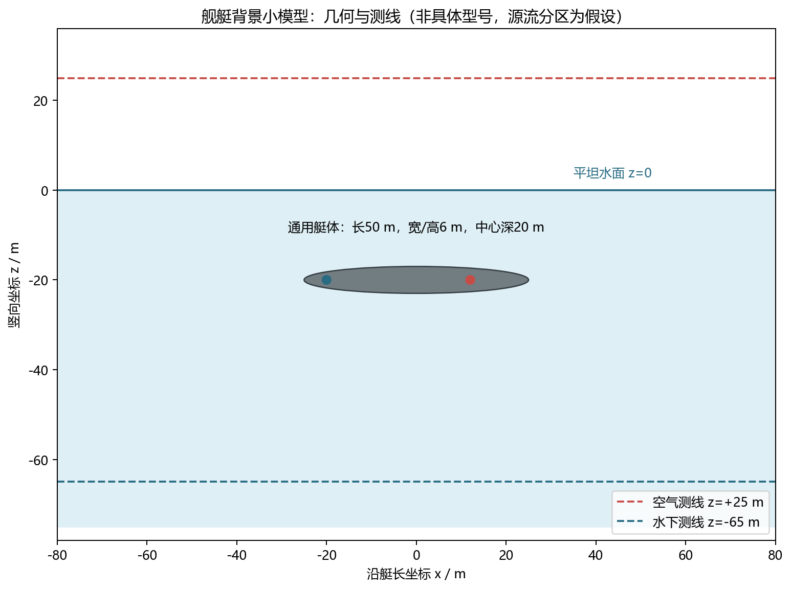
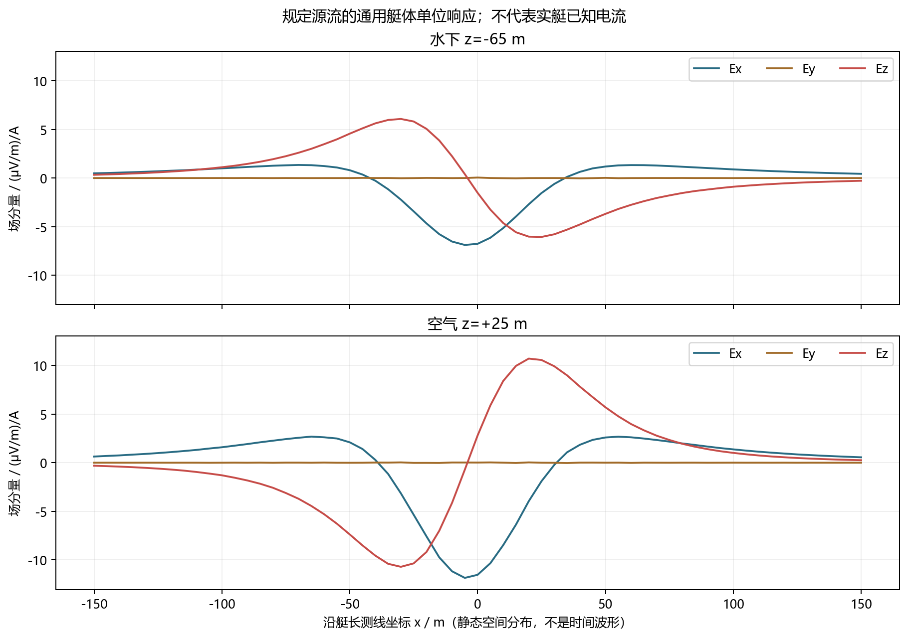
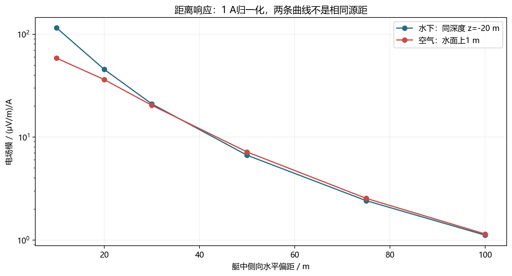

# 数值结果与核验

更新：2026-09-28。所有数值均为规定源流的通用艇体计算，不是实艇测量或TC灵敏度。

## 当前模型层级

公开尺度50 m/20 m；艇宽6 m、分布式源流形状为假设。水中EC与空气ES耦合。源强采用1 A归一化，未求非线性极化。

## 单位源流距离表

取扩大外域wide结果。表中单位为μV/m每安培；只有固定源流形状和线性介质时才可按实际等效支路电流缩放。

| 水平偏距 | 水下，同深度 | 空气，水面上1 m |
|---:|---:|---:|
| 10 m | 115.2 | 58.52 |
| 20 m | 45.51 | 36.22 |
| 30 m | 21.01 | 20.38 |
| 50 m | 6.667 | 7.177 |
| 75 m | 2.414 | 2.542 |
| 100 m | 1.115 | 1.145 |

这是传递系数表，不表示真实潜艇采用1 A电流；源流形状若改变，不能仅乘电流。

## 检查结果

相对误差按三分量电场差的模除以参考场模计算，避免某个分量过零造成虚假巨大百分比。

| 检查 | 水下侧向点 | 空气侧向点 | 水下完整测线 | 空气完整测线 |
|---|---:|---:|---:|---:|
| base→fine网格变化 | 1.585% | 2.200% | 2.197% | 2.215% |
| 500→750 m外域变化 | 1.060% | 1.062% | 1.373% | 1.751% |
| 解析边界条件对照 | 2.747% | 1.200% | 1.101% | 1.462% |

这些是本次数值差异，不是物理参数置信区间；网格差小也不是严格误差上界。5%仅为本轮披露/筛选尺度，不是传感器识别阈值。

解析对照在同一挖空艇体、水面和两物理场框架中，将边界输入替换为已知平衡点源解析解的通量及外边界电位；它验证求解链，不证明假设的艇表电流分布等同真实舰艇。

规定源汇积分均为±1 A，净输入接近零。对有限元梯度直接积分所得的边界通量另行记录，它不等于规定通量的精确积分。

| 情景 | 净规定电流/A | 梯度通量闭合残差/A | 外域净通量/A |
|---|---:|---:|---:|
| base | -4.97e-16 | 0.00127 | 1.12e-06 |
| fine | -8.55e-15 | -0.00104 | 5.33e-06 |
| wide | -1.01e-14 | -0.000704 | -2.91e-07 |

侧向点三项筛选超过5%的点：无。
完整测线有更远的采样点，是否通过请按上表和convergence.csv逐点核对，不将局部通过宣称为全域收敛。

## 图与文件

原始导出及MPH在comsol；整理CSV、误差与图片在results；生成脚本为summarize_model.py。

## 尚未覆盖

真实极化/涂层/阳极配置、海底、交流感应、轴系与流场、自身接收链及环境噪声。没有据此给出真实艇检测距离或修改实验结论。
