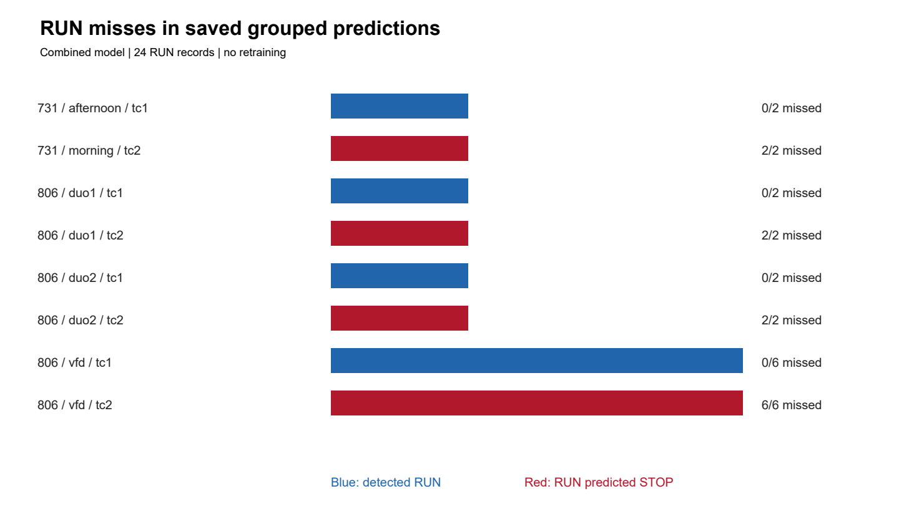
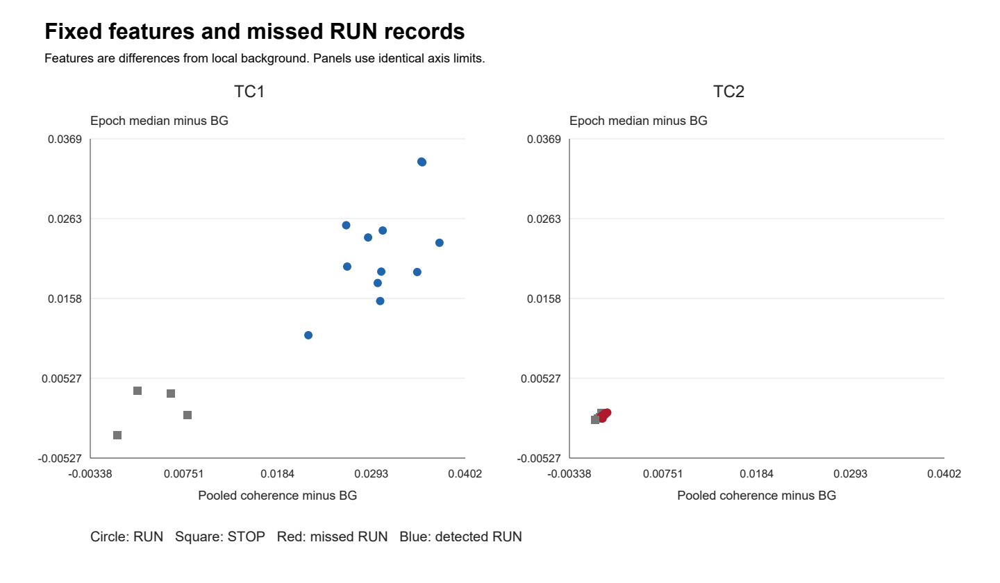
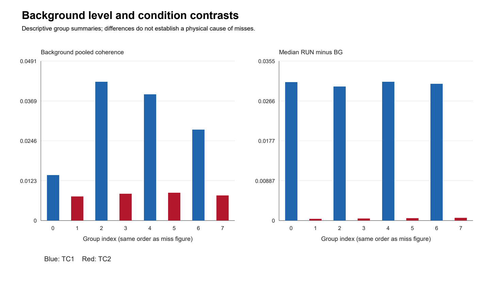
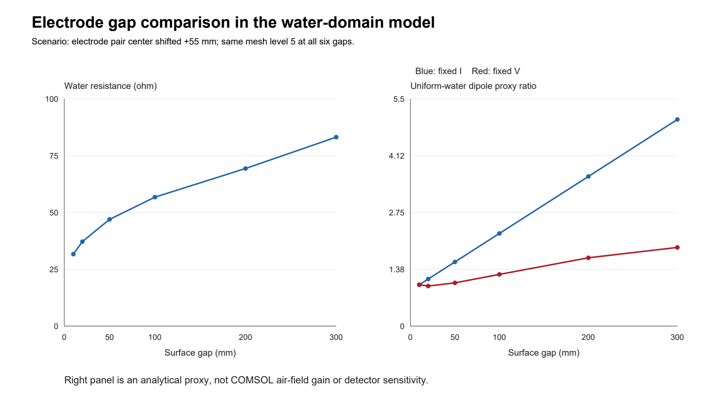
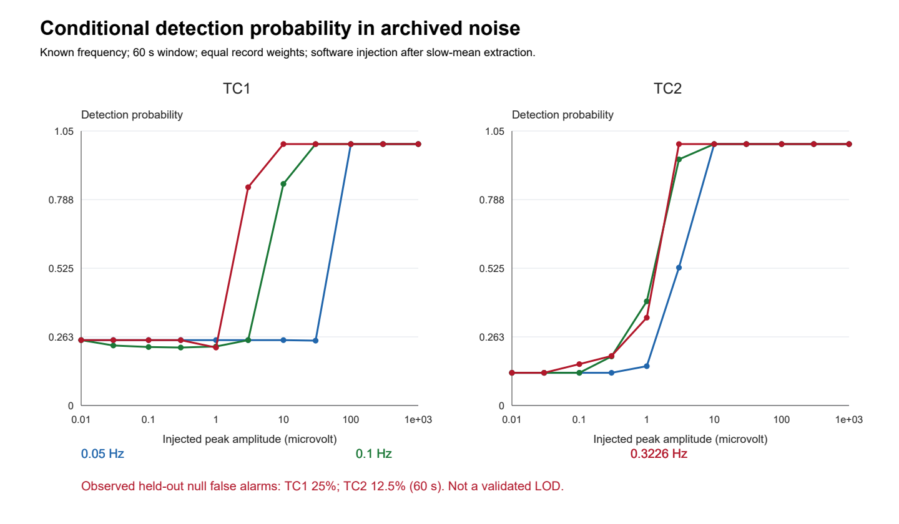
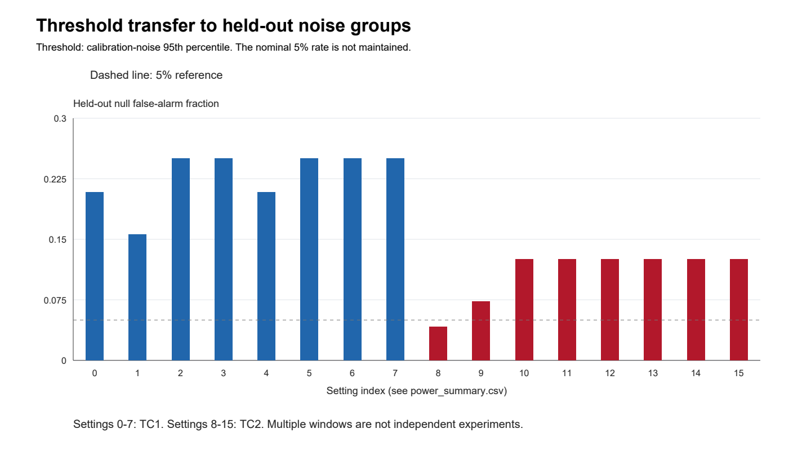

# 结果主表 漏判分析 间隙比较与检出能力

计算批次为2026年9月8日，最终整理核验于9月9日完成。本轮只使用既有实验资料，并新增条件仿真和软件注入，没有新增物理实验。

## 1 文件入口与主要结论

- [论文结果主表与漏判明细 Excel](../../outputs/thesis_completion_20260908/论文结果主表与漏判明细_20260908.xlsx)：50项可追溯结果，附32条预测、8层漏判、6种间隙和16种检出条件。主表逐项保留数值、单位、允许表述、限制、来源定位及SHA256。
- [COMSOL仿真执行计划书 Word](../../output/documents/COMSOL仿真执行计划书_20260908.docx)：8页，说明已完成计算、下一批外场算例、边界与数值核验，以及论文写作安排。
- [漏判详细报告](RESULTS_AND_MISSES.md)与[12条漏判明细](missed_run_records.csv)。
- [间隙数表](gap/gap_comparison.csv)、[网格比较](gap/mesh_comparison.csv)、[全部11个成功算例](gap/all_cases.csv)。对应MPH工程位于gap目录。
- [条件检出汇总](detection/power_summary.csv)、[完整检出曲线](detection/power_curves.csv)、[记录级结果](detection/record_power.csv)及[预先写出的计算协议](detection/protocol.json)。

最需要修改的论文表述是：合并模型的BA=0.75不能代替逐探测器的漏判表现；间隙源矩比不能代替桶外场增益；输出域软件注入不能直接给出仪器场强检出限。这三处限制都有本轮具体数值支持，不只是笼统的保守措辞。

## 2 漏判到底发生在哪里

使用相干双精度复核保存的full64_common组外预测，模型和频带没有重新选择。合并模型24条RUN识别12条、漏判12条，8条STOP全部正确。RUN召回率50%，STOP召回率100%，平衡准确率75%，普通准确率62.5%。零观测STOP误报不等于未来误报率为零。

| 模型及测试记录 | RUN正确 | RUN漏判 | STOP正确 |
|---|---:|---:|---:|
| 合并模型，TC1记录 | 12/12 | 0/12 | 4/4 |
| 合并模型，TC2记录 | 0/12 | 12/12 | 4/4 |
| TC1单探测器模型 | 11/12 | 1/12 | 4/4 |
| TC2单探测器模型 | 9/12 | 3/12 | 3/4 |



全部12条合并模型漏判均来自TC2。单独训练TC2仍可识别9/12条RUN，因此现有证据不支持把漏判直接归因于“TC2没有信号”或“TC2硬件坏了”。单探测器模型使用不同训练数据和训练折尺度，不能把两种模型的正确预测拼接成一个更高成绩。



同一坐标范围下，TC1相对背景的两个特征变化明显大于TC2。这个描述解释了为什么应检查跨探测器训练的尺度和基线问题，但不能单凭散点图确定物理原因。八层RUN−STOP差值同向是层内比较；分类器输入则是RUN或STOP相对本地背景的差值，跨层背景和幅度不相同。层内方向一致不保证一条跨层决策规则能正确识别所有记录。



论文第5章建议保留“探索性状态区分”的定位，增加上述分层混淆表和漏判图。后续若比较探测器专属模型、训练折内的尺度归一化或其他方法，必须保留当前基线，按同一验证单元重新评价，并把只有两个已探索日期的限制写清。本轮没有用测试结果修改模型来消除漏判。

## 3 间隙比较已经算出了什么

基于旧阴极保护水域V3模型，电导率保持0.05 S/m。表面间隙为10、20、50、100、200、300 mm，电极对中心统一移动至桶中心右侧55 mm。这是保证长钢管在最大间隙下仍可容纳于圆桶的几何情景，不是新增测得的摆放位置。另算20 mm、中心0 mm的历史位置对照。

| 表面间隙 mm | 水路电阻 Ω | 10 mA压降 V | 1 V电流 mA | 恒电流源矩相对值 | 恒电压源矩相对值 |
|---|---:|---:|---:|---:|---:|
| 10 | 31.6451 | 0.31645 | 31.6005 | 1.0000 | 1.0000 |
| 20 | 37.1679 | 0.37168 | 26.9049 | 1.1379 | 0.9688 |
| 50 | 46.9591 | 0.46959 | 21.2951 | 1.5517 | 1.0457 |
| 100 | 56.7242 | 0.56724 | 17.6292 | 2.2414 | 1.2504 |
| 200 | 69.3411 | 0.69341 | 14.4215 | 3.6207 | 1.6524 |
| 300 | 83.1319 | 0.83132 | 12.0291 | 5.0000 | 1.9033 |

主表采用相同网格等级5。1 V电流由线性水域解缩放；末两列是均匀水体远场偶极近似，以电流乘电极轴线距离作为源矩，并以10 mm为参考。轴线距离等于表面间隙加62.5 mm，不能直接用表面间隙计算30倍增益。



从10 mm到300 mm，水路电阻约增至2.627倍。恒电流下近似源矩增至5倍；恒电压下电流下降，因此近似源矩仅增至1.903倍。这个结果说明“大间隙更容易检出”需要附带输入条件，且未必在每个相邻间隙都单调。这里没有计算新的空气场，不能把末两列写成空气场、MEMS电压或检出距离增益。

10 mm和300 mm分别做等级5、4、3的网格对照。等级5相对等级3的电阻差为−1.092%和−0.745%；等级4相对等级3为−0.382%和−0.298%。等级5相对等级3的水域平均场差为约0.181%和0.005%。这些是目标量的数值敏感性，没有证明尖角最大场或外部场收敛。

共11个成功算例，最大功率平衡相对残差约2.31×10⁻¹¹，水体体积相对跨度约4.61×10⁻⁶。等级6的两个粗网格算例因网格生成失败而没有有效结果，已在验证JSON中保留失败状态，没有填补虚构值。旧模型水路电阻与历史端电压/电流的差异仍未解决，不能通过本次间隙扫描宣称模型已被实测校准。

## 4 条件检出能力怎么计算和解释

噪声来自7月31日及8月6日的16条归档BG/STOP记录，每个探测器8条。通道沿用full64_common规则；channel_sets.csv中的通道号为1起始，脚本转换为0起始数组索引。读取双精度slow_mean，按原归档起止裁剪规则得到稳定区间，再取共同健康通道均值。没有用RUN记录设阈值，也没有重新选择健康通道。

在0.05、0.1及1/3.1 Hz三个固定频率下，比较20、40、60 s窗口；0.05 Hz的20 s只有一个周期，因此不计算。记录内选择不重叠窗口，最多6个，长记录均匀抽取，避免长记录主导统计。对每个窗口，同时拟合截距、线性趋势、余弦和正弦，取两谐波系数的欧氏模作为峰值幅值。

对一个留出工况，标定集只使用同探测器的其他工况BG/STOP。训练和测试记录无交集。阈值为等记录权重的95%经验分位数；这只是阈值构造规则，不保证新工况误报为5%。注入幅值固定为0、0.01、0.03、0.1、0.3、1、3、10、30、100、300、1000 µV峰值，每档64个等间隔相位。先平均窗口与相位，再对记录等权平均；没有把注入次数当独立实验数量。

| 探测器 | 频率 Hz | 60 s平均90%最小测试幅值 µV峰值 | 各记录均90%最小测试幅值 µV峰值 | 实际留组空白误报 |
|---|---:|---:|---:|---:|
| TC1 | 0.05 | 100 | 100 | 25.0% |
| TC1 | 0.10 | 30 | 30 | 25.0% |
| TC1 | 0.3226 | 10 | 10 | 25.0% |
| TC2 | 0.05 | 10 | 10 | 12.5% |
| TC2 | 0.10 | 3 | 10 | 12.5% |
| TC2 | 0.3226 | 3 | 3 | 12.5% |



表中给的是离散幅值网格上的最小合格档，并要求后续更大幅值档均达到相应标准；不是精确插值得到的90%交点。相位导致弱信号与原有频率成分相消时，局部曲线可以非单调。TC2的0.1 Hz例子说明，平均检出90%不等于每条记录都能检出90%。



在60 s条件下，TC1三个频率的实际留组空白误报均为25%，TC2均为12.5%。因此当前不能给出“5%误报下的仪器检出限”。同样，20、40、60 s的曲线差异不只是积分时间效应，也包含可用窗口数和工况非平稳性的影响，不能简单总结为时间越长越好。

软件注入发生在慢均值输出域，等价于向所选通道加入相同幅度、相同相位的正弦。它没有检验真实场在通道之间的空间响应、原始采样及滤波传递、频率失配、未知频率盲搜或通断瞬态。所用背景属于泵系统旧记录，不等于新阴极保护实验背景。没有场到电压的独立标定，不能从这些微伏数值换算出V/m或最远检出距离。

## 5 计划书如何接着执行

计划书把外部模型核验放在六间隙外场扫描之前。重点是参数化引线连接、区分平衡差模和真实浮地、分别检查网格与外域、导出复数场分量和单位输入传递。旧V4指定对地±0.5 V，不足以代表所有浮地回路；旧V13外域扩展仍有显著变化，也不足以证明10 m边界已经足够远。

这些检查参照[COMSOL网格细化说明](https://www.comsol.com/support/knowledgebase/1261)、[电准静态理论说明](https://www.comsol.com/multiphysics/electroquasistatics-theory)及[Floating Potential说明](https://doc.comsol.com/6.4/doc/com.comsol.help.acdc/acdc_ug_electric_fields.07.085.html)，具体批次和参数已写入计划书。本轮交付的是水域间隙比较与外场执行计划，没有把尚未完成的外场核验标为完成。

从尽快完成毕业论文的角度，接下来优先处理两件事：一是把跨工况误报对应的背景漂移与记录差异查清，在不利用测试记录调参的前提下比较阈值稳定化方法；二是完成一个外部场代表算例的可信度核验，再扩展间隙主表。现有结果可先进入第5章局限分析和第6章条件仿真、测量能力讨论，结论强度由导师审阅和后续验证确定。

## 6 可复现入口与本轮核验

项目根目录下，本轮新增的独立计算入口如下。COMSOL模型耗时和许可证情况依机器环境变化，CSV后处理不需要重跑COMSOL。

```text
scripts/build_thesis_result_registry_20260908.py
scripts/CathodicGapAudit20260908.java
scripts/CathodicGapFine20260908.java
scripts/summarize_gap_20260908.py
scripts/detection_power_20260908.py
scripts/plot_thesis_completion_20260908.py
```

实际执行了COMSOL编译与4核批处理、水域CSV汇总、已有预测聚合、NumPy软件注入、ReportLab矢量图生成和Excel导出。数值后处理顺序为间隙汇总、检出能力、主表汇总、绘图。文件名为20260908是本轮批次标记，不表示9月9日新增了物理实验。

核验包括：32条预测逐记录唯一性，24 RUN和8 STOP计数，12条漏判与分层汇总一致；主表50行来源哈希；16条噪声归档哈希与标定/测试记录互斥；软件注入直接波形最小二乘与系数叠加对照，最大误差约3.82×10⁻¹⁴ µV；11个水域算例的功率、体积和网格比较；Excel五个工作表预览及错误值检查；Word导出8页PDF后逐页检查。标准LibreOffice渲染器因本机未安装而不可用，采用独立隐藏Word实例导出后检查，没有操作用户已有Word文档。

保留未解决项：新的桶外间隙场尚未求解；真实供电共模与旧I–V差异待核；场到采集电压缺独立标定；背景阈值跨工况转移未达到稳定5%误报。本轮未覆盖原始TDMS、历史PPT、旧MPH模型或主处理流程，也没有重新训练原分类器。
