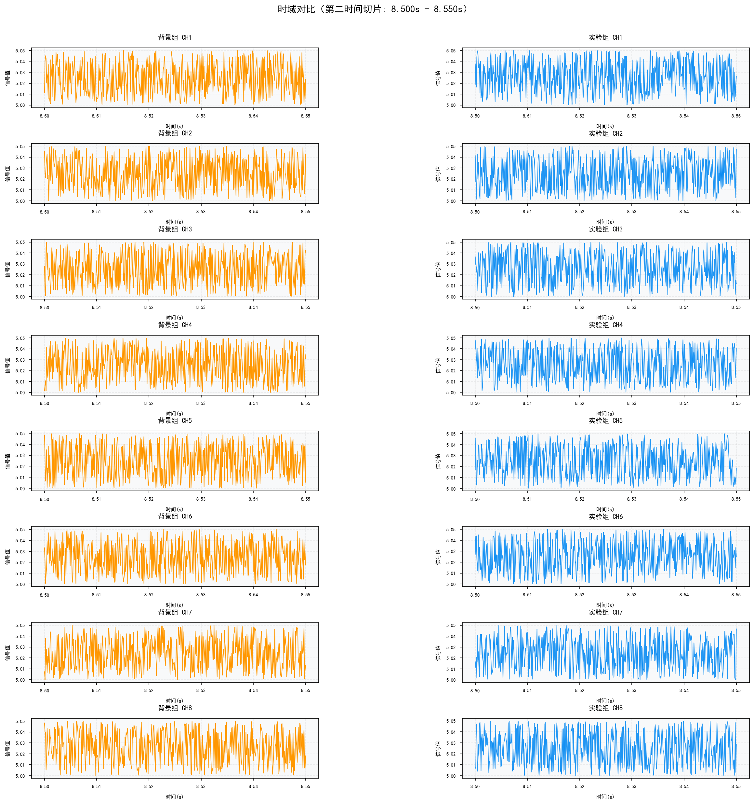
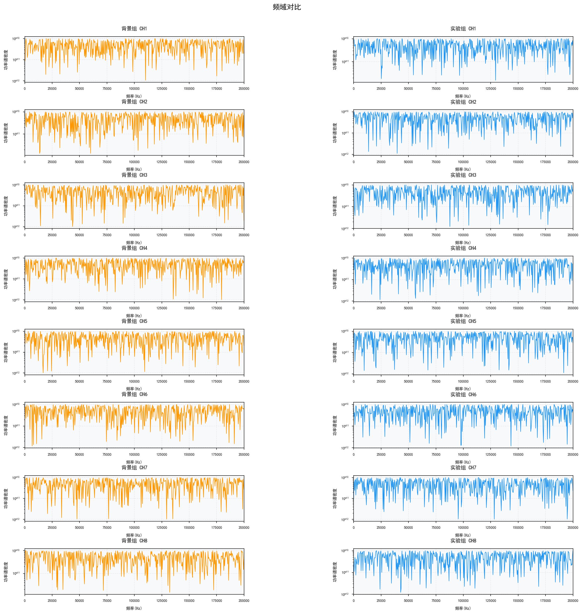
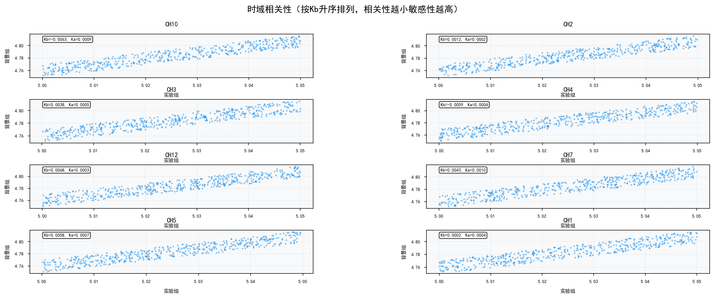
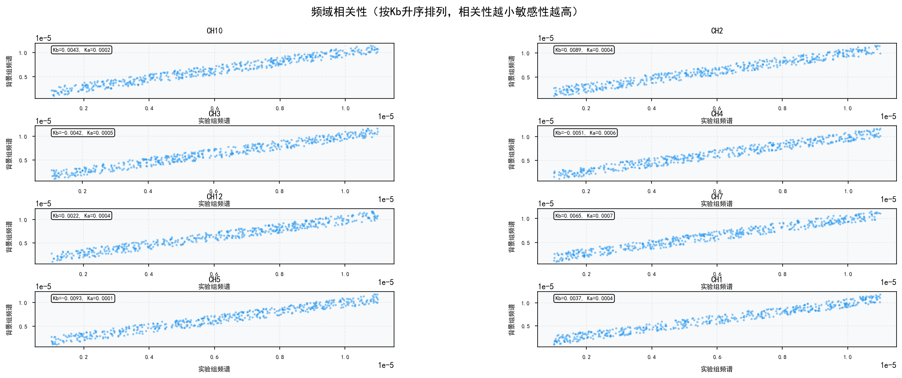

## 基础响应敏感性分析报告

### 1. 实验状态定义

| 序号 | 状态名称 | 类型 | α或K | β或L | r |
| --- | --- | --- | --- | --- | --- |
| 1 | 状态A-放电 | TC12 | 30° | 45° | 1.5m |
| 2 | 状态B-不放电 | TC12 | 30° | 45° | 1.5m |

| 参数 | 值 |
|------|----|
| 采样率 | 400000 Hz |
| 通道数 | 12 |
| 时间切片 | 6.00s - 12.00s |
| 相关性算法 | 皮尔逊相关系数 |

### 2. 可视化结果

#### 2.1 时域二次切片对比

**说明**: 显示各通道背景组与实验组的时域信号对比。

#### 2.2 频域对比

**说明**: 显示各通道背景组与实验组的频域频谱对比。

#### 2.3 时域相关性

**说明**: 各通道实验组与背景组的时域散点图，按敏感性(Kb)降序排列。

#### 2.4 频域相关性

**说明**: 各通道实验组与背景组的频域散点图，按敏感性(Kb)降序排列。

### 3. 敏感性排序

> **敏感性判断**: 实验组与背景组越不相关(Kb越小)，通道越敏感。

| 排名 | 通道 | Ka (频域峰值差) | Kb (相关性系数) |
|------|------|----------------|----------------|
| 1 | CH10 | 0.000866 | 0.007343 |
| 2 | CH2 | 0.000750 | -0.005406 |
| 3 | CH3 | 0.000437 | -0.009841 |
| 4 | CH4 | 0.000133 | 0.008217 |
| 5 | CH12 | 0.000418 | -0.007403 |
| 6 | CH7 | 0.000388 | 0.004175 |
| 7 | CH5 | 0.000953 | -0.003994 |
| 8 | CH1 | 0.000575 | 0.001094 |
