# NPMEMS_TC12 实验报告

> 生成时间: 2026-07-21 17:39:27

---

### BLOCK 1

## Tab6-批量对比-组1, 组2, 组3, 组4

> 来源: 批量参数对比 | 生成时间: 2026-07-21 17:39:27

## 批量参数对比报告

### 实验状态定义

| 序号 | 状态名称 | 类型 | alpha | beta | gamma |
| --- | --- | --- | --- | --- | --- |
| 1 | α1=0.1 | TC12 | 0.1 | 0.5 | 1.0 |
| 2 | α2=0.2 | TC12 | 0.2 | 0.5 | 1.0 |
| 3 | α3=0.3 | TC12 | 0.3 | 0.5 | 1.0 |
| 4 | α4=0.4 | TC12 | 0.4 | 0.5 | 1.0 |
**数据组数**: 4

**参数标签**: 组1, 组2, 组3, 组4

**计算类型**: 时域

### 时域波形对比

#### 通道 CH1

#### 通道 CH2

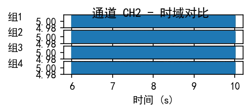

#### 通道 CH3

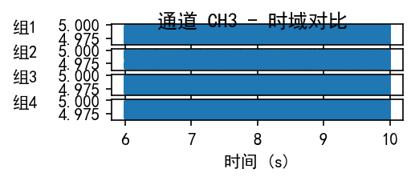

#### 通道 CH4

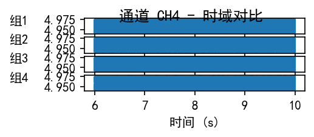

#### 通道 CH5

#### 通道 CH6

#### 通道 CH7

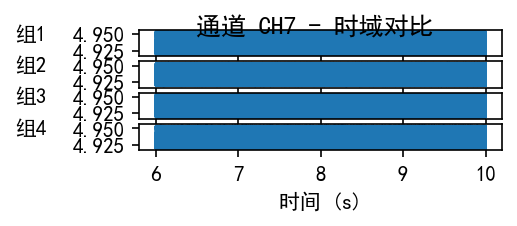

#### 通道 CH8

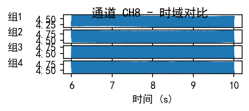

#### 通道 CH9

#### 通道 CH10

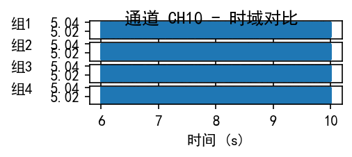

#### 通道 CH11

#### 通道 CH12

### 频域波形对比

#### 通道 CH1

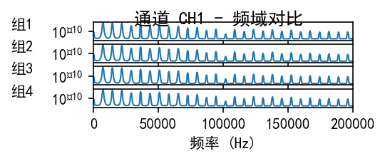

#### 通道 CH2

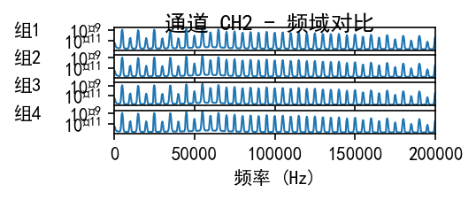

#### 通道 CH3

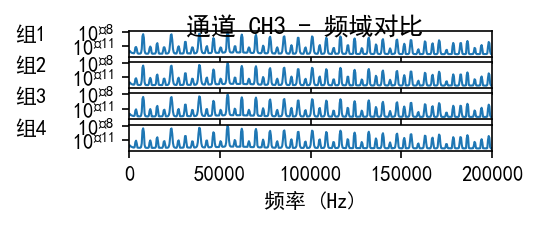

#### 通道 CH4

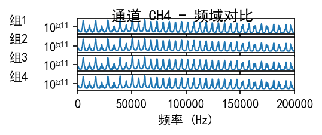

#### 通道 CH5

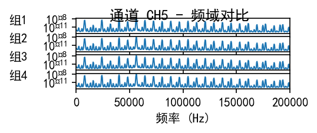

#### 通道 CH6

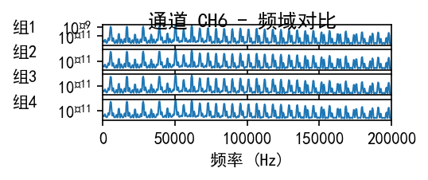

#### 通道 CH7

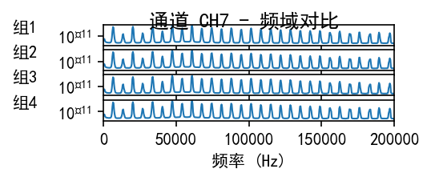

#### 通道 CH8

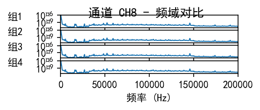

#### 通道 CH9

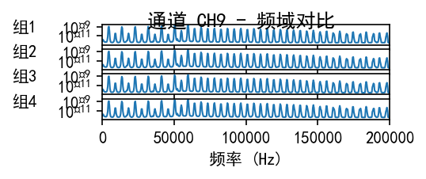

#### 通道 CH10

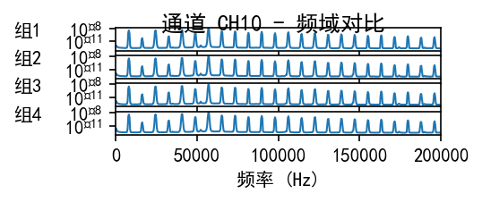

#### 通道 CH11

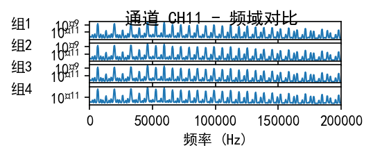

#### 通道 CH12

### 相关性可视化

#### 通道 CH1

#### 通道 CH2

#### 通道 CH3

#### 通道 CH4

#### 通道 CH5

#### 通道 CH6

#### 通道 CH7

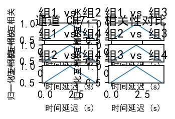

#### 通道 CH8

#### 通道 CH9

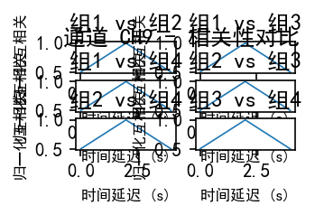

#### 通道 CH10

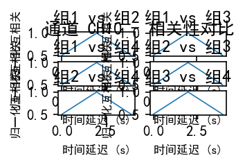

#### 通道 CH11

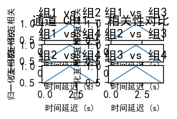

#### 通道 CH12

### 通道相关性指标排序

| 排名 | 通道 | 加权均值 |
|------|------|----------|
| 1 | CH1 | 1.000000 |
| 2 | CH2 | 1.000000 |
| 3 | CH3 | 1.000000 |
| 4 | CH4 | 1.000000 |
| 5 | CH5 | 1.000000 |
| 6 | CH6 | 1.000000 |
| 7 | CH7 | 1.000000 |
| 8 | CH8 | 1.000000 |
| 9 | CH9 | 1.000000 |
| 10 | CH10 | 1.000000 |
| 11 | CH11 | 1.000000 |
| 12 | CH12 | 1.000000 |

---
