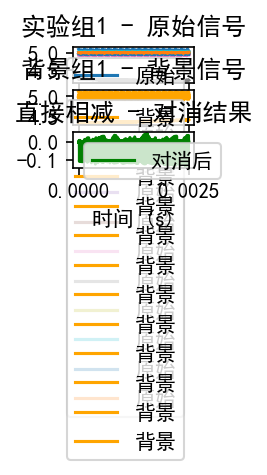
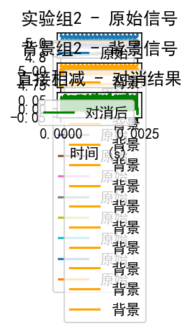
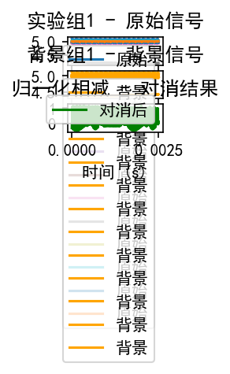
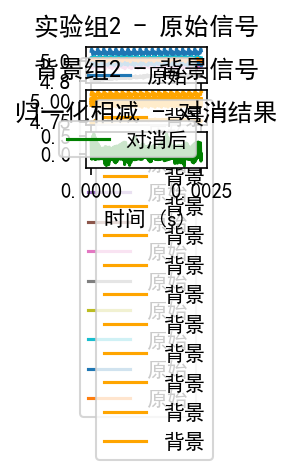

# NPMEMS_TC12 实验报告

> 生成时间: 2026-07-21 17:38:17

---

### BLOCK 1

## Tab7-背景对消批处理

> 来源: 背景对消批处理 | 生成时间: 2026-07-21 17:38:17

## 背景对消批处理报告

### 实验状态定义

| 序号 | 状态名称 | 类型 | α或K | r |
| --- | --- | --- | --- | --- |
| 1 | 实验状态1 | TC12 | 0.1 | 1.0 |
| 2 | 实验状态2 | TC12 | 0.2 | 1.0 |
### 直接相减

#### 实验组1 vs 背景组1

#### 实验组2 vs 背景组2

### 归一化相减

#### 实验组1 vs 背景组1

#### 实验组2 vs 背景组2

---
