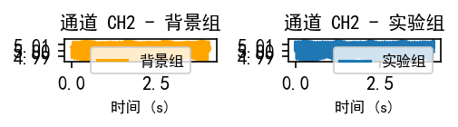
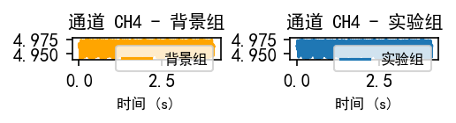
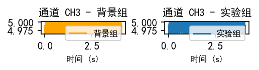
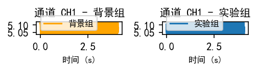
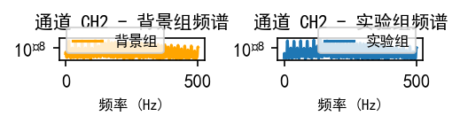
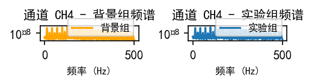
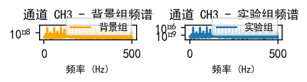
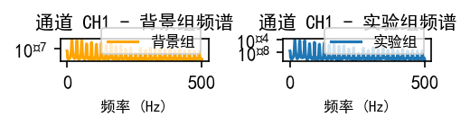
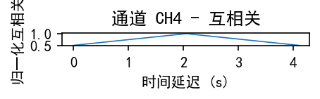

# NPMEMS_TC12 实验报告

> 生成时间: 2026-07-21 17:38:38

---

### BLOCK 1

## Tab8-通道敏感性分析

> 来源: 通道敏感性分析 | 生成时间: 2026-07-21 17:38:38

## 通道敏感性分析报告

### 实验状态定义

| 序号 | 状态名称 | 类型 | alpha | beta |
| --- | --- | --- | --- | --- |
| 1 | 实验状态-实验组 | TC12 | 0.5 | 1.0 |
| 2 | 实验状态-背景组 | TC12 | 0.0 | 0.0 |
### 敏感性排序

| 排名 | 通道 | Ka指标 | Kb指标 | 相关性 |
|------|------|--------|--------|--------|
| 1 | CH2 | 0.953895 | 0.997973 | 0.046105 |
| 2 | CH4 | 0.942258 | 1.001565 | 0.057742 |
| 3 | CH3 | 0.760156 | 0.994634 | -0.239844 |
| 4 | CH1 | 0.750094 | 0.999375 | 0.249906 |

> **说明**: Ka越大表示敏感性越高（相关性越小，敏感性越高）

### 时域波形对比（左背景右实验）

#### 通道 CH2

#### 通道 CH4

#### 通道 CH3

#### 通道 CH1

### 频域分析（左背景右实验）

#### 通道 CH2

#### 通道 CH4

#### 通道 CH3

#### 通道 CH1

### 相关性分析

#### 通道 CH2

#### 通道 CH4

#### 通道 CH3

#### 通道 CH1

---
