# NPMEMS_TC12 实验报告

> 生成时间: 2026-07-01 17:24:10

---

### BLOCK 1

## 背景对消-直接相减-9组数据

> 来源: 背景对消批处理 | 生成时间: 2026-07-01 17:24:06

# 背景对消批处理报告（直接相减）

> 生成时间: 2026-07-01 17:24:06

**数据组数**: 9

**参数标签**: α1, α2, α3, α4, α5, α6, α7, α8, α9

**采样频率**: 200000 Hz

**计算类型**: 时域+频域

**时域算法**: 互相关系数, 互相关峰值, 协方差

**频域算法**: 频谱余弦相似度, 频谱皮尔逊相关, 频谱相干性

**频域变换算法**: Welch功率谱密度估计（使用FFT计算）

**背景对消算法**: 直接相减

**背景数据文件**: 20260624135520.858716-1.tdms

---

## 实验状态列表

| 编号 | 标签 | α值 | KW值 | 电压 | 实验数据文件 | 背景数据文件 |

|------|------|-----|------|------|--------------|--------------|

| 1 | α1 | 0.1 | 100 | 20V | 20260624111409.730223-1.tdms | 20260624135520.858716-1.tdms |

| 2 | α2 | 0.2 | 120 | 22V | 20260624111233.451147-1.tdms | 20260624135520.858716-1.tdms |

| 3 | α3 | 0.3 | 140 | 24V | 20260624111513.846692-1.tdms | 20260624135520.858716-1.tdms |

| 4 | α4 | 0.4 | 160 | 26V | 20260624111600.394885-1.tdms | 20260624135520.858716-1.tdms |

| 5 | α5 | 0.5 | 180 | 28V | 20260624111816.858115-1.tdms | 20260624135520.858716-1.tdms |

| 6 | α6 | 0.6 | 200 | 30V | 20260624111724.702410-1.tdms | 20260624135520.858716-1.tdms |

| 7 | α7 | 0.7 | 220 | 32V | 20260624140100.819606-1.tdms | 20260624135520.858716-1.tdms |

| 8 | α8 | 0.8 | 240 | 34V | 20260624135638.040408-1.tdms | 20260624135520.858716-1.tdms |

| 9 | α9 | 0.9 | 260 | 36V | 20260624135415.777303-1.tdms | 20260624135520.858716-1.tdms |

## 第一章：时域分析（背景对消后）

### 1.1 时域波形堆叠图

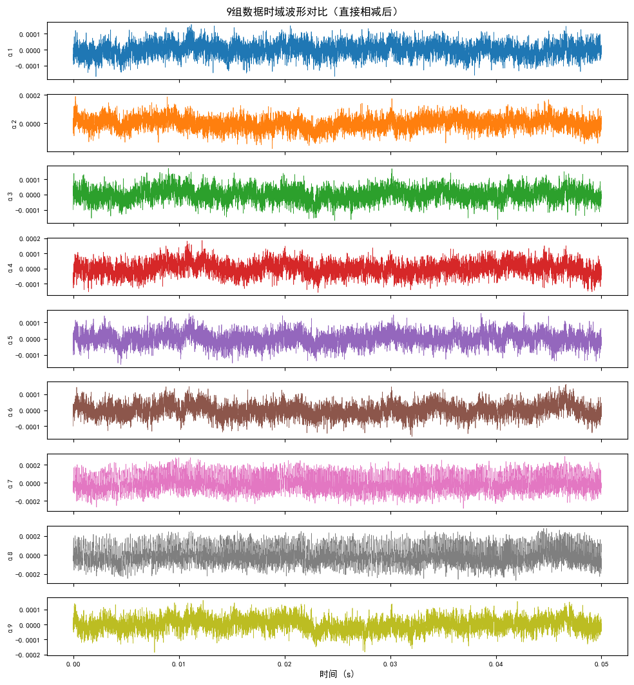

### 1.2 时域相似性计算结果

| 算法 | 组A | 组B | 值 |

|------|-----|-----|----|

| 互相关系数 | α1 | α1 | 1.000000 |

| 互相关峰值 | α1 | α1 | 0.999995 |

| 协方差 | α1 | α1 | 0.000000 |

| 互相关系数 | α1 | α2 | 0.412168 |

| 互相关峰值 | α1 | α2 | 0.412166 |

| 协方差 | α1 | α2 | 0.000000 |

| 互相关系数 | α1 | α3 | 0.449628 |

| 互相关峰值 | α1 | α3 | 0.449626 |

| 协方差 | α1 | α3 | 0.000000 |

| 互相关系数 | α1 | α4 | 0.436943 |

| 互相关峰值 | α1 | α4 | 0.436941 |

| 协方差 | α1 | α4 | 0.000000 |

| 互相关系数 | α1 | α5 | 0.486818 |

| 互相关峰值 | α1 | α5 | 0.486816 |

| 协方差 | α1 | α5 | 0.000000 |

| 互相关系数 | α1 | α6 | 0.478156 |

| 互相关峰值 | α1 | α6 | 0.478153 |

| 协方差 | α1 | α6 | 0.000000 |

| 互相关系数 | α1 | α7 | 0.214884 |

| 互相关峰值 | α1 | α7 | 0.214883 |

| 协方差 | α1 | α7 | 0.000000 |

| 互相关系数 | α1 | α8 | 0.212190 |

| 互相关峰值 | α1 | α8 | 0.212189 |

| 协方差 | α1 | α8 | 0.000000 |

| 互相关系数 | α1 | α9 | 0.473041 |

| 互相关峰值 | α1 | α9 | 0.473039 |

| 协方差 | α1 | α9 | 0.000000 |

| 互相关系数 | α2 | α1 | 0.412168 |

| 互相关峰值 | α2 | α1 | 0.412166 |

| 协方差 | α2 | α1 | 0.000000 |

### 1.3 时域相似度矩阵（9×9）

#### 互相关系数（时域）

**算法**: 互相关系数

| | α1 | α2 | α3 | α4 | α5 | α6 | α7 | α8 | α9 |
|----|----|----|----|----|----|----|----|----|
| α1 | 1.0000 | 0.4122 | 0.4496 | 0.4369 | 0.4868 | 0.4782 | 0.2149 | 0.2122 | 0.4730 |
| α2 | 0.4122 | 1.0000 | 0.4856 | 0.4483 | 0.4994 | 0.5195 | 0.1959 | 0.2397 | 0.4698 |
| α3 | 0.4496 | 0.4856 | 1.0000 | 0.4584 | 0.4901 | 0.5135 | 0.2174 | 0.2396 | 0.4910 |
| α4 | 0.4369 | 0.4483 | 0.4584 | 1.0000 | 0.4843 | 0.5020 | 0.2390 | 0.2236 | 0.5032 |
| α5 | 0.4868 | 0.4994 | 0.4901 | 0.4843 | 1.0000 | 0.5253 | 0.2182 | 0.2383 | 0.4911 |
| α6 | 0.4782 | 0.5195 | 0.5135 | 0.5020 | 0.5253 | 1.0000 | 0.2584 | 0.2575 | 0.5513 |
| α7 | 0.2149 | 0.1959 | 0.2174 | 0.2390 | 0.2182 | 0.2584 | 1.0000 | 0.0960 | 0.2589 |
| α8 | 0.2122 | 0.2397 | 0.2396 | 0.2236 | 0.2383 | 0.2575 | 0.0960 | 1.0000 | 0.2679 |
| α9 | 0.4730 | 0.4698 | 0.4910 | 0.5032 | 0.4911 | 0.5513 | 0.2589 | 0.2679 | 1.0000 |

#### 互相关峰值（时域）

**算法**: 互相关峰值

| | α1 | α2 | α3 | α4 | α5 | α6 | α7 | α8 | α9 |
|----|----|----|----|----|----|----|----|----|
| α1 | 1.0000 | 0.4122 | 0.4496 | 0.4369 | 0.4868 | 0.4782 | 0.2149 | 0.2122 | 0.4730 |
| α2 | 0.4122 | 1.0000 | 0.4856 | 0.4483 | 0.4994 | 0.5195 | 0.1959 | 0.2397 | 0.4698 |
| α3 | 0.4496 | 0.4856 | 1.0000 | 0.4584 | 0.4901 | 0.5135 | 0.2174 | 0.2396 | 0.4910 |
| α4 | 0.4369 | 0.4483 | 0.4584 | 1.0000 | 0.4843 | 0.5020 | 0.2390 | 0.2236 | 0.5032 |
| α5 | 0.4868 | 0.4994 | 0.4901 | 0.4843 | 1.0000 | 0.5253 | 0.2182 | 0.2383 | 0.4911 |
| α6 | 0.4782 | 0.5195 | 0.5135 | 0.5020 | 0.5253 | 1.0000 | 0.2584 | 0.2575 | 0.5513 |
| α7 | 0.2149 | 0.1959 | 0.2174 | 0.2390 | 0.2182 | 0.2584 | 1.0000 | 0.0960 | 0.2589 |
| α8 | 0.2122 | 0.2397 | 0.2396 | 0.2236 | 0.2383 | 0.2575 | 0.0960 | 1.0000 | 0.2679 |
| α9 | 0.4730 | 0.4698 | 0.4910 | 0.5032 | 0.4911 | 0.5513 | 0.2589 | 0.2679 | 1.0000 |

#### 协方差（时域）

**算法**: 协方差

| | α1 | α2 | α3 | α4 | α5 | α6 | α7 | α8 | α9 |
|----|----|----|----|----|----|----|----|----|
| α1 | 0.0000 | 0.0000 | 0.0000 | 0.0000 | 0.0000 | 0.0000 | 0.0000 | 0.0000 | 0.0000 |
| α2 | 0.0000 | 0.0000 | 0.0000 | 0.0000 | 0.0000 | 0.0000 | 0.0000 | 0.0000 | 0.0000 |
| α3 | 0.0000 | 0.0000 | 0.0000 | 0.0000 | 0.0000 | 0.0000 | 0.0000 | 0.0000 | 0.0000 |
| α4 | 0.0000 | 0.0000 | 0.0000 | 0.0000 | 0.0000 | 0.0000 | 0.0000 | 0.0000 | 0.0000 |
| α5 | 0.0000 | 0.0000 | 0.0000 | 0.0000 | 0.0000 | 0.0000 | 0.0000 | 0.0000 | 0.0000 |
| α6 | 0.0000 | 0.0000 | 0.0000 | 0.0000 | 0.0000 | 0.0000 | 0.0000 | 0.0000 | 0.0000 |
| α7 | 0.0000 | 0.0000 | 0.0000 | 0.0000 | 0.0000 | 0.0000 | 0.0000 | 0.0000 | 0.0000 |
| α8 | 0.0000 | 0.0000 | 0.0000 | 0.0000 | 0.0000 | 0.0000 | 0.0000 | 0.0000 | 0.0000 |
| α9 | 0.0000 | 0.0000 | 0.0000 | 0.0000 | 0.0000 | 0.0000 | 0.0000 | 0.0000 | 0.0000 |

## 第二章：频域分析（背景对消后）

### 2.1 频域波形堆叠图

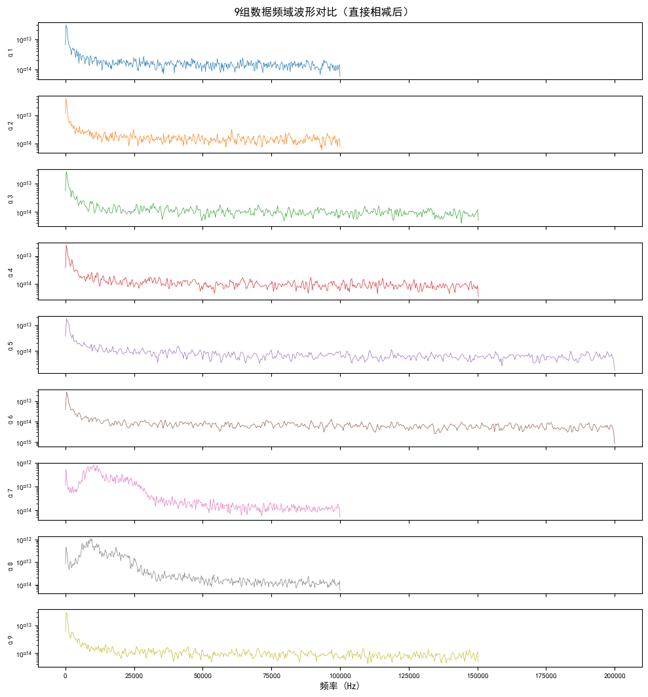

### 2.2 频域相似性计算结果

| 算法 | 组A | 组B | 值 |

|------|-----|-----|----|

| 频谱余弦相似度 | α1 | α1 | 1.000000 |

| 频谱皮尔逊相关 | α1 | α1 | 1.000000 |

| 频谱相干性 | α1 | α1 | 0.000000 |

| 频谱余弦相似度 | α1 | α2 | 0.823409 |

| 频谱皮尔逊相关 | α1 | α2 | 0.467883 |

| 频谱相干性 | α1 | α2 | 0.000000 |

| 频谱余弦相似度 | α1 | α3 | 0.835901 |

| 频谱皮尔逊相关 | α1 | α3 | 0.472862 |

| 频谱相干性 | α1 | α3 | 0.000000 |

| 频谱余弦相似度 | α1 | α4 | 0.812293 |

| 频谱皮尔逊相关 | α1 | α4 | 0.438218 |

| 频谱相干性 | α1 | α4 | 0.000000 |

| 频谱余弦相似度 | α1 | α5 | 0.834617 |

| 频谱皮尔逊相关 | α1 | α5 | 0.480935 |

| 频谱相干性 | α1 | α5 | 0.000000 |

| 频谱余弦相似度 | α1 | α6 | 0.837476 |

| 频谱皮尔逊相关 | α1 | α6 | 0.518684 |

| 频谱相干性 | α1 | α6 | 0.000000 |

| 频谱余弦相似度 | α1 | α7 | 0.660556 |

| 频谱皮尔逊相关 | α1 | α7 | 0.225280 |

| 频谱相干性 | α1 | α7 | 0.000000 |

| 频谱余弦相似度 | α1 | α8 | 0.654108 |

| 频谱皮尔逊相关 | α1 | α8 | 0.218323 |

| 频谱相干性 | α1 | α8 | 0.000000 |

| 频谱余弦相似度 | α1 | α9 | 0.826410 |

| 频谱皮尔逊相关 | α1 | α9 | 0.488616 |

| 频谱相干性 | α1 | α9 | 0.000000 |

| 频谱余弦相似度 | α2 | α1 | 0.823409 |

| 频谱皮尔逊相关 | α2 | α1 | 0.467883 |

| 频谱相干性 | α2 | α1 | 0.000000 |

### 2.3 频域相似度矩阵（9×9）

#### 频谱余弦相似度（频域）

**算法**: 频谱余弦相似度

| | α1 | α2 | α3 | α4 | α5 | α6 | α7 | α8 | α9 |
|----|----|----|----|----|----|----|----|----|
| α1 | 1.0000 | 0.8234 | 0.8359 | 0.8123 | 0.8346 | 0.8375 | 0.6606 | 0.6541 | 0.8264 |
| α2 | 0.8234 | 1.0000 | 0.8276 | 0.8235 | 0.8229 | 0.8411 | 0.6518 | 0.6486 | 0.8533 |
| α3 | 0.8359 | 0.8276 | 1.0000 | 0.8325 | 0.8373 | 0.8365 | 0.6557 | 0.6552 | 0.8366 |
| α4 | 0.8123 | 0.8235 | 0.8325 | 1.0000 | 0.8241 | 0.8193 | 0.6442 | 0.6479 | 0.8305 |
| α5 | 0.8346 | 0.8229 | 0.8373 | 0.8241 | 1.0000 | 0.8239 | 0.6532 | 0.6628 | 0.8285 |
| α6 | 0.8375 | 0.8411 | 0.8365 | 0.8193 | 0.8239 | 1.0000 | 0.6569 | 0.6531 | 0.8359 |
| α7 | 0.6606 | 0.6518 | 0.6557 | 0.6442 | 0.6532 | 0.6569 | 1.0000 | 0.7890 | 0.6576 |
| α8 | 0.6541 | 0.6486 | 0.6552 | 0.6479 | 0.6628 | 0.6531 | 0.7890 | 1.0000 | 0.6482 |
| α9 | 0.8264 | 0.8533 | 0.8366 | 0.8305 | 0.8285 | 0.8359 | 0.6576 | 0.6482 | 1.0000 |

#### 频谱皮尔逊相关（频域）

**算法**: 频谱皮尔逊相关

| | α1 | α2 | α3 | α4 | α5 | α6 | α7 | α8 | α9 |
|----|----|----|----|----|----|----|----|----|
| α1 | 1.0000 | 0.4679 | 0.4729 | 0.4382 | 0.4809 | 0.5187 | 0.2253 | 0.2183 | 0.4886 |
| α2 | 0.4679 | 1.0000 | 0.4883 | 0.5055 | 0.4841 | 0.5582 | 0.2364 | 0.2367 | 0.5942 |
| α3 | 0.4729 | 0.4883 | 1.0000 | 0.5064 | 0.4979 | 0.5226 | 0.2208 | 0.2282 | 0.5257 |
| α4 | 0.4382 | 0.5055 | 0.5064 | 1.0000 | 0.4908 | 0.5006 | 0.2216 | 0.2378 | 0.5338 |
| α5 | 0.4809 | 0.4841 | 0.4979 | 0.4908 | 1.0000 | 0.4944 | 0.2240 | 0.2551 | 0.5103 |
| α6 | 0.5187 | 0.5582 | 0.5226 | 0.5006 | 0.4944 | 1.0000 | 0.2540 | 0.2527 | 0.5517 |
| α7 | 0.2253 | 0.2364 | 0.2208 | 0.2216 | 0.2240 | 0.2540 | 1.0000 | 0.6065 | 0.2578 |
| α8 | 0.2183 | 0.2367 | 0.2282 | 0.2378 | 0.2551 | 0.2527 | 0.6065 | 1.0000 | 0.2440 |
| α9 | 0.4886 | 0.5942 | 0.5257 | 0.5338 | 0.5103 | 0.5517 | 0.2578 | 0.2440 | 1.0000 |

#### 频谱相干性（频域）

**算法**: 频谱相干性

| | α1 | α2 | α3 | α4 | α5 | α6 | α7 | α8 | α9 |
|----|----|----|----|----|----|----|----|----|
| α1 | 0.0000 | 0.0000 | 0.0000 | 0.0000 | 0.0000 | 0.0000 | 0.0000 | 0.0000 | 0.0000 |
| α2 | 0.0000 | 0.0000 | 0.0000 | 0.0000 | 0.0000 | 0.0000 | 0.0000 | 0.0000 | 0.0000 |
| α3 | 0.0000 | 0.0000 | 0.0000 | 0.0000 | 0.0000 | 0.0000 | 0.0000 | 0.0000 | 0.0000 |
| α4 | 0.0000 | 0.0000 | 0.0000 | 0.0000 | 0.0000 | 0.0000 | 0.0000 | 0.0000 | 0.0000 |
| α5 | 0.0000 | 0.0000 | 0.0000 | 0.0000 | 0.0000 | 0.0000 | 0.0000 | 0.0000 | 0.0000 |
| α6 | 0.0000 | 0.0000 | 0.0000 | 0.0000 | 0.0000 | 0.0000 | 0.0000 | 0.0000 | 0.0000 |
| α7 | 0.0000 | 0.0000 | 0.0000 | 0.0000 | 0.0000 | 0.0000 | 0.0000 | 0.0000 | 0.0000 |
| α8 | 0.0000 | 0.0000 | 0.0000 | 0.0000 | 0.0000 | 0.0000 | 0.0000 | 0.0000 | 0.0000 |
| α9 | 0.0000 | 0.0000 | 0.0000 | 0.0000 | 0.0000 | 0.0000 | 0.0000 | 0.0000 | 0.0000 |

## 第三章：热力图可视化（背景对消后）

### 互相关系数（时域）热力图

### 互相关峰值（时域）热力图

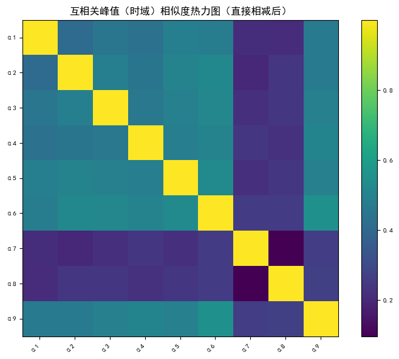

### 协方差（时域）热力图

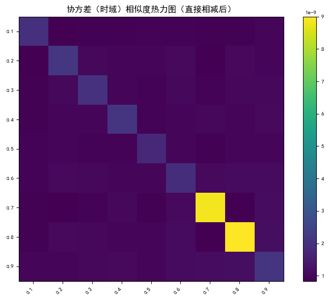

### 频谱余弦相似度（频域）热力图

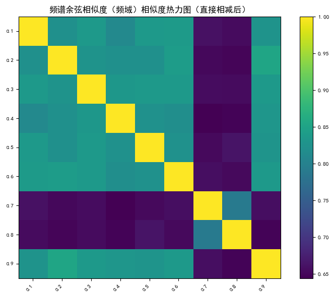

### 频谱皮尔逊相关（频域）热力图

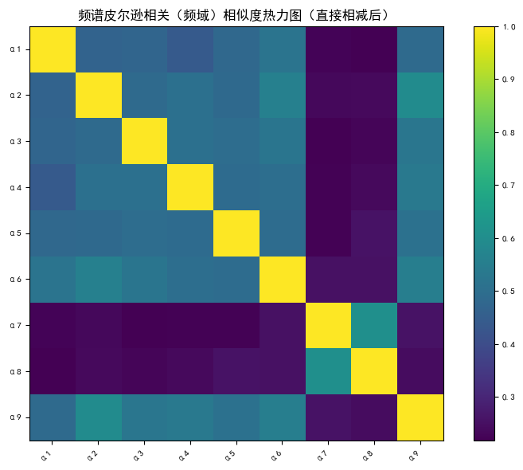

### 频谱相干性（频域）热力图

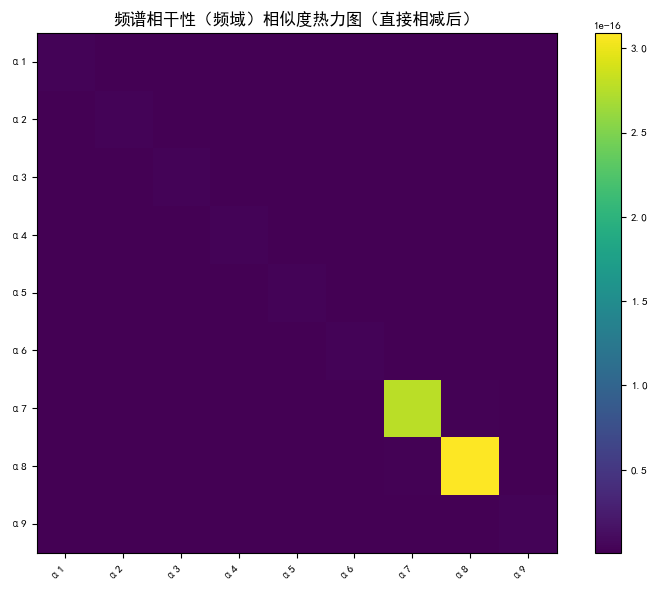

---

### BLOCK 2

## 背景对消-归一化相减-9组数据

> 来源: 背景对消批处理 | 生成时间: 2026-07-01 17:24:10

# 背景对消批处理报告（归一化相减）

> 生成时间: 2026-07-01 17:24:10

**数据组数**: 9

**参数标签**: α1, α2, α3, α4, α5, α6, α7, α8, α9

**采样频率**: 200000 Hz

**计算类型**: 时域+频域

**时域算法**: 互相关系数, 互相关峰值, 协方差

**频域算法**: 频谱余弦相似度, 频谱皮尔逊相关, 频谱相干性

**频域变换算法**: Welch功率谱密度估计（使用FFT计算）

**背景对消算法**: 归一化相减

**背景数据文件**: 20260624135520.858716-1.tdms

---

## 实验状态列表

| 编号 | 标签 | α值 | KW值 | 电压 | 实验数据文件 | 背景数据文件 |

|------|------|-----|------|------|--------------|--------------|

| 1 | α1 | 0.1 | 100 | 20V | 20260624111409.730223-1.tdms | 20260624135520.858716-1.tdms |

| 2 | α2 | 0.2 | 120 | 22V | 20260624111233.451147-1.tdms | 20260624135520.858716-1.tdms |

| 3 | α3 | 0.3 | 140 | 24V | 20260624111513.846692-1.tdms | 20260624135520.858716-1.tdms |

| 4 | α4 | 0.4 | 160 | 26V | 20260624111600.394885-1.tdms | 20260624135520.858716-1.tdms |

| 5 | α5 | 0.5 | 180 | 28V | 20260624111816.858115-1.tdms | 20260624135520.858716-1.tdms |

| 6 | α6 | 0.6 | 200 | 30V | 20260624111724.702410-1.tdms | 20260624135520.858716-1.tdms |

| 7 | α7 | 0.7 | 220 | 32V | 20260624140100.819606-1.tdms | 20260624135520.858716-1.tdms |

| 8 | α8 | 0.8 | 240 | 34V | 20260624135638.040408-1.tdms | 20260624135520.858716-1.tdms |

| 9 | α9 | 0.9 | 260 | 36V | 20260624135415.777303-1.tdms | 20260624135520.858716-1.tdms |

## 第一章：时域分析（背景对消后）

### 1.1 时域波形堆叠图

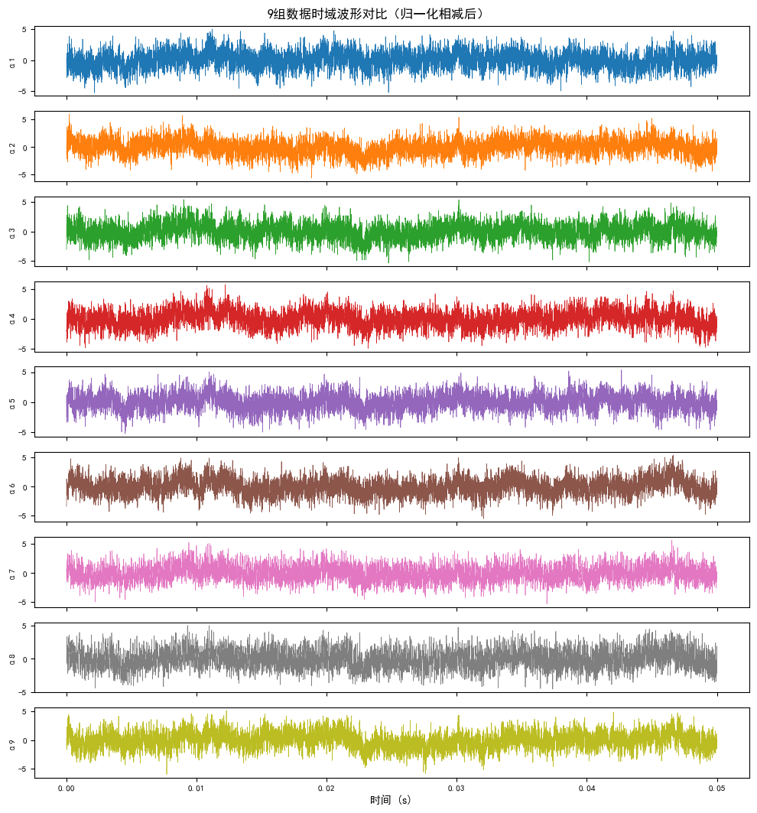

### 1.2 时域相似性计算结果

| 算法 | 组A | 组B | 值 |

|------|-----|-----|----|

| 互相关系数 | α1 | α1 | 1.000000 |

| 互相关峰值 | α1 | α1 | 1.000000 |

| 协方差 | α1 | α1 | 1.874902 |

| 互相关系数 | α1 | α2 | 0.452079 |

| 互相关峰值 | α1 | α2 | 0.452079 |

| 协方差 | α1 | α2 | 0.880959 |

| 互相关系数 | α1 | α3 | 0.477965 |

| 互相关峰值 | α1 | α3 | 0.477965 |

| 协方差 | α1 | α3 | 0.924363 |

| 互相关系数 | α1 | α4 | 0.472977 |

| 互相关峰值 | α1 | α4 | 0.472977 |

| 协方差 | α1 | α4 | 0.908266 |

| 互相关系数 | α1 | α5 | 0.494656 |

| 互相关峰值 | α1 | α5 | 0.494656 |

| 协方差 | α1 | α5 | 0.939024 |

| 互相关系数 | α1 | α6 | 0.480900 |

| 互相关峰值 | α1 | α6 | 0.480900 |

| 协方差 | α1 | α6 | 0.953527 |

| 互相关系数 | α1 | α7 | 0.484620 |

| 互相关峰值 | α1 | α7 | 0.484620 |

| 协方差 | α1 | α7 | 0.932955 |

| 互相关系数 | α1 | α8 | 0.477672 |

| 互相关峰值 | α1 | α8 | 0.477672 |

| 协方差 | α1 | α8 | 0.933042 |

| 互相关系数 | α1 | α9 | 0.493220 |

| 互相关峰值 | α1 | α9 | 0.493220 |

| 协方差 | α1 | α9 | 0.981013 |

| 互相关系数 | α2 | α1 | 0.452079 |

| 互相关峰值 | α2 | α1 | 0.452079 |

| 协方差 | α2 | α1 | 0.880959 |

### 1.3 时域相似度矩阵（9×9）

#### 互相关系数（时域）

**算法**: 互相关系数

| | α1 | α2 | α3 | α4 | α5 | α6 | α7 | α8 | α9 |
|----|----|----|----|----|----|----|----|----|
| α1 | 1.0000 | 0.4521 | 0.4780 | 0.4730 | 0.4947 | 0.4809 | 0.4846 | 0.4777 | 0.4932 |
| α2 | 0.4521 | 1.0000 | 0.5174 | 0.4896 | 0.5111 | 0.5263 | 0.4851 | 0.5116 | 0.4954 |
| α3 | 0.4780 | 0.5174 | 1.0000 | 0.4897 | 0.4925 | 0.5101 | 0.4948 | 0.5057 | 0.5058 |
| α4 | 0.4730 | 0.4896 | 0.4897 | 1.0000 | 0.4947 | 0.5073 | 0.5108 | 0.4946 | 0.5254 |
| α5 | 0.4947 | 0.5111 | 0.4925 | 0.4947 | 1.0000 | 0.5000 | 0.4822 | 0.4911 | 0.4839 |
| α6 | 0.4809 | 0.5263 | 0.5101 | 0.5073 | 0.5000 | 1.0000 | 0.5251 | 0.5173 | 0.5383 |
| α7 | 0.4846 | 0.4851 | 0.4948 | 0.5108 | 0.4822 | 0.5251 | 1.0000 | 0.4939 | 0.5321 |
| α8 | 0.4777 | 0.5116 | 0.5057 | 0.4946 | 0.4911 | 0.5173 | 0.4939 | 1.0000 | 0.5326 |
| α9 | 0.4932 | 0.4954 | 0.5058 | 0.5254 | 0.4839 | 0.5383 | 0.5321 | 0.5326 | 1.0000 |

#### 互相关峰值（时域）

**算法**: 互相关峰值

| | α1 | α2 | α3 | α4 | α5 | α6 | α7 | α8 | α9 |
|----|----|----|----|----|----|----|----|----|
| α1 | 1.0000 | 0.4521 | 0.4780 | 0.4730 | 0.4947 | 0.4809 | 0.4846 | 0.4777 | 0.4932 |
| α2 | 0.4521 | 1.0000 | 0.5174 | 0.4896 | 0.5111 | 0.5263 | 0.4851 | 0.5116 | 0.4954 |
| α3 | 0.4780 | 0.5174 | 1.0000 | 0.4897 | 0.4925 | 0.5101 | 0.4948 | 0.5057 | 0.5058 |
| α4 | 0.4730 | 0.4896 | 0.4897 | 1.0000 | 0.4947 | 0.5073 | 0.5108 | 0.4946 | 0.5254 |
| α5 | 0.4947 | 0.5111 | 0.4925 | 0.4947 | 1.0000 | 0.5000 | 0.4822 | 0.4911 | 0.4839 |
| α6 | 0.4809 | 0.5263 | 0.5101 | 0.5073 | 0.5000 | 1.0000 | 0.5251 | 0.5173 | 0.5383 |
| α7 | 0.4846 | 0.4851 | 0.4948 | 0.5108 | 0.4822 | 0.5251 | 1.0000 | 0.4939 | 0.5321 |
| α8 | 0.4777 | 0.5116 | 0.5057 | 0.4946 | 0.4911 | 0.5173 | 0.4939 | 1.0000 | 0.5326 |
| α9 | 0.4932 | 0.4954 | 0.5058 | 0.5254 | 0.4839 | 0.5383 | 0.5321 | 0.5326 | 1.0000 |

#### 协方差（时域）

**算法**: 协方差

| | α1 | α2 | α3 | α4 | α5 | α6 | α7 | α8 | α9 |
|----|----|----|----|----|----|----|----|----|
| α1 | 1.8749 | 0.8810 | 0.9244 | 0.9083 | 0.9390 | 0.9535 | 0.9330 | 0.9330 | 0.9810 |
| α2 | 0.8810 | 2.0254 | 1.0400 | 0.9771 | 1.0085 | 1.0847 | 0.9706 | 1.0386 | 1.0242 |
| α3 | 0.9244 | 1.0400 | 1.9949 | 0.9701 | 0.9643 | 1.0434 | 0.9826 | 1.0188 | 1.0378 |
| α4 | 0.9083 | 0.9771 | 0.9701 | 1.9668 | 0.9619 | 1.0303 | 1.0072 | 0.9896 | 1.0704 |
| α5 | 0.9390 | 1.0085 | 0.9643 | 0.9619 | 1.9221 | 1.0037 | 0.9398 | 0.9712 | 0.9745 |
| α6 | 0.9535 | 1.0847 | 1.0434 | 1.0303 | 1.0037 | 2.0969 | 1.0691 | 1.0685 | 1.1322 |
| α7 | 0.9330 | 0.9706 | 0.9826 | 1.0072 | 0.9398 | 1.0691 | 1.9767 | 0.9906 | 1.0867 |
| α8 | 0.9330 | 1.0386 | 1.0188 | 0.9896 | 0.9712 | 1.0685 | 0.9906 | 2.0350 | 1.1037 |
| α9 | 0.9810 | 1.0242 | 1.0378 | 1.0704 | 0.9745 | 1.1322 | 1.0867 | 1.1037 | 2.1100 |

## 第二章：频域分析（背景对消后）

### 2.1 频域波形堆叠图

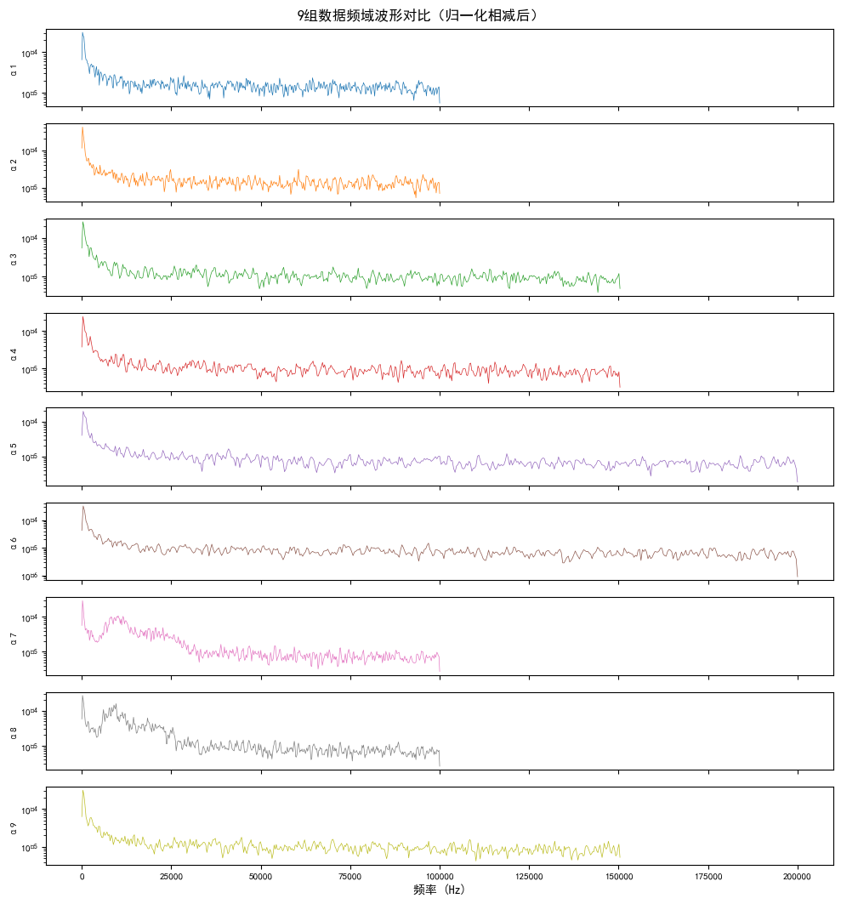

### 2.2 频域相似性计算结果

| 算法 | 组A | 组B | 值 |

|------|-----|-----|----|

| 频谱余弦相似度 | α1 | α1 | 1.000000 |

| 频谱皮尔逊相关 | α1 | α1 | 1.000000 |

| 频谱相干性 | α1 | α1 | 0.689181 |

| 频谱余弦相似度 | α1 | α2 | 0.829682 |

| 频谱皮尔逊相关 | α1 | α2 | 0.485621 |

| 频谱相干性 | α1 | α2 | 0.181433 |

| 频谱余弦相似度 | α1 | α3 | 0.841225 |

| 频谱皮尔逊相关 | α1 | α3 | 0.490764 |

| 频谱相干性 | α1 | α3 | 0.174610 |

| 频谱余弦相似度 | α1 | α4 | 0.819954 |

| 频谱皮尔逊相关 | α1 | α4 | 0.460598 |

| 频谱相干性 | α1 | α4 | 0.169910 |

| 频谱余弦相似度 | α1 | α5 | 0.835949 |

| 频谱皮尔逊相关 | α1 | α5 | 0.485349 |

| 频谱相干性 | α1 | α5 | 0.181213 |

| 频谱余弦相似度 | α1 | α6 | 0.837240 |

| 频谱皮尔逊相关 | α1 | α6 | 0.518005 |

| 频谱相干性 | α1 | α6 | 0.174262 |

| 频谱余弦相似度 | α1 | α7 | 0.799189 |

| 频谱皮尔逊相关 | α1 | α7 | 0.438593 |

| 频谱相干性 | α1 | α7 | 0.201192 |

| 频谱余弦相似度 | α1 | α8 | 0.788419 |

| 频谱皮尔逊相关 | α1 | α8 | 0.416815 |

| 频谱相干性 | α1 | α8 | 0.203715 |

| 频谱余弦相似度 | α1 | α9 | 0.830118 |

| 频谱皮尔逊相关 | α1 | α9 | 0.499603 |

| 频谱相干性 | α1 | α9 | 0.179967 |

| 频谱余弦相似度 | α2 | α1 | 0.829682 |

| 频谱皮尔逊相关 | α2 | α1 | 0.485621 |

| 频谱相干性 | α2 | α1 | 0.181433 |

### 2.3 频域相似度矩阵（9×9）

#### 频谱余弦相似度（频域）

**算法**: 频谱余弦相似度

| | α1 | α2 | α3 | α4 | α5 | α6 | α7 | α8 | α9 |
|----|----|----|----|----|----|----|----|----|
| α1 | 1.0000 | 0.8297 | 0.8412 | 0.8200 | 0.8359 | 0.8372 | 0.7992 | 0.7884 | 0.8301 |
| α2 | 0.8297 | 1.0000 | 0.8343 | 0.8322 | 0.8250 | 0.8420 | 0.7999 | 0.7981 | 0.8579 |
| α3 | 0.8412 | 0.8343 | 1.0000 | 0.8385 | 0.8380 | 0.8355 | 0.7972 | 0.7950 | 0.8399 |
| α4 | 0.8200 | 0.8322 | 0.8385 | 1.0000 | 0.8265 | 0.8202 | 0.7866 | 0.7891 | 0.8360 |
| α5 | 0.8359 | 0.8250 | 0.8380 | 0.8265 | 1.0000 | 0.8175 | 0.7903 | 0.7904 | 0.8270 |
| α6 | 0.8372 | 0.8420 | 0.8355 | 0.8202 | 0.8175 | 1.0000 | 0.7972 | 0.7966 | 0.8319 |
| α7 | 0.7992 | 0.7999 | 0.7972 | 0.7866 | 0.7903 | 0.7972 | 1.0000 | 0.8589 | 0.8041 |
| α8 | 0.7884 | 0.7981 | 0.7950 | 0.7891 | 0.7904 | 0.7966 | 0.8589 | 1.0000 | 0.7974 |
| α9 | 0.8301 | 0.8579 | 0.8399 | 0.8360 | 0.8270 | 0.8319 | 0.8041 | 0.7974 | 1.0000 |

#### 频谱皮尔逊相关（频域）

**算法**: 频谱皮尔逊相关

| | α1 | α2 | α3 | α4 | α5 | α6 | α7 | α8 | α9 |
|----|----|----|----|----|----|----|----|----|
| α1 | 1.0000 | 0.4856 | 0.4908 | 0.4606 | 0.4853 | 0.5180 | 0.4386 | 0.4168 | 0.4996 |
| α2 | 0.4856 | 1.0000 | 0.5079 | 0.5285 | 0.4895 | 0.5600 | 0.4702 | 0.4724 | 0.6062 |
| α3 | 0.4908 | 0.5079 | 1.0000 | 0.5243 | 0.5011 | 0.5204 | 0.4408 | 0.4430 | 0.5360 |
| α4 | 0.4606 | 0.5285 | 0.5243 | 1.0000 | 0.4976 | 0.5025 | 0.4382 | 0.4517 | 0.5485 |
| α5 | 0.4853 | 0.4895 | 0.5011 | 0.4976 | 1.0000 | 0.4764 | 0.4302 | 0.4384 | 0.5064 |
| α6 | 0.5180 | 0.5600 | 0.5204 | 0.5025 | 0.4764 | 1.0000 | 0.4698 | 0.4749 | 0.5408 |
| α7 | 0.4386 | 0.4702 | 0.4408 | 0.4382 | 0.4302 | 0.4698 | 1.0000 | 0.6504 | 0.4900 |
| α8 | 0.4168 | 0.4724 | 0.4430 | 0.4517 | 0.4384 | 0.4749 | 0.6504 | 1.0000 | 0.4790 |
| α9 | 0.4996 | 0.6062 | 0.5360 | 0.5485 | 0.5064 | 0.5408 | 0.4900 | 0.4790 | 1.0000 |

#### 频谱相干性（频域）

**算法**: 频谱相干性

| | α1 | α2 | α3 | α4 | α5 | α6 | α7 | α8 | α9 |
|----|----|----|----|----|----|----|----|----|
| α1 | 0.6892 | 0.1814 | 0.1746 | 0.1699 | 0.1812 | 0.1743 | 0.2012 | 0.2037 | 0.1800 |
| α2 | 0.1814 | 0.6800 | 0.1763 | 0.1772 | 0.1792 | 0.1829 | 0.2045 | 0.2128 | 0.1865 |
| α3 | 0.1746 | 0.1763 | 0.7011 | 0.1678 | 0.1694 | 0.1736 | 0.1960 | 0.1966 | 0.1774 |
| α4 | 0.1699 | 0.1772 | 0.1678 | 0.6709 | 0.1675 | 0.1695 | 0.1976 | 0.1988 | 0.1767 |
| α5 | 0.1812 | 0.1792 | 0.1694 | 0.1675 | 0.6809 | 0.1805 | 0.2031 | 0.2053 | 0.1854 |
| α6 | 0.1743 | 0.1829 | 0.1736 | 0.1695 | 0.1805 | 0.6845 | 0.2029 | 0.1996 | 0.1833 |
| α7 | 0.2012 | 0.2045 | 0.1960 | 0.1976 | 0.2031 | 0.2029 | 0.5370 | 0.2397 | 0.2110 |
| α8 | 0.2037 | 0.2128 | 0.1966 | 0.1988 | 0.2053 | 0.1996 | 0.2397 | 0.5297 | 0.2139 |
| α9 | 0.1800 | 0.1865 | 0.1774 | 0.1767 | 0.1854 | 0.1833 | 0.2110 | 0.2139 | 0.6943 |

## 第三章：热力图可视化（背景对消后）

### 互相关系数（时域）热力图

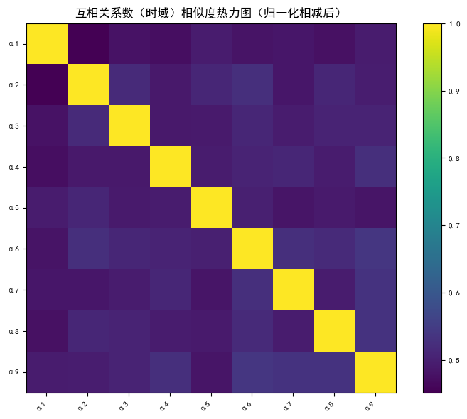

### 互相关峰值（时域）热力图

### 协方差（时域）热力图

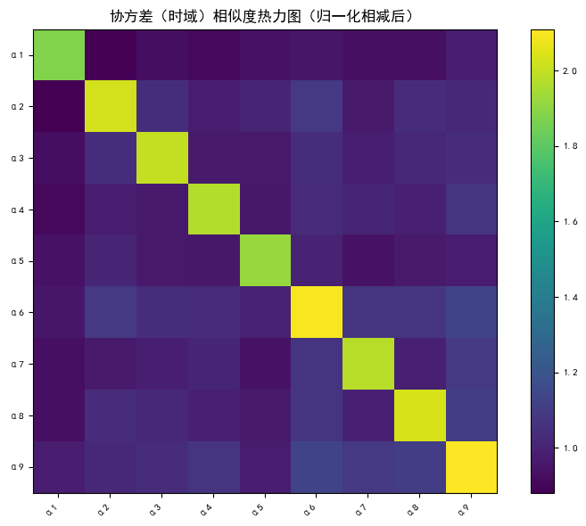

### 频谱余弦相似度（频域）热力图

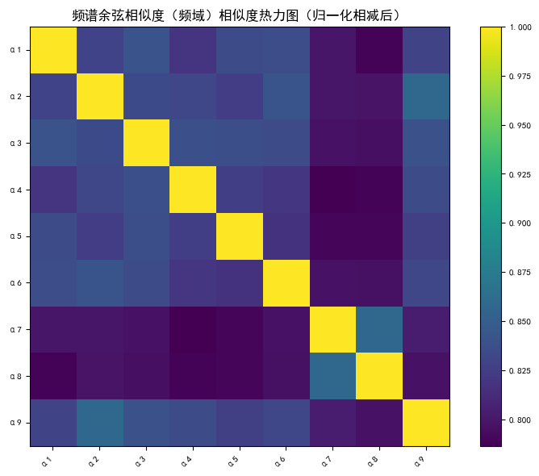

### 频谱皮尔逊相关（频域）热力图

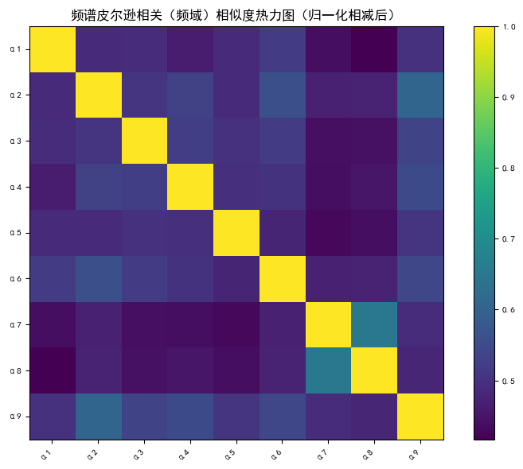

### 频谱相干性（频域）热力图

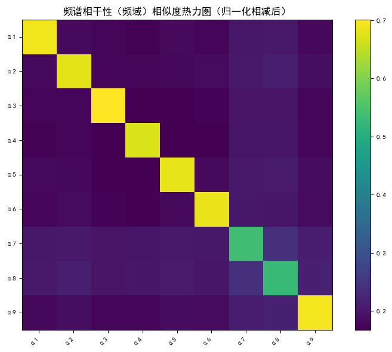

---
