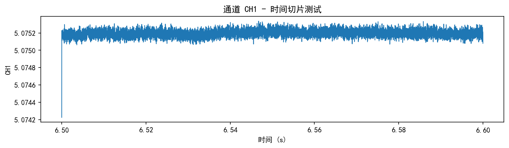
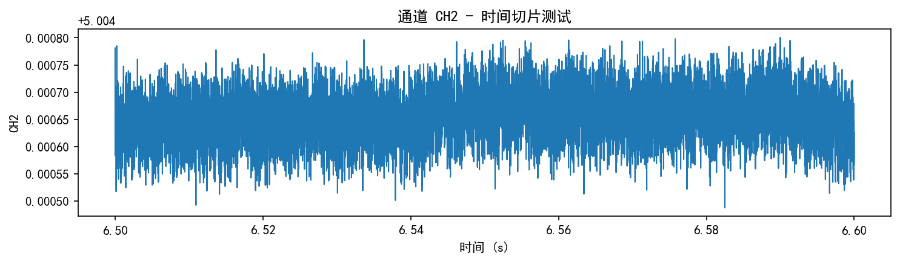

# NPMEMS_TC12 实验报告

> 生成时间: 2026-07-16 14:45:03

---

### BLOCK 1

## 时间切片测试报告

> 来源: 时间切片测试 | 生成时间: 2026-07-16 14:44:49

## 时间切片测试报告

### 实验状态定义

| 序号 | 状态名称 | 报告BLOCK序号 | 类型 | α | K | 电压 | 数据文件 |
| --- | --- | --- | --- | --- | --- | --- | --- |
| 1 | 状态A | 状态A202607161444处理数据 | TC12 | 0.1 | 1.0 | 5V | file1.tdms |
| 2 | 状态B | 状态B202607161444处理数据 | TC12 | 0.2 | 2.0 | 10V | file2.tdms |
| 3 | 状态C | 状态C202607161444处理数据 | TC34 | 0.3 | 3.0 | 15V | file3.tdms |
**第一时间切片**: 6.0s - 10.0s
**第二时间切片**: 6.5s - 6.6s

#### 通道 CH1

#### 通道 CH2

---

### BLOCK 2

## Tab8实验状态关联测试报告

> 来源: Tab8状态关联测试 | 生成时间: 2026-07-16 14:45:03

## Tab8实验状态关联测试

### 实验状态定义

| 序号 | 状态名称 | 报告BLOCK序号 | 类型 | α | K | 电压 | 数据文件 |
| --- | --- | --- | --- | --- | --- | --- | --- |
| 1 | 状态A | 状态A202607161444处理数据 | TC12 | 0.1 | 1.0 | 5V | file1.tdms |
| 2 | 状态B | 状态B202607161444处理数据 | TC12 | 0.2 | 2.0 | 10V | file2.tdms |
| 3 | 状态C | 状态C202607161444处理数据 | TC34 | 0.3 | 3.0 | 15V | file3.tdms |
**实验组关联状态**: 状态A
**背景组关联状态**: 状态B
**关联结果**: 成功 ✅

---
