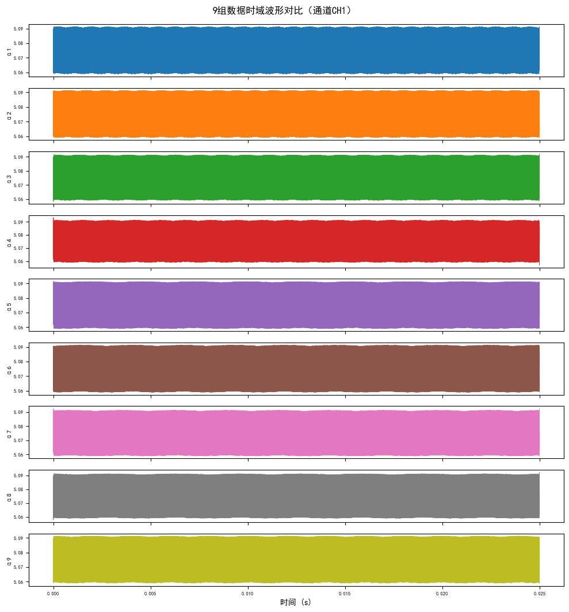
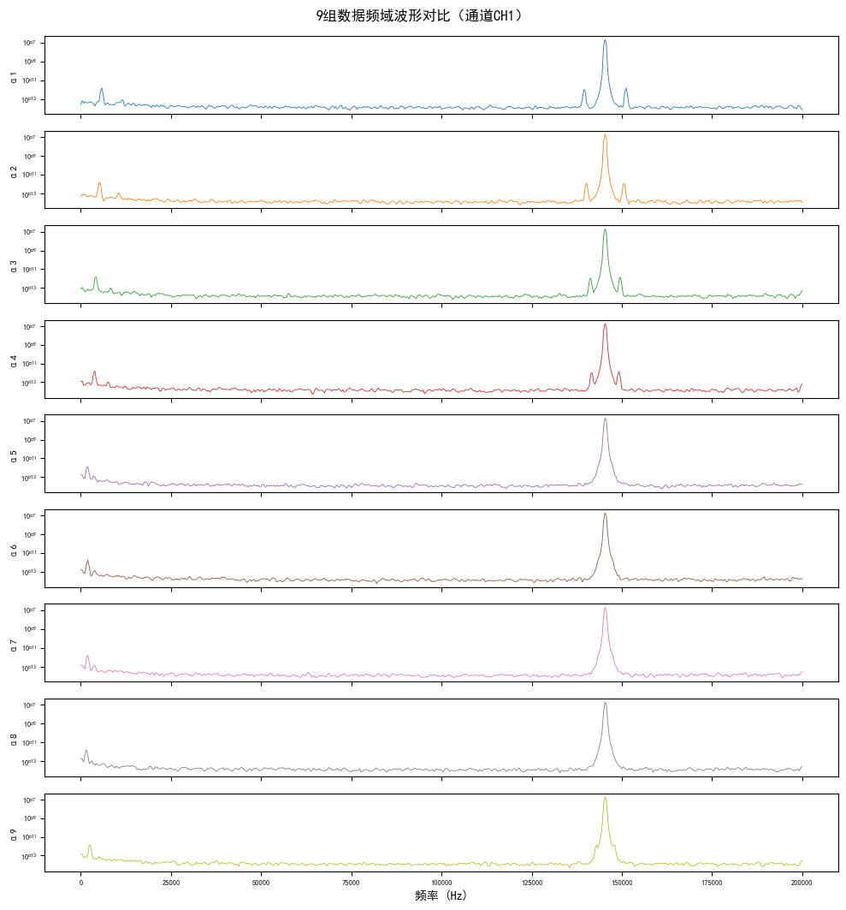
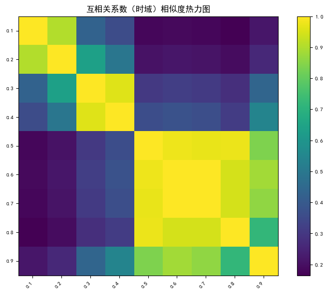
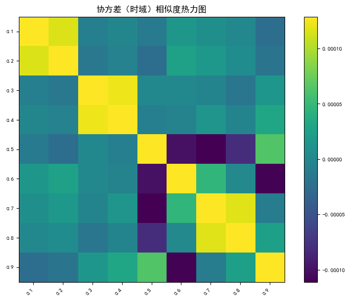
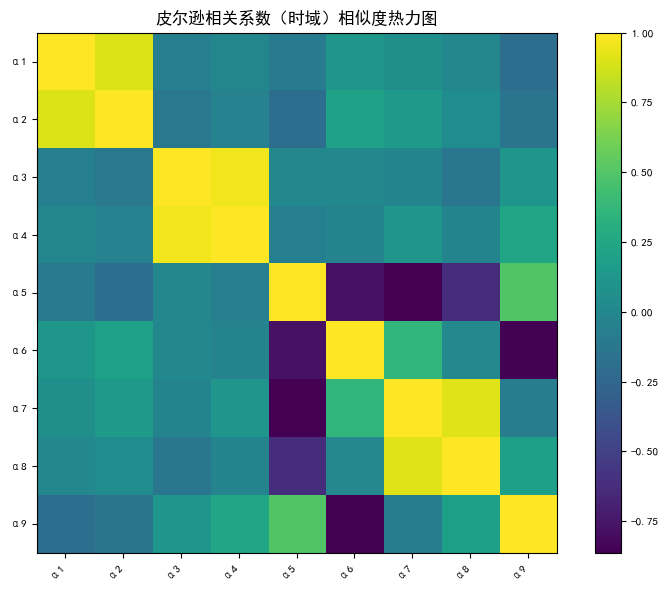
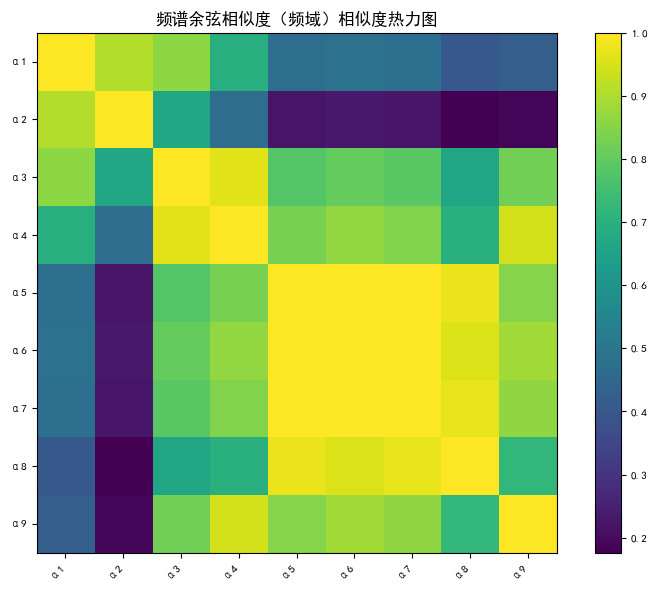
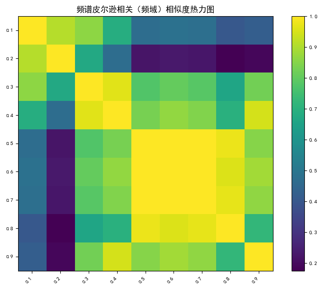
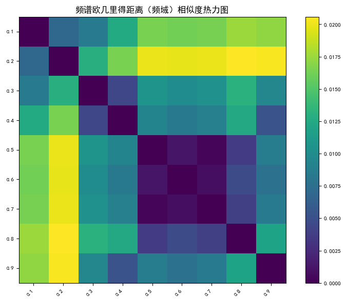
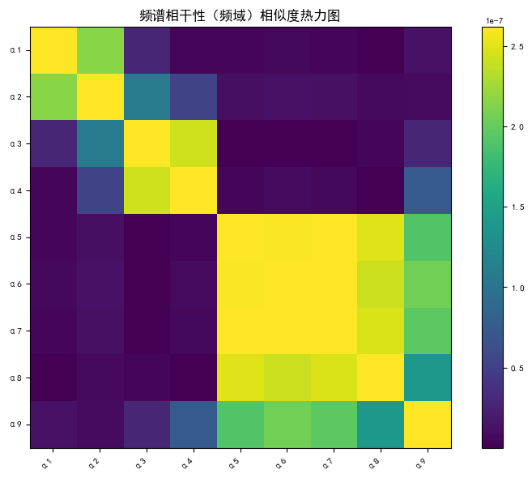

# NPMEMS_TC12 实验报告

> 生成时间: 2026-07-01 16:43:15

---

### BLOCK 1

## 批量对比-α1, α2, α3, α4, α5, α6, α7, α8, α9

> 来源: 批量参数对比 | 生成时间: 2026-07-01 16:43:15

# 批量参数对比报告

> 生成时间: 2026-07-01 16:43:11

## 实验状态列表

| 编号 | 标签 | α值 | KW值 | 电压 | 数据文件 |
|------|------|-----|------|------|----------|
| 1 | α1 | 0.1 | 100 | 20V | 20260615170256.394205-1.tdms |
| 2 | α2 | 0.2 | 120 | 22V | 20260615170339.919846-1.tdms |
| 3 | α3 | 0.3 | 140 | 24V | 20260615170713.753352-1.tdms |
| 4 | α4 | 0.4 | 160 | 26V | 20260615170843.809415-1.tdms |
| 5 | α5 | 0.5 | 180 | 28V | 20260615172047.258344-1.tdms |
| 6 | α6 | 0.6 | 200 | 30V | 20260615172116.137363-1.tdms |
| 7 | α7 | 0.7 | 220 | 32V | 20260615172227.969817-1.tdms |
| 8 | α8 | 0.8 | 240 | 34V | 20260615172259.129469-1.tdms |
| 9 | α9 | 0.9 | 260 | 36V | 20260615171327.697381-1.tdms |

## 实验信息

| 参数 | 值 |
|------|----|
| 数据组数 | 9 |
| 参数标签 | α1, α2, α3, α4, α5, α6, α7, α8, α9 |
| 采样频率 | 400000 Hz |
| 计算类型 | 时域+频域 |
| 时域算法 | 互相关系数, 互相关峰值, 协方差, 皮尔逊相关系数 |
| 频域算法 | 频谱余弦相似度, 频谱皮尔逊相关, 频谱欧几里得距离, 频谱相干性 |
| 频域变换算法 | Welch功率谱密度估计（使用FFT计算） |

## 第一章：时域分析

### 1.1 时域波形堆叠图

### 1.2 时域相似性计算结果

| 算法 | 组A | 组B | 值 |
|------|-----|-----|----|
| 互相关系数 | α1 | α1 | 1.000000 |
| 互相关峰值 | α1 | α1 | 1.000000 |
| 协方差 | α1 | α1 | 0.000128 |
| 皮尔逊相关系数 | α1 | α1 | 1.000000 |
| 互相关系数 | α1 | α2 | 0.904360 |
| 互相关峰值 | α1 | α2 | 0.904360 |
| 协方差 | α1 | α2 | 0.000116 |
| 皮尔逊相关系数 | α1 | α2 | 0.904360 |
| 互相关系数 | α1 | α3 | 0.428244 |
| 互相关峰值 | α1 | α3 | 0.428244 |
| 协方差 | α1 | α3 | -0.000008 |
| 皮尔逊相关系数 | α1 | α3 | -0.058498 |
| 互相关系数 | α1 | α4 | 0.360039 |
| 互相关峰值 | α1 | α4 | 0.360207 |
| 协方差 | α1 | α4 | -0.000001 |
| 皮尔逊相关系数 | α1 | α4 | -0.010099 |
| 互相关系数 | α1 | α5 | 0.179760 |
| 互相关峰值 | α1 | α5 | 0.179760 |
| 协方差 | α1 | α5 | -0.000012 |
| 皮尔逊相关系数 | α1 | α5 | -0.096523 |
| 互相关系数 | α1 | α6 | 0.184479 |
| 互相关峰值 | α1 | α6 | 0.184867 |
| 协方差 | α1 | α6 | 0.000016 |
| 皮尔逊相关系数 | α1 | α6 | 0.126193 |
| 互相关系数 | α1 | α7 | 0.179677 |
| 互相关峰值 | α1 | α7 | 0.180055 |
| 协方差 | α1 | α7 | 0.000009 |
| 皮尔逊相关系数 | α1 | α7 | 0.066268 |
| 互相关系数 | α1 | α8 | 0.164665 |
| 互相关峰值 | α1 | α8 | 0.164935 |

### 1.3 时域相似度矩阵（9×9）

#### 互相关系数

| | α1 | α2 | α3 | α4 | α5 | α6 | α7 | α8 | α9 |
|----|----|----|----|----|----|----|----|----|
| α1 | 1.0000 | 0.9044 | 0.4282 | 0.3600 | 0.1798 | 0.1845 | 0.1797 | 0.1647 | 0.2138 |
| α2 | 0.9044 | 1.0000 | 0.6392 | 0.4914 | 0.2067 | 0.2141 | 0.2086 | 0.1914 | 0.2623 |
| α3 | 0.4282 | 0.6392 | 1.0000 | 0.9576 | 0.3041 | 0.3200 | 0.3078 | 0.2776 | 0.4384 |
| α4 | 0.3600 | 0.4914 | 0.9576 | 1.0000 | 0.3624 | 0.3745 | 0.3660 | 0.3123 | 0.5408 |
| α5 | 0.1798 | 0.2067 | 0.3041 | 0.3624 | 1.0000 | 0.9796 | 0.9715 | 0.9744 | 0.8378 |
| α6 | 0.1845 | 0.2141 | 0.3200 | 0.3745 | 0.9796 | 1.0000 | 0.9968 | 0.9451 | 0.8845 |
| α7 | 0.1797 | 0.2086 | 0.3078 | 0.3660 | 0.9715 | 0.9968 | 1.0000 | 0.9476 | 0.8611 |
| α8 | 0.1647 | 0.1914 | 0.2776 | 0.3123 | 0.9744 | 0.9451 | 0.9476 | 1.0000 | 0.7175 |
| α9 | 0.2138 | 0.2623 | 0.4384 | 0.5408 | 0.8378 | 0.8845 | 0.8611 | 0.7175 | 1.0000 |

#### 互相关峰值

| | α1 | α2 | α3 | α4 | α5 | α6 | α7 | α8 | α9 |
|----|----|----|----|----|----|----|----|----|
| α1 | 1.0000 | 0.9044 | 0.4282 | 0.3602 | 0.1798 | 0.1849 | 0.1801 | 0.1649 | 0.2145 |
| α2 | 0.9044 | 1.0000 | 0.6392 | 0.4914 | 0.2069 | 0.2141 | 0.2086 | 0.1928 | 0.2628 |
| α3 | 0.4282 | 0.6392 | 1.0000 | 0.9576 | 0.3041 | 0.3200 | 0.3078 | 0.2776 | 0.4390 |
| α4 | 0.3602 | 0.4914 | 0.9576 | 1.0000 | 0.3638 | 0.3745 | 0.3660 | 0.3135 | 0.5413 |
| α5 | 0.1798 | 0.2069 | 0.3041 | 0.3638 | 1.0000 | 0.9921 | 0.9984 | 0.9744 | 0.8469 |
| α6 | 0.1849 | 0.2141 | 0.3200 | 0.3745 | 0.9921 | 1.0000 | 0.9968 | 0.9495 | 0.8845 |
| α7 | 0.1801 | 0.2086 | 0.3078 | 0.3660 | 0.9984 | 0.9968 | 1.0000 | 0.9670 | 0.8611 |
| α8 | 0.1649 | 0.1928 | 0.2776 | 0.3135 | 0.9744 | 0.9495 | 0.9670 | 1.0000 | 0.7182 |
| α9 | 0.2145 | 0.2628 | 0.4390 | 0.5413 | 0.8469 | 0.8845 | 0.8611 | 0.7182 | 1.0000 |

#### 协方差

| | α1 | α2 | α3 | α4 | α5 | α6 | α7 | α8 | α9 |
|----|----|----|----|----|----|----|----|----|
| α1 | 0.0001 | 0.0001 | -0.0000 | -0.0000 | -0.0000 | 0.0000 | 0.0000 | 0.0000 | -0.0000 |
| α2 | 0.0001 | 0.0001 | -0.0000 | -0.0000 | -0.0000 | 0.0000 | 0.0000 | 0.0000 | -0.0000 |
| α3 | -0.0000 | -0.0000 | 0.0001 | 0.0001 | 0.0000 | 0.0000 | -0.0000 | -0.0000 | 0.0000 |
| α4 | -0.0000 | -0.0000 | 0.0001 | 0.0001 | -0.0000 | -0.0000 | 0.0000 | -0.0000 | 0.0000 |
| α5 | -0.0000 | -0.0000 | 0.0000 | -0.0000 | 0.0001 | -0.0001 | -0.0001 | -0.0001 | 0.0001 |
| α6 | 0.0000 | 0.0000 | 0.0000 | -0.0000 | -0.0001 | 0.0001 | 0.0000 | 0.0000 | -0.0001 |
| α7 | 0.0000 | 0.0000 | -0.0000 | 0.0000 | -0.0001 | 0.0000 | 0.0001 | 0.0001 | -0.0000 |
| α8 | 0.0000 | 0.0000 | -0.0000 | -0.0000 | -0.0001 | 0.0000 | 0.0001 | 0.0001 | 0.0000 |
| α9 | -0.0000 | -0.0000 | 0.0000 | 0.0000 | 0.0001 | -0.0001 | -0.0000 | 0.0000 | 0.0001 |

#### 皮尔逊相关系数

| | α1 | α2 | α3 | α4 | α5 | α6 | α7 | α8 | α9 |
|----|----|----|----|----|----|----|----|----|
| α1 | 1.0000 | 0.9044 | -0.0585 | -0.0101 | -0.0965 | 0.1262 | 0.0663 | 0.0096 | -0.1909 |
| α2 | 0.9044 | 1.0000 | -0.1197 | -0.0343 | -0.1914 | 0.2033 | 0.1342 | 0.0464 | -0.1495 |
| α3 | -0.0585 | -0.1197 | 1.0000 | 0.9576 | 0.0073 | 0.0095 | -0.0247 | -0.1341 | 0.1137 |
| α4 | -0.0101 | -0.0343 | 0.9576 | 1.0000 | -0.0595 | -0.0330 | 0.1092 | -0.0188 | 0.2406 |
| α5 | -0.0965 | -0.1914 | 0.0073 | -0.0595 | 1.0000 | -0.7825 | -0.8629 | -0.6173 | 0.4945 |
| α6 | 0.1262 | 0.2033 | 0.0095 | -0.0330 | -0.7825 | 1.0000 | 0.3640 | 0.0161 | -0.8507 |
| α7 | 0.0663 | 0.1342 | -0.0247 | 0.1092 | -0.8629 | 0.3640 | 1.0000 | 0.9090 | -0.0802 |
| α8 | 0.0096 | 0.0464 | -0.1341 | -0.0188 | -0.6173 | 0.0161 | 0.9090 | 1.0000 | 0.1855 |
| α9 | -0.1909 | -0.1495 | 0.1137 | 0.2406 | 0.4945 | -0.8507 | -0.0802 | 0.1855 | 1.0000 |

## 第二章：频域分析

### 2.1 频域波形堆叠图

### 2.2 频域相似性计算结果

| 算法 | 组A | 组B | 值 |
|------|-----|-----|----|
| 频谱余弦相似度 | α1 | α1 | 1.000000 |
| 频谱皮尔逊相关 | α1 | α1 | 1.000000 |
| 频谱欧几里得距离 | α1 | α1 | 0.000000 |
| 频谱相干性 | α1 | α1 | 0.000000 |
| 频谱余弦相似度 | α1 | α2 | 0.906318 |
| 频谱皮尔逊相关 | α1 | α2 | 0.907319 |
| 频谱欧几里得距离 | α1 | α2 | 0.006936 |
| 频谱相干性 | α1 | α2 | 0.000000 |
| 频谱余弦相似度 | α1 | α3 | 0.859921 |
| 频谱皮尔逊相关 | α1 | α3 | 0.859178 |
| 频谱欧几里得距离 | α1 | α3 | 0.008483 |
| 频谱相干性 | α1 | α3 | 0.000000 |
| 频谱余弦相似度 | α1 | α4 | 0.691802 |
| 频谱皮尔逊相关 | α1 | α4 | 0.690101 |
| 频谱欧几里得距离 | α1 | α4 | 0.012584 |
| 频谱相干性 | α1 | α4 | 0.000000 |
| 频谱余弦相似度 | α1 | α5 | 0.472561 |
| 频谱皮尔逊相关 | α1 | α5 | 0.469311 |
| 频谱欧几里得距离 | α1 | α5 | 0.016468 |
| 频谱相干性 | α1 | α5 | 0.000000 |
| 频谱余弦相似度 | α1 | α6 | 0.487324 |
| 频谱皮尔逊相关 | α1 | α6 | 0.484166 |
| 频谱欧几里得距离 | α1 | α6 | 0.016236 |
| 频谱相干性 | α1 | α6 | 0.000000 |
| 频谱余弦相似度 | α1 | α7 | 0.478139 |
| 频谱皮尔逊相关 | α1 | α7 | 0.474975 |
| 频谱欧几里得距离 | α1 | α7 | 0.016380 |
| 频谱相干性 | α1 | α7 | 0.000000 |
| 频谱余弦相似度 | α1 | α8 | 0.404159 |
| 频谱皮尔逊相关 | α1 | α8 | 0.400889 |

### 2.3 频域相似度矩阵（9×9）

#### 频谱余弦相似度

| | α1 | α2 | α3 | α4 | α5 | α6 | α7 | α8 | α9 |
|----|----|----|----|----|----|----|----|----|
| α1 | 1.0000 | 0.9063 | 0.8599 | 0.6918 | 0.4726 | 0.4873 | 0.4781 | 0.4042 | 0.4241 |
| α2 | 0.9063 | 1.0000 | 0.6717 | 0.4717 | 0.2222 | 0.2340 | 0.2256 | 0.1763 | 0.1903 |
| α3 | 0.8599 | 0.6717 | 1.0000 | 0.9620 | 0.7782 | 0.8059 | 0.7879 | 0.6638 | 0.8239 |
| α4 | 0.6918 | 0.4717 | 0.9620 | 1.0000 | 0.8321 | 0.8662 | 0.8439 | 0.6993 | 0.9460 |
| α5 | 0.4726 | 0.2222 | 0.7782 | 0.8321 | 1.0000 | 0.9975 | 0.9997 | 0.9754 | 0.8510 |
| α6 | 0.4873 | 0.2340 | 0.8059 | 0.8662 | 0.9975 | 1.0000 | 0.9988 | 0.9576 | 0.8849 |
| α7 | 0.4781 | 0.2256 | 0.7879 | 0.8439 | 0.9997 | 0.9988 | 1.0000 | 0.9701 | 0.8626 |
| α8 | 0.4042 | 0.1763 | 0.6638 | 0.6993 | 0.9754 | 0.9576 | 0.9701 | 1.0000 | 0.7222 |
| α9 | 0.4241 | 0.1903 | 0.8239 | 0.9460 | 0.8510 | 0.8849 | 0.8626 | 0.7222 | 1.0000 |

#### 频谱皮尔逊相关

| | α1 | α2 | α3 | α4 | α5 | α6 | α7 | α8 | α9 |
|----|----|----|----|----|----|----|----|----|
| α1 | 1.0000 | 0.9073 | 0.8592 | 0.6901 | 0.4693 | 0.4842 | 0.4750 | 0.4009 | 0.4216 |
| α2 | 0.9073 | 1.0000 | 0.6726 | 0.4716 | 0.2213 | 0.2332 | 0.2247 | 0.1753 | 0.1894 |
| α3 | 0.8592 | 0.6726 | 1.0000 | 0.9618 | 0.7764 | 0.8044 | 0.7863 | 0.6616 | 0.8232 |
| α4 | 0.6901 | 0.4716 | 0.9618 | 1.0000 | 0.8310 | 0.8653 | 0.8429 | 0.6975 | 0.9458 |
| α5 | 0.4693 | 0.2213 | 0.7764 | 0.8310 | 1.0000 | 0.9974 | 0.9997 | 0.9753 | 0.8504 |
| α6 | 0.4842 | 0.2332 | 0.8044 | 0.8653 | 0.9974 | 1.0000 | 0.9988 | 0.9573 | 0.8846 |
| α7 | 0.4750 | 0.2247 | 0.7863 | 0.8429 | 0.9997 | 0.9988 | 1.0000 | 0.9699 | 0.8621 |
| α8 | 0.4009 | 0.1753 | 0.6616 | 0.6975 | 0.9753 | 0.9573 | 0.9699 | 1.0000 | 0.7208 |
| α9 | 0.4216 | 0.1894 | 0.8232 | 0.9458 | 0.8504 | 0.8846 | 0.8621 | 0.7208 | 1.0000 |

#### 频谱欧几里得距离

| | α1 | α2 | α3 | α4 | α5 | α6 | α7 | α8 | α9 |
|----|----|----|----|----|----|----|----|----|
| α1 | 0.0000 | 0.0069 | 0.0085 | 0.0126 | 0.0165 | 0.0162 | 0.0164 | 0.0175 | 0.0172 |
| α2 | 0.0069 | 0.0000 | 0.0130 | 0.0165 | 0.0200 | 0.0198 | 0.0200 | 0.0206 | 0.0204 |
| α3 | 0.0085 | 0.0130 | 0.0000 | 0.0044 | 0.0107 | 0.0100 | 0.0104 | 0.0132 | 0.0095 |
| α4 | 0.0126 | 0.0165 | 0.0044 | 0.0000 | 0.0093 | 0.0083 | 0.0090 | 0.0124 | 0.0053 |
| α5 | 0.0165 | 0.0200 | 0.0107 | 0.0093 | 0.0000 | 0.0011 | 0.0004 | 0.0036 | 0.0088 |
| α6 | 0.0162 | 0.0198 | 0.0100 | 0.0083 | 0.0011 | 0.0000 | 0.0008 | 0.0047 | 0.0077 |
| α7 | 0.0164 | 0.0200 | 0.0104 | 0.0090 | 0.0004 | 0.0008 | 0.0000 | 0.0039 | 0.0084 |
| α8 | 0.0175 | 0.0206 | 0.0132 | 0.0124 | 0.0036 | 0.0047 | 0.0039 | 0.0000 | 0.0120 |
| α9 | 0.0172 | 0.0204 | 0.0095 | 0.0053 | 0.0088 | 0.0077 | 0.0084 | 0.0120 | 0.0000 |

#### 频谱相干性

| | α1 | α2 | α3 | α4 | α5 | α6 | α7 | α8 | α9 |
|----|----|----|----|----|----|----|----|----|
| α1 | 0.0000 | 0.0000 | 0.0000 | 0.0000 | 0.0000 | 0.0000 | 0.0000 | 0.0000 | 0.0000 |
| α2 | 0.0000 | 0.0000 | 0.0000 | 0.0000 | 0.0000 | 0.0000 | 0.0000 | 0.0000 | 0.0000 |
| α3 | 0.0000 | 0.0000 | 0.0000 | 0.0000 | 0.0000 | 0.0000 | 0.0000 | 0.0000 | 0.0000 |
| α4 | 0.0000 | 0.0000 | 0.0000 | 0.0000 | 0.0000 | 0.0000 | 0.0000 | 0.0000 | 0.0000 |
| α5 | 0.0000 | 0.0000 | 0.0000 | 0.0000 | 0.0000 | 0.0000 | 0.0000 | 0.0000 | 0.0000 |
| α6 | 0.0000 | 0.0000 | 0.0000 | 0.0000 | 0.0000 | 0.0000 | 0.0000 | 0.0000 | 0.0000 |
| α7 | 0.0000 | 0.0000 | 0.0000 | 0.0000 | 0.0000 | 0.0000 | 0.0000 | 0.0000 | 0.0000 |
| α8 | 0.0000 | 0.0000 | 0.0000 | 0.0000 | 0.0000 | 0.0000 | 0.0000 | 0.0000 | 0.0000 |
| α9 | 0.0000 | 0.0000 | 0.0000 | 0.0000 | 0.0000 | 0.0000 | 0.0000 | 0.0000 | 0.0000 |

## 第三章：热力图可视化

### 互相关系数（时域）热力图

### 互相关峰值（时域）热力图

### 协方差（时域）热力图

### 皮尔逊相关系数（时域）热力图

### 频谱余弦相似度（频域）热力图

### 频谱皮尔逊相关（频域）热力图

### 频谱欧几里得距离（频域）热力图

### 频谱相干性（频域）热力图

---
