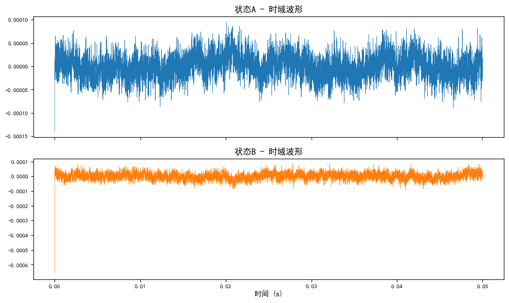
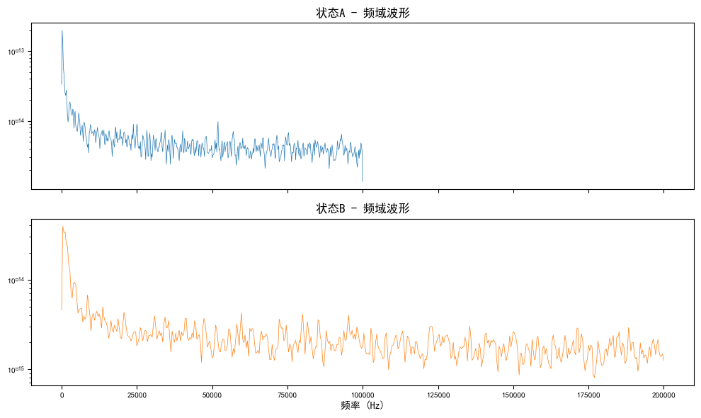
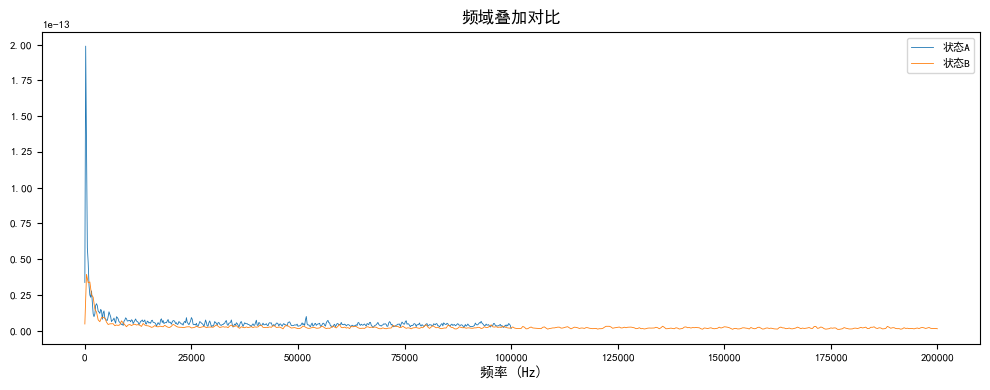
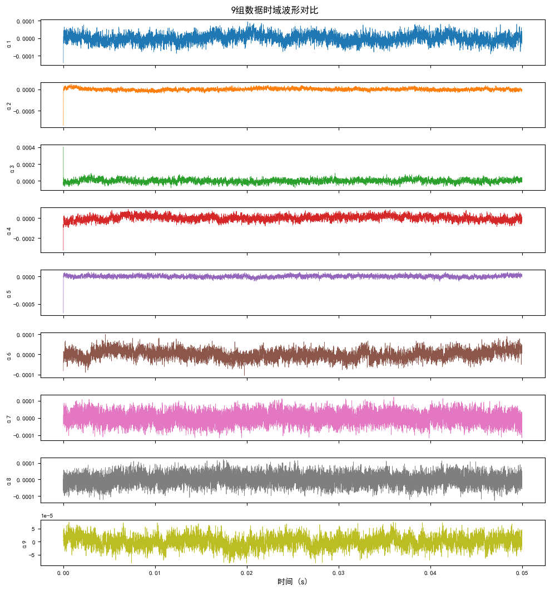
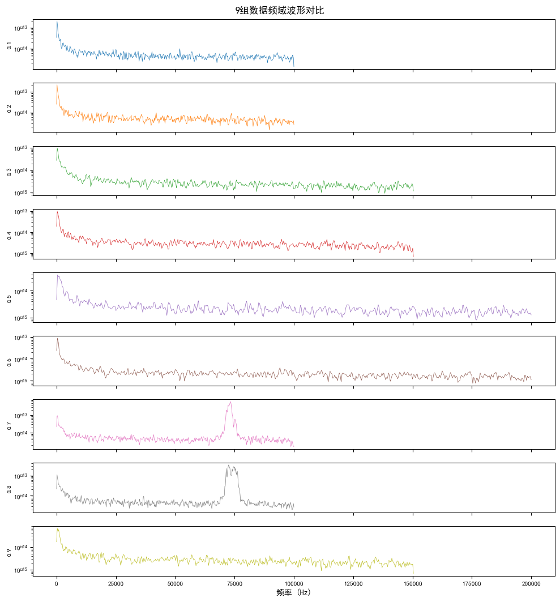
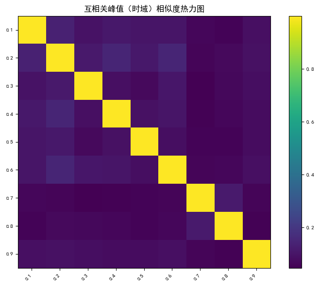
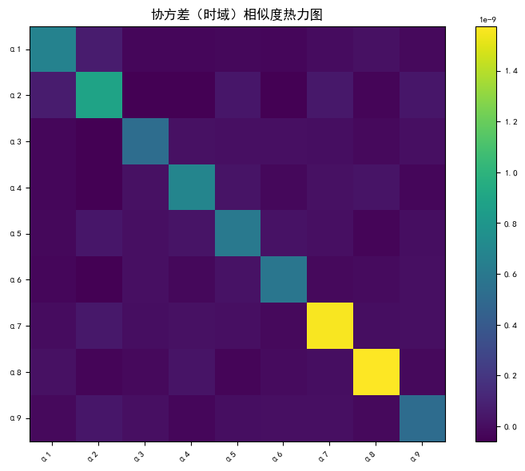
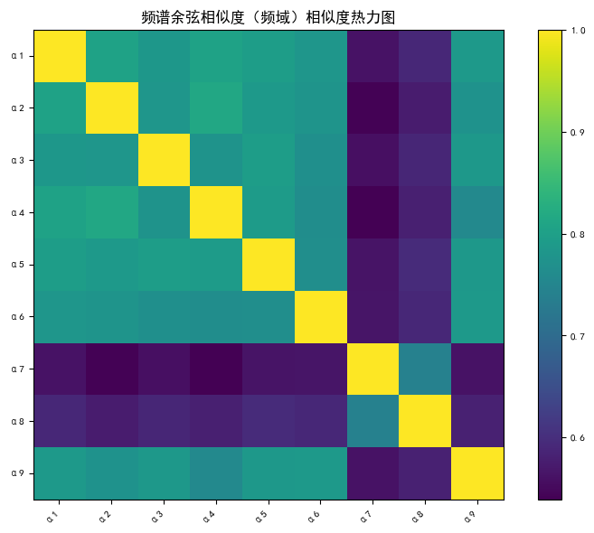
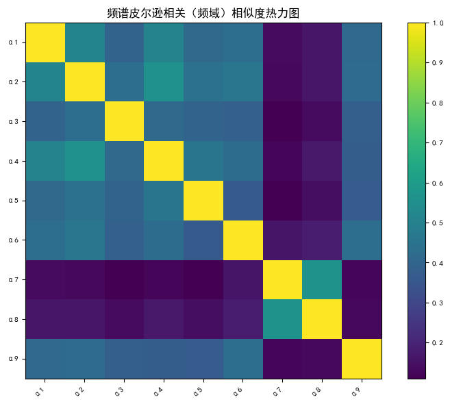
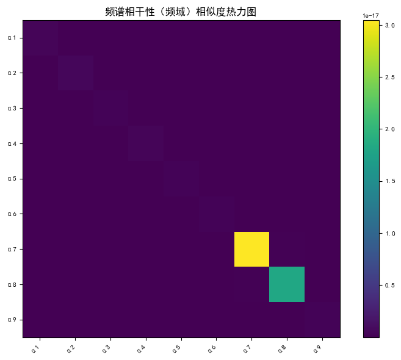

# NPMEMS_TC12 实验报告

> 生成时间: 2026-07-01 16:44:34

---

### BLOCK 1

## Tab1-两组数据时域对比

> 来源: 两组数据时域处理 | 生成时间: 2026-07-01 16:44:28

# Tab1: 两组数据时域对比报告

> 生成时间: 2026-07-01 16:44:28

**数据文件A**: 20260624111642.616704-1.tdms

**数据文件B**: 20260624112103.647930-1.tdms

**采样频率**: 200000 Hz

**实验状态A**: α=α1, KW=100, 电压=20V

**实验状态B**: α=α5, KW=180, 电压=28V

---

## 实验状态列表

| 编号 | 标签 | α值 | KW值 | 电压 | 数据文件 |

|------|------|-----|------|------|----------|

| 1 | α1 | 0.1 | 100 | 20V | 20260624111642.616704-1.tdms |

| 2 | α5 | 0.5 | 180 | 28V | 20260624112103.647930-1.tdms |

## 第一章：时域波形对比

## 第二章：时域相似性计算结果

| 算法 | 相似性值 |

|------|----------|

| 互相关系数 | 0.101373 |

| 互相关峰值 | 0.101372 |

| 协方差 | -0.000000 |

| 余弦相似度 | -0.035986 |

| 欧几里得距离 | 0.003618 |

## 第三章：相似度矩阵（2×2）

### 互相关系数矩阵

| | 状态A | 状态B |

|----|-------|-------|

| 状态A | 1.0000 | 0.1014 |

| 状态B | 0.1014 | 1.0000 |

---

### BLOCK 2

## Tab2-两组数据频域对比

> 来源: 两组数据频域处理 | 生成时间: 2026-07-01 16:44:28

# Tab2: 两组数据频域对比报告

> 生成时间: 2026-07-01 16:44:28

**数据文件A**: 20260624111642.616704-1.tdms

**数据文件B**: 20260624112103.647930-1.tdms

**采样频率**: 200000 Hz

**频域变换算法**: Welch功率谱密度估计（使用FFT计算）

**实验状态A**: α=α1, KW=100, 电压=20V

**实验状态B**: α=α5, KW=180, 电压=28V

---

## 实验状态列表

| 编号 | 标签 | α值 | KW值 | 电压 | 数据文件 |

|------|------|-----|------|------|----------|

| 1 | α1 | 0.1 | 100 | 20V | 20260624111642.616704-1.tdms |

| 2 | α5 | 0.5 | 180 | 28V | 20260624112103.647930-1.tdms |

## 第一章：频域波形对比

## 第二章：频域相似性计算结果

| 算法 | 相似性值 |

|------|----------|

| 频谱余弦相似度 | 0.795898 |

| 频谱皮尔逊相关 | 0.418888 |

| 频谱欧几里得距离 | 0.000023 |

| 频谱能量差 | 0.091239 |

## 第三章：相似度矩阵（2×2）

### 频谱余弦相似度矩阵

| | 状态A | 状态B |

|----|-------|-------|

| 状态A | 1.0000 | 0.7959 |

| 状态B | 0.7959 | 1.0000 |

---

### BLOCK 3

## 批量对比-9组数据

> 来源: 批量参数对比 | 生成时间: 2026-07-01 16:44:34

# 批量参数对比报告

> 生成时间: 2026-07-01 16:44:34

**数据组数**: 9

**参数标签**: α1, α2, α3, α4, α5, α6, α7, α8, α9

**采样频率**: 200000 Hz

**计算类型**: 时域+频域

**时域算法**: 互相关系数, 互相关峰值, 协方差

**频域算法**: 频谱余弦相似度, 频谱皮尔逊相关, 频谱相干性

**频域变换算法**: Welch功率谱密度估计（使用FFT计算）

---

## 实验状态列表

| 编号 | 标签 | α值 | KW值 | 电压 | 数据文件 |

|------|------|-----|------|------|----------|

| 1 | α1 | 0.1 | 100 | 20V | 20260624111642.616704-1.tdms |

| 2 | α2 | 0.2 | 120 | 22V | 20260624111532.680461-1.tdms |

| 3 | α3 | 0.3 | 140 | 24V | 20260624111804.369210-1.tdms |

| 4 | α4 | 0.4 | 160 | 26V | 20260624111900.832063-1.tdms |

| 5 | α5 | 0.5 | 180 | 28V | 20260624112103.647930-1.tdms |

| 6 | α6 | 0.6 | 200 | 30V | 20260624112017.719900-1.tdms |

| 7 | α7 | 0.7 | 220 | 32V | 20260624140816.284361-1.tdms |

| 8 | α8 | 0.8 | 240 | 34V | 20260624140730.618507-1.tdms |

| 9 | α9 | 0.9 | 260 | 36V | 20260624140533.611519-1.tdms |

## 第一章：时域分析

### 1.1 时域波形堆叠图

### 1.2 时域相似性计算结果

| 算法 | 组A | 组B | 值 |

|------|-----|-----|----|

| 互相关系数 | α1 | α1 | 1.000000 |

| 互相关峰值 | α1 | α1 | 0.999985 |

| 协方差 | α1 | α1 | 0.000000 |

| 互相关系数 | α1 | α2 | 0.102875 |

| 互相关峰值 | α1 | α2 | 0.136402 |

| 协方差 | α1 | α2 | 0.000000 |

| 互相关系数 | α1 | α3 | 0.092851 |

| 互相关峰值 | α1 | α3 | 0.092849 |

| 协方差 | α1 | α3 | -0.000000 |

| 互相关系数 | α1 | α4 | 0.108570 |

| 互相关峰值 | α1 | α4 | 0.108568 |

| 协方差 | α1 | α4 | -0.000000 |

| 互相关系数 | α1 | α5 | 0.101373 |

| 互相关峰值 | α1 | α5 | 0.101372 |

| 协方差 | α1 | α5 | -0.000000 |

| 互相关系数 | α1 | α6 | 0.100464 |

| 互相关峰值 | α1 | α6 | 0.100462 |

| 协方差 | α1 | α6 | -0.000000 |

| 互相关系数 | α1 | α7 | 0.065411 |

| 互相关峰值 | α1 | α7 | 0.065411 |

| 协方差 | α1 | α7 | -0.000000 |

| 互相关系数 | α1 | α8 | 0.054619 |

| 互相关峰值 | α1 | α8 | 0.055129 |

| 协方差 | α1 | α8 | 0.000000 |

| 互相关系数 | α1 | α9 | 0.071771 |

| 互相关峰值 | α1 | α9 | 0.086130 |

| 协方差 | α1 | α9 | -0.000000 |

| 互相关系数 | α2 | α1 | 0.102875 |

| 互相关峰值 | α2 | α1 | 0.136402 |

| 协方差 | α2 | α1 | 0.000000 |

### 1.3 时域相似度矩阵（9×9）

#### 互相关系数（时域）

**算法**: 互相关系数

| | α1 | α2 | α3 | α4 | α5 | α6 | α7 | α8 | α9 |
|----|----|----|----|----|----|----|----|----|
| α1 | 1.0000 | 0.1029 | 0.0929 | 0.1086 | 0.1014 | 0.1005 | 0.0654 | 0.0546 | 0.0718 |
| α2 | 0.1029 | 1.0000 | 0.1129 | 0.1185 | 0.0896 | 0.1017 | 0.0580 | 0.0698 | 0.0891 |
| α3 | 0.0929 | 0.1129 | 1.0000 | 0.0873 | 0.0729 | 0.1065 | 0.0472 | 0.0517 | 0.0840 |
| α4 | 0.1086 | 0.1185 | 0.0873 | 1.0000 | 0.0888 | 0.1000 | 0.0536 | 0.0536 | 0.0681 |
| α5 | 0.1014 | 0.0896 | 0.0729 | 0.0888 | 1.0000 | 0.0787 | 0.0552 | 0.0451 | 0.0771 |
| α6 | 0.1005 | 0.1017 | 0.1065 | 0.1000 | 0.0787 | 1.0000 | 0.0490 | 0.0656 | 0.0765 |
| α7 | 0.0654 | 0.0580 | 0.0472 | 0.0536 | 0.0552 | 0.0490 | 1.0000 | 0.0977 | 0.0585 |
| α8 | 0.0546 | 0.0698 | 0.0517 | 0.0536 | 0.0451 | 0.0656 | 0.0977 | 1.0000 | 0.0516 |
| α9 | 0.0718 | 0.0891 | 0.0840 | 0.0681 | 0.0771 | 0.0765 | 0.0585 | 0.0516 | 1.0000 |

#### 互相关峰值（时域）

**算法**: 互相关峰值

| | α1 | α2 | α3 | α4 | α5 | α6 | α7 | α8 | α9 |
|----|----|----|----|----|----|----|----|----|
| α1 | 1.0000 | 0.1364 | 0.0928 | 0.1086 | 0.1014 | 0.1005 | 0.0654 | 0.0551 | 0.0861 |
| α2 | 0.1364 | 1.0000 | 0.1129 | 0.1448 | 0.1080 | 0.1474 | 0.0586 | 0.0698 | 0.0894 |
| α3 | 0.0928 | 0.1129 | 1.0000 | 0.0873 | 0.0729 | 0.1065 | 0.0472 | 0.0682 | 0.0840 |
| α4 | 0.1086 | 0.1448 | 0.0873 | 1.0000 | 0.0888 | 0.1000 | 0.0536 | 0.0634 | 0.0788 |
| α5 | 0.1014 | 0.1080 | 0.0729 | 0.0888 | 1.0000 | 0.0839 | 0.0552 | 0.0577 | 0.0774 |
| α6 | 0.1005 | 0.1474 | 0.1065 | 0.1000 | 0.0839 | 1.0000 | 0.0615 | 0.0656 | 0.0873 |
| α7 | 0.0654 | 0.0586 | 0.0472 | 0.0536 | 0.0552 | 0.0615 | 1.0000 | 0.1173 | 0.0619 |
| α8 | 0.0551 | 0.0698 | 0.0682 | 0.0634 | 0.0577 | 0.0656 | 0.1173 | 1.0000 | 0.0516 |
| α9 | 0.0861 | 0.0894 | 0.0840 | 0.0788 | 0.0774 | 0.0873 | 0.0619 | 0.0516 | 1.0000 |

#### 协方差（时域）

**算法**: 协方差

| | α1 | α2 | α3 | α4 | α5 | α6 | α7 | α8 | α9 |
|----|----|----|----|----|----|----|----|----|
| α1 | 0.0000 | 0.0000 | -0.0000 | -0.0000 | -0.0000 | -0.0000 | -0.0000 | 0.0000 | -0.0000 |
| α2 | 0.0000 | 0.0000 | -0.0000 | -0.0000 | 0.0000 | -0.0000 | 0.0000 | -0.0000 | 0.0000 |
| α3 | -0.0000 | -0.0000 | 0.0000 | 0.0000 | 0.0000 | 0.0000 | -0.0000 | -0.0000 | 0.0000 |
| α4 | -0.0000 | -0.0000 | 0.0000 | 0.0000 | 0.0000 | -0.0000 | 0.0000 | 0.0000 | -0.0000 |
| α5 | -0.0000 | 0.0000 | 0.0000 | 0.0000 | 0.0000 | 0.0000 | 0.0000 | -0.0000 | 0.0000 |
| α6 | -0.0000 | -0.0000 | 0.0000 | -0.0000 | 0.0000 | 0.0000 | -0.0000 | -0.0000 | 0.0000 |
| α7 | -0.0000 | 0.0000 | -0.0000 | 0.0000 | 0.0000 | -0.0000 | 0.0000 | 0.0000 | 0.0000 |
| α8 | 0.0000 | -0.0000 | -0.0000 | 0.0000 | -0.0000 | -0.0000 | 0.0000 | 0.0000 | -0.0000 |
| α9 | -0.0000 | 0.0000 | 0.0000 | -0.0000 | 0.0000 | 0.0000 | 0.0000 | -0.0000 | 0.0000 |

## 第二章：频域分析

### 2.1 频域波形堆叠图

### 2.2 频域相似性计算结果

| 算法 | 组A | 组B | 值 |

|------|-----|-----|----|

| 频谱余弦相似度 | α1 | α1 | 1.000000 |

| 频谱皮尔逊相关 | α1 | α1 | 1.000000 |

| 频谱相干性 | α1 | α1 | 0.000000 |

| 频谱余弦相似度 | α1 | α2 | 0.805112 |

| 频谱皮尔逊相关 | α1 | α2 | 0.510854 |

| 频谱相干性 | α1 | α2 | 0.000000 |

| 频谱余弦相似度 | α1 | α3 | 0.783347 |

| 频谱皮尔逊相关 | α1 | α3 | 0.392760 |

| 频谱相干性 | α1 | α3 | 0.000000 |

| 频谱余弦相似度 | α1 | α4 | 0.804216 |

| 频谱皮尔逊相关 | α1 | α4 | 0.507774 |

| 频谱相干性 | α1 | α4 | 0.000000 |

| 频谱余弦相似度 | α1 | α5 | 0.795898 |

| 频谱皮尔逊相关 | α1 | α5 | 0.418888 |

| 频谱相干性 | α1 | α5 | 0.000000 |

| 频谱余弦相似度 | α1 | α6 | 0.781175 |

| 频谱皮尔逊相关 | α1 | α6 | 0.432652 |

| 频谱相干性 | α1 | α6 | 0.000000 |

| 频谱余弦相似度 | α1 | α7 | 0.562049 |

| 频谱皮尔逊相关 | α1 | α7 | 0.136095 |

| 频谱相干性 | α1 | α7 | 0.000000 |

| 频谱余弦相似度 | α1 | α8 | 0.591649 |

| 频谱皮尔逊相关 | α1 | α8 | 0.163482 |

| 频谱相干性 | α1 | α8 | 0.000000 |

| 频谱余弦相似度 | α1 | α9 | 0.789018 |

| 频谱皮尔逊相关 | α1 | α9 | 0.416137 |

| 频谱相干性 | α1 | α9 | 0.000000 |

| 频谱余弦相似度 | α2 | α1 | 0.805112 |

| 频谱皮尔逊相关 | α2 | α1 | 0.510854 |

| 频谱相干性 | α2 | α1 | 0.000000 |

### 2.3 频域相似度矩阵（9×9）

#### 频谱余弦相似度（频域）

**算法**: 频谱余弦相似度

| | α1 | α2 | α3 | α4 | α5 | α6 | α7 | α8 | α9 |
|----|----|----|----|----|----|----|----|----|
| α1 | 1.0000 | 0.8051 | 0.7833 | 0.8042 | 0.7959 | 0.7812 | 0.5620 | 0.5916 | 0.7890 |
| α2 | 0.8051 | 1.0000 | 0.7806 | 0.8152 | 0.7893 | 0.7782 | 0.5431 | 0.5752 | 0.7744 |
| α3 | 0.7833 | 0.7806 | 1.0000 | 0.7762 | 0.7967 | 0.7697 | 0.5591 | 0.5882 | 0.7849 |
| α4 | 0.8042 | 0.8152 | 0.7762 | 1.0000 | 0.7930 | 0.7644 | 0.5395 | 0.5801 | 0.7566 |
| α5 | 0.7959 | 0.7893 | 0.7967 | 0.7930 | 1.0000 | 0.7664 | 0.5631 | 0.5955 | 0.7848 |
| α6 | 0.7812 | 0.7782 | 0.7697 | 0.7644 | 0.7664 | 1.0000 | 0.5660 | 0.5901 | 0.7863 |
| α7 | 0.5620 | 0.5431 | 0.5591 | 0.5395 | 0.5631 | 0.5660 | 1.0000 | 0.7412 | 0.5627 |
| α8 | 0.5916 | 0.5752 | 0.5882 | 0.5801 | 0.5955 | 0.5901 | 0.7412 | 1.0000 | 0.5826 |
| α9 | 0.7890 | 0.7744 | 0.7849 | 0.7566 | 0.7848 | 0.7863 | 0.5627 | 0.5826 | 1.0000 |

#### 频谱皮尔逊相关（频域）

**算法**: 频谱皮尔逊相关

| | α1 | α2 | α3 | α4 | α5 | α6 | α7 | α8 | α9 |
|----|----|----|----|----|----|----|----|----|
| α1 | 1.0000 | 0.5109 | 0.3928 | 0.5078 | 0.4189 | 0.4327 | 0.1361 | 0.1635 | 0.4161 |
| α2 | 0.5109 | 1.0000 | 0.4315 | 0.5616 | 0.4474 | 0.4606 | 0.1310 | 0.1635 | 0.4210 |
| α3 | 0.3928 | 0.4315 | 1.0000 | 0.4189 | 0.3947 | 0.3816 | 0.1105 | 0.1361 | 0.3795 |
| α4 | 0.5078 | 0.5616 | 0.4189 | 1.0000 | 0.4563 | 0.4261 | 0.1233 | 0.1726 | 0.3738 |
| α5 | 0.4189 | 0.4474 | 0.3947 | 0.4563 | 1.0000 | 0.3636 | 0.1108 | 0.1442 | 0.3685 |
| α6 | 0.4327 | 0.4606 | 0.3816 | 0.4261 | 0.3636 | 1.0000 | 0.1626 | 0.1792 | 0.4331 |
| α7 | 0.1361 | 0.1310 | 0.1105 | 0.1233 | 0.1108 | 0.1626 | 1.0000 | 0.5632 | 0.1247 |
| α8 | 0.1635 | 0.1635 | 0.1361 | 0.1726 | 0.1442 | 0.1792 | 0.5632 | 1.0000 | 0.1304 |
| α9 | 0.4161 | 0.4210 | 0.3795 | 0.3738 | 0.3685 | 0.4331 | 0.1247 | 0.1304 | 1.0000 |

#### 频谱相干性（频域）

**算法**: 频谱相干性

| | α1 | α2 | α3 | α4 | α5 | α6 | α7 | α8 | α9 |
|----|----|----|----|----|----|----|----|----|
| α1 | 0.0000 | 0.0000 | 0.0000 | 0.0000 | 0.0000 | 0.0000 | 0.0000 | 0.0000 | 0.0000 |
| α2 | 0.0000 | 0.0000 | 0.0000 | 0.0000 | 0.0000 | 0.0000 | 0.0000 | 0.0000 | 0.0000 |
| α3 | 0.0000 | 0.0000 | 0.0000 | 0.0000 | 0.0000 | 0.0000 | 0.0000 | 0.0000 | 0.0000 |
| α4 | 0.0000 | 0.0000 | 0.0000 | 0.0000 | 0.0000 | 0.0000 | 0.0000 | 0.0000 | 0.0000 |
| α5 | 0.0000 | 0.0000 | 0.0000 | 0.0000 | 0.0000 | 0.0000 | 0.0000 | 0.0000 | 0.0000 |
| α6 | 0.0000 | 0.0000 | 0.0000 | 0.0000 | 0.0000 | 0.0000 | 0.0000 | 0.0000 | 0.0000 |
| α7 | 0.0000 | 0.0000 | 0.0000 | 0.0000 | 0.0000 | 0.0000 | 0.0000 | 0.0000 | 0.0000 |
| α8 | 0.0000 | 0.0000 | 0.0000 | 0.0000 | 0.0000 | 0.0000 | 0.0000 | 0.0000 | 0.0000 |
| α9 | 0.0000 | 0.0000 | 0.0000 | 0.0000 | 0.0000 | 0.0000 | 0.0000 | 0.0000 | 0.0000 |

## 第三章：热力图可视化

### 互相关系数（时域）热力图

### 互相关峰值（时域）热力图

### 协方差（时域）热力图

### 频谱余弦相似度（频域）热力图

### 频谱皮尔逊相关（频域）热力图

### 频谱相干性（频域）热力图

---
