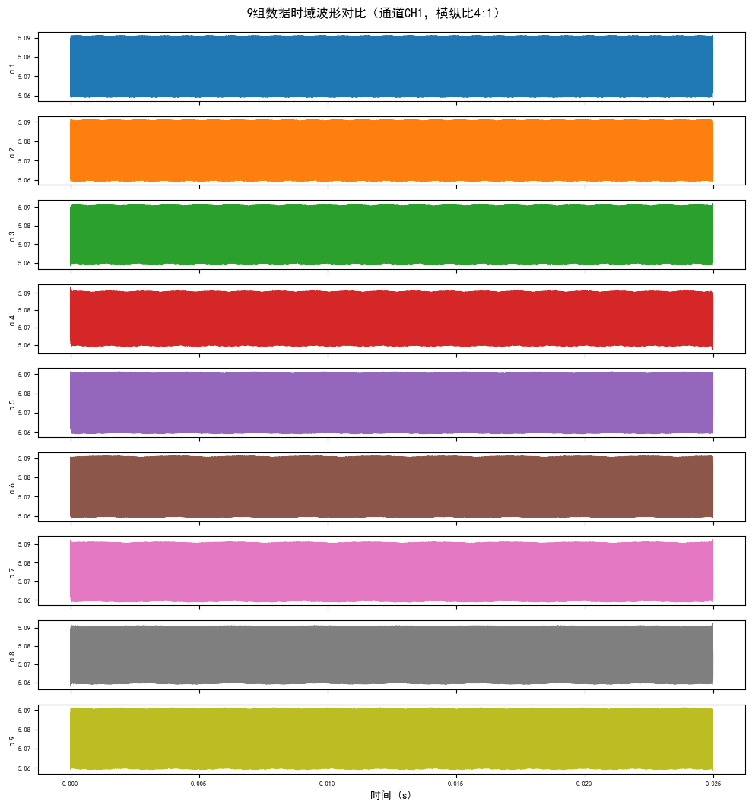
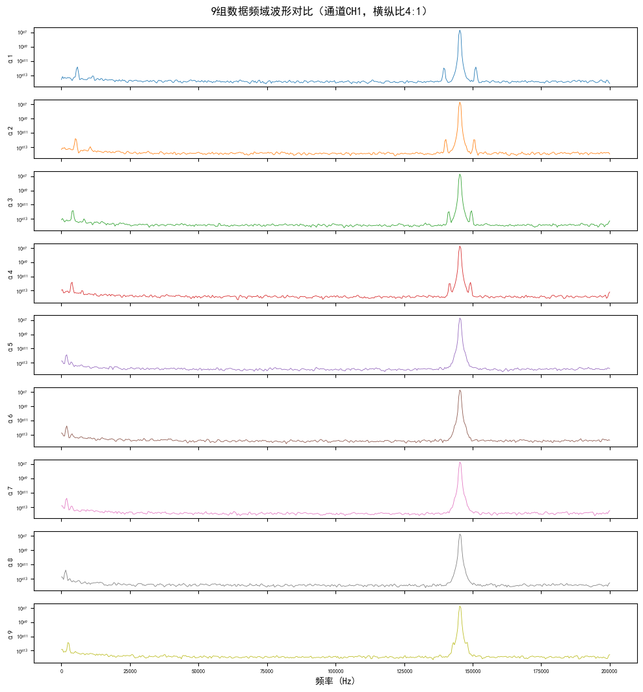
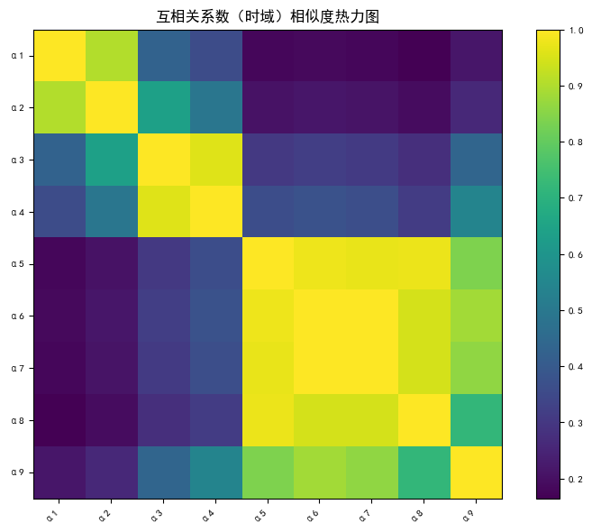
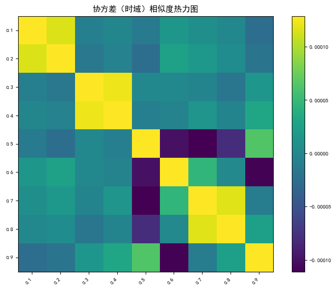
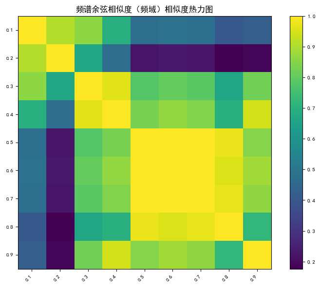
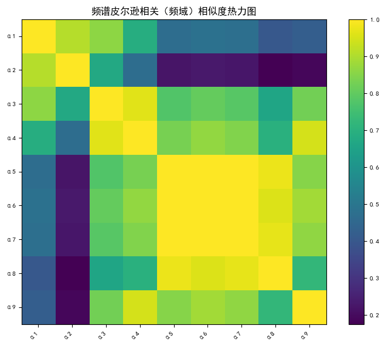
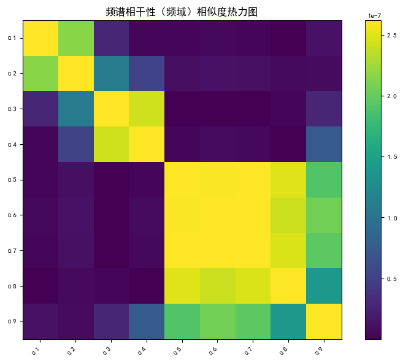

# NPMEMS_TC12 实验报告

> 生成时间: 2026-07-15 11:52:40

---

### BLOCK 1

## 批量对比-α1, α2, α3, α4, α5, α6, α7, α8, α9

> 来源: 批量参数对比 | 生成时间: 2026-07-15 11:52:40

## 批量参数对比报告

**数据组数**: 9

**参数标签**: α1, α2, α3, α4, α5, α6, α7, α8, α9

**计算类型**: 时域+频域

**采样频率**: 400000 Hz

**时域相似性算法**: 互相关系数、互相关峰值、协方差

**频域变换算法**: Welch功率谱密度估计（使用FFT计算）

### 时域波形堆叠图（通道: CH1）

### 频域波形堆叠图（通道: CH1）

### 互相关系数（时域）相似度热力图

### 互相关峰值（时域）相似度热力图

### 协方差（时域）相似度热力图

### 频谱余弦相似度（频域）相似度热力图

### 频谱皮尔逊相关（频域）相似度热力图

### 频谱相干性（频域）相似度热力图

### 时域相似性计算结果（部分示例）

**数据域**: 时域原始信号

| 算法 | 组A | 组B | 值 |
|------|-----|-----|----|
| 互相关系数 | α1 | α1 | 1.000000 |
| 互相关峰值 | α1 | α1 | 1.000000 |
| 协方差 | α1 | α1 | 0.000128 |
| 互相关系数 | α1 | α2 | 0.904360 |
| 互相关峰值 | α1 | α2 | 0.904360 |
| 协方差 | α1 | α2 | 0.000116 |
| 互相关系数 | α1 | α3 | 0.428244 |
| 互相关峰值 | α1 | α3 | 0.428244 |
| 协方差 | α1 | α3 | -0.000008 |
| 互相关系数 | α1 | α4 | 0.360039 |
| 互相关峰值 | α1 | α4 | 0.360207 |
| 协方差 | α1 | α4 | -0.000001 |
| 互相关系数 | α1 | α5 | 0.179760 |
| 互相关峰值 | α1 | α5 | 0.179760 |
| 协方差 | α1 | α5 | -0.000012 |
| 互相关系数 | α1 | α6 | 0.184479 |
| 互相关峰值 | α1 | α6 | 0.184867 |
| 协方差 | α1 | α6 | 0.000016 |
| 互相关系数 | α1 | α7 | 0.179677 |
| 互相关峰值 | α1 | α7 | 0.180055 |

### 频域相似性计算结果（部分示例）

**数据域**: 频域（Welch功率谱密度估计（FFT））

| 算法 | 组A | 组B | 值 |
|------|-----|-----|----|
| 频谱余弦相似度 | α1 | α1 | 1.000000 |
| 频谱皮尔逊相关 | α1 | α1 | 1.000000 |
| 频谱相干性 | α1 | α1 | 0.000000 |
| 频谱余弦相似度 | α1 | α2 | 0.906318 |
| 频谱皮尔逊相关 | α1 | α2 | 0.907319 |
| 频谱相干性 | α1 | α2 | 0.000000 |
| 频谱余弦相似度 | α1 | α3 | 0.859921 |
| 频谱皮尔逊相关 | α1 | α3 | 0.859178 |
| 频谱相干性 | α1 | α3 | 0.000000 |
| 频谱余弦相似度 | α1 | α4 | 0.691802 |
| 频谱皮尔逊相关 | α1 | α4 | 0.690101 |
| 频谱相干性 | α1 | α4 | 0.000000 |
| 频谱余弦相似度 | α1 | α5 | 0.472561 |
| 频谱皮尔逊相关 | α1 | α5 | 0.469311 |
| 频谱相干性 | α1 | α5 | 0.000000 |
| 频谱余弦相似度 | α1 | α6 | 0.487324 |
| 频谱皮尔逊相关 | α1 | α6 | 0.484166 |
| 频谱相干性 | α1 | α6 | 0.000000 |
| 频谱余弦相似度 | α1 | α7 | 0.478139 |
| 频谱皮尔逊相关 | α1 | α7 | 0.474975 |

### 相似度矩阵汇总

#### 时域相似度矩阵

**数据域**: 时域原始信号

##### 互相关系数（时域）

| | α1 | α2 | α3 | α4 | α5 | α6 | α7 | α8 | α9 |
|----|----|----|----|----|----|----|----|----|
| α1 | 1.0000 | 0.9044 | 0.4282 | 0.3600 | 0.1798 | 0.1845 | 0.1797 | 0.1647 | 0.2138 |
| α2 | 0.9044 | 1.0000 | 0.6392 | 0.4914 | 0.2067 | 0.2141 | 0.2086 | 0.1914 | 0.2623 |
| α3 | 0.4282 | 0.6392 | 1.0000 | 0.9576 | 0.3041 | 0.3200 | 0.3078 | 0.2776 | 0.4384 |
| α4 | 0.3600 | 0.4914 | 0.9576 | 1.0000 | 0.3624 | 0.3745 | 0.3660 | 0.3123 | 0.5408 |
| α5 | 0.1798 | 0.2067 | 0.3041 | 0.3624 | 1.0000 | 0.9796 | 0.9715 | 0.9744 | 0.8378 |
| α6 | 0.1845 | 0.2141 | 0.3200 | 0.3745 | 0.9796 | 1.0000 | 0.9968 | 0.9451 | 0.8845 |
| α7 | 0.1797 | 0.2086 | 0.3078 | 0.3660 | 0.9715 | 0.9968 | 1.0000 | 0.9476 | 0.8611 |
| α8 | 0.1647 | 0.1914 | 0.2776 | 0.3123 | 0.9744 | 0.9451 | 0.9476 | 1.0000 | 0.7175 |
| α9 | 0.2138 | 0.2623 | 0.4384 | 0.5408 | 0.8378 | 0.8845 | 0.8611 | 0.7175 | 1.0000 |

##### 互相关峰值（时域）

| | α1 | α2 | α3 | α4 | α5 | α6 | α7 | α8 | α9 |
|----|----|----|----|----|----|----|----|----|
| α1 | 1.0000 | 0.9044 | 0.4282 | 0.3602 | 0.1798 | 0.1849 | 0.1801 | 0.1649 | 0.2145 |
| α2 | 0.9044 | 1.0000 | 0.6392 | 0.4914 | 0.2069 | 0.2141 | 0.2086 | 0.1928 | 0.2628 |
| α3 | 0.4282 | 0.6392 | 1.0000 | 0.9576 | 0.3041 | 0.3200 | 0.3078 | 0.2776 | 0.4390 |
| α4 | 0.3602 | 0.4914 | 0.9576 | 1.0000 | 0.3638 | 0.3745 | 0.3660 | 0.3135 | 0.5413 |
| α5 | 0.1798 | 0.2069 | 0.3041 | 0.3638 | 1.0000 | 0.9921 | 0.9984 | 0.9744 | 0.8469 |
| α6 | 0.1849 | 0.2141 | 0.3200 | 0.3745 | 0.9921 | 1.0000 | 0.9968 | 0.9495 | 0.8845 |
| α7 | 0.1801 | 0.2086 | 0.3078 | 0.3660 | 0.9984 | 0.9968 | 1.0000 | 0.9670 | 0.8611 |
| α8 | 0.1649 | 0.1928 | 0.2776 | 0.3135 | 0.9744 | 0.9495 | 0.9670 | 1.0000 | 0.7182 |
| α9 | 0.2145 | 0.2628 | 0.4390 | 0.5413 | 0.8469 | 0.8845 | 0.8611 | 0.7182 | 1.0000 |

##### 协方差（时域）

| | α1 | α2 | α3 | α4 | α5 | α6 | α7 | α8 | α9 |
|----|----|----|----|----|----|----|----|----|
| α1 | 0.0001 | 0.0001 | -0.0000 | -0.0000 | -0.0000 | 0.0000 | 0.0000 | 0.0000 | -0.0000 |
| α2 | 0.0001 | 0.0001 | -0.0000 | -0.0000 | -0.0000 | 0.0000 | 0.0000 | 0.0000 | -0.0000 |
| α3 | -0.0000 | -0.0000 | 0.0001 | 0.0001 | 0.0000 | 0.0000 | -0.0000 | -0.0000 | 0.0000 |
| α4 | -0.0000 | -0.0000 | 0.0001 | 0.0001 | -0.0000 | -0.0000 | 0.0000 | -0.0000 | 0.0000 |
| α5 | -0.0000 | -0.0000 | 0.0000 | -0.0000 | 0.0001 | -0.0001 | -0.0001 | -0.0001 | 0.0001 |
| α6 | 0.0000 | 0.0000 | 0.0000 | -0.0000 | -0.0001 | 0.0001 | 0.0000 | 0.0000 | -0.0001 |
| α7 | 0.0000 | 0.0000 | -0.0000 | 0.0000 | -0.0001 | 0.0000 | 0.0001 | 0.0001 | -0.0000 |
| α8 | 0.0000 | 0.0000 | -0.0000 | -0.0000 | -0.0001 | 0.0000 | 0.0001 | 0.0001 | 0.0000 |
| α9 | -0.0000 | -0.0000 | 0.0000 | 0.0000 | 0.0001 | -0.0001 | -0.0000 | 0.0000 | 0.0001 |

#### 频域相似度矩阵

**数据域**: 频域（Welch功率谱密度估计（FFT））

##### 频谱余弦相似度（频域）

| | α1 | α2 | α3 | α4 | α5 | α6 | α7 | α8 | α9 |
|----|----|----|----|----|----|----|----|----|
| α1 | 1.0000 | 0.9063 | 0.8599 | 0.6918 | 0.4726 | 0.4873 | 0.4781 | 0.4042 | 0.4241 |
| α2 | 0.9063 | 1.0000 | 0.6717 | 0.4717 | 0.2222 | 0.2340 | 0.2256 | 0.1763 | 0.1903 |
| α3 | 0.8599 | 0.6717 | 1.0000 | 0.9620 | 0.7782 | 0.8059 | 0.7879 | 0.6638 | 0.8239 |
| α4 | 0.6918 | 0.4717 | 0.9620 | 1.0000 | 0.8321 | 0.8662 | 0.8439 | 0.6993 | 0.9460 |
| α5 | 0.4726 | 0.2222 | 0.7782 | 0.8321 | 1.0000 | 0.9975 | 0.9997 | 0.9754 | 0.8510 |
| α6 | 0.4873 | 0.2340 | 0.8059 | 0.8662 | 0.9975 | 1.0000 | 0.9988 | 0.9576 | 0.8849 |
| α7 | 0.4781 | 0.2256 | 0.7879 | 0.8439 | 0.9997 | 0.9988 | 1.0000 | 0.9701 | 0.8626 |
| α8 | 0.4042 | 0.1763 | 0.6638 | 0.6993 | 0.9754 | 0.9576 | 0.9701 | 1.0000 | 0.7222 |
| α9 | 0.4241 | 0.1903 | 0.8239 | 0.9460 | 0.8510 | 0.8849 | 0.8626 | 0.7222 | 1.0000 |

##### 频谱皮尔逊相关（频域）

| | α1 | α2 | α3 | α4 | α5 | α6 | α7 | α8 | α9 |
|----|----|----|----|----|----|----|----|----|
| α1 | 1.0000 | 0.9073 | 0.8592 | 0.6901 | 0.4693 | 0.4842 | 0.4750 | 0.4009 | 0.4216 |
| α2 | 0.9073 | 1.0000 | 0.6726 | 0.4716 | 0.2213 | 0.2332 | 0.2247 | 0.1753 | 0.1894 |
| α3 | 0.8592 | 0.6726 | 1.0000 | 0.9618 | 0.7764 | 0.8044 | 0.7863 | 0.6616 | 0.8232 |
| α4 | 0.6901 | 0.4716 | 0.9618 | 1.0000 | 0.8310 | 0.8653 | 0.8429 | 0.6975 | 0.9458 |
| α5 | 0.4693 | 0.2213 | 0.7764 | 0.8310 | 1.0000 | 0.9974 | 0.9997 | 0.9753 | 0.8504 |
| α6 | 0.4842 | 0.2332 | 0.8044 | 0.8653 | 0.9974 | 1.0000 | 0.9988 | 0.9573 | 0.8846 |
| α7 | 0.4750 | 0.2247 | 0.7863 | 0.8429 | 0.9997 | 0.9988 | 1.0000 | 0.9699 | 0.8621 |
| α8 | 0.4009 | 0.1753 | 0.6616 | 0.6975 | 0.9753 | 0.9573 | 0.9699 | 1.0000 | 0.7208 |
| α9 | 0.4216 | 0.1894 | 0.8232 | 0.9458 | 0.8504 | 0.8846 | 0.8621 | 0.7208 | 1.0000 |

##### 频谱相干性（频域）

| | α1 | α2 | α3 | α4 | α5 | α6 | α7 | α8 | α9 |
|----|----|----|----|----|----|----|----|----|
| α1 | 0.0000 | 0.0000 | 0.0000 | 0.0000 | 0.0000 | 0.0000 | 0.0000 | 0.0000 | 0.0000 |
| α2 | 0.0000 | 0.0000 | 0.0000 | 0.0000 | 0.0000 | 0.0000 | 0.0000 | 0.0000 | 0.0000 |
| α3 | 0.0000 | 0.0000 | 0.0000 | 0.0000 | 0.0000 | 0.0000 | 0.0000 | 0.0000 | 0.0000 |
| α4 | 0.0000 | 0.0000 | 0.0000 | 0.0000 | 0.0000 | 0.0000 | 0.0000 | 0.0000 | 0.0000 |
| α5 | 0.0000 | 0.0000 | 0.0000 | 0.0000 | 0.0000 | 0.0000 | 0.0000 | 0.0000 | 0.0000 |
| α6 | 0.0000 | 0.0000 | 0.0000 | 0.0000 | 0.0000 | 0.0000 | 0.0000 | 0.0000 | 0.0000 |
| α7 | 0.0000 | 0.0000 | 0.0000 | 0.0000 | 0.0000 | 0.0000 | 0.0000 | 0.0000 | 0.0000 |
| α8 | 0.0000 | 0.0000 | 0.0000 | 0.0000 | 0.0000 | 0.0000 | 0.0000 | 0.0000 | 0.0000 |
| α9 | 0.0000 | 0.0000 | 0.0000 | 0.0000 | 0.0000 | 0.0000 | 0.0000 | 0.0000 | 0.0000 |

---
