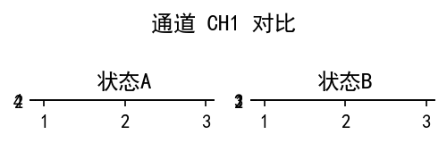
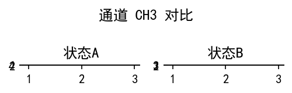

# NPMEMS_TC12 实验报告

> 生成时间: 2026-07-17 12:22:34

---

### BLOCK 1

## Tab3测试报告

> 来源: Tab3 | 生成时间: 2026-07-17 12:22:34

## Tab3报告

### 实验状态定义

| 序号 | 状态名称 | 类型 | alpha |
| --- | --- | --- | --- |
| 1 | 状态A | TC12 | 0.1 |
| 2 | 状态B | TC12 | 0.2 |
### 波形对比

#### 通道 CH1

#### 通道 CH2

#### 通道 CH3

---
