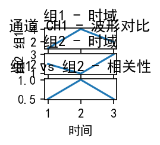
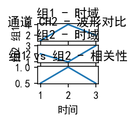

# NPMEMS_TC12 实验报告

> 生成时间: 2026-07-17 12:22:35

---

### BLOCK 1

## Tab6测试报告

> 来源: Tab6 | 生成时间: 2026-07-17 12:22:35

## Tab6报告

### 实验状态定义

| 序号 | 状态名称 | 类型 | alpha |
| --- | --- | --- | --- |
| 1 | α1=0.1 | TC12 | 0.1 |
| 2 | α2=0.2 | TC12 | 0.2 |
### 通道波形对比

#### 通道 CH1

#### 通道 CH2

### 通道相关性指标排序

| 排名 | 通道 | 加权均值 |
|------|------|----------|
| 1 | CH1 | 0.950000 |
| 2 | CH2 | 0.900000 |

---
