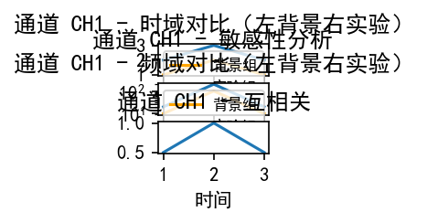
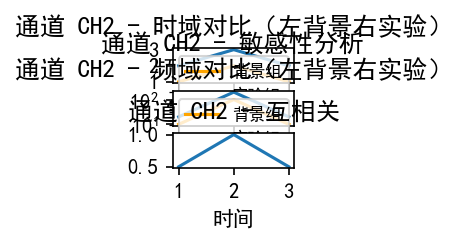

# NPMEMS_TC12 实验报告

> 生成时间: 2026-07-17 12:22:36

---

### BLOCK 1

## Tab8测试报告

> 来源: Tab8 | 生成时间: 2026-07-17 12:22:36

## Tab8报告

### 实验状态定义

| 序号 | 状态名称 | 类型 | angle |
| --- | --- | --- | --- |
| 1 | 方位0度 | 方位 | 0 |
| 2 | 方位90度 | 方位 | 90 |
### 基础敏感性分析（左背景右实验）

> **左列**: 背景数据 | **右列**: 实验数据

### 相关性分析

### 通道敏感性分析汇总

#### 通道 CH1

#### 通道 CH2

---
