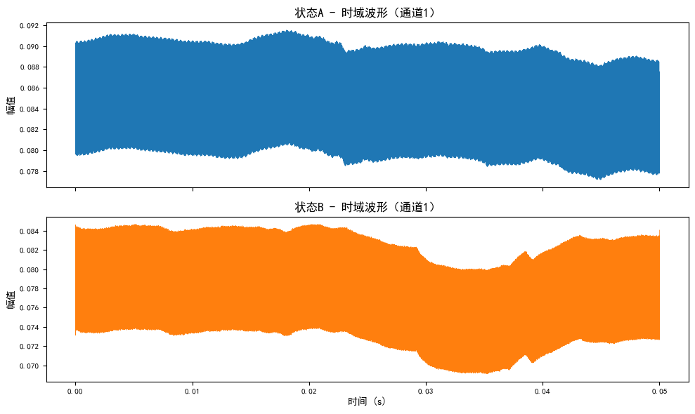
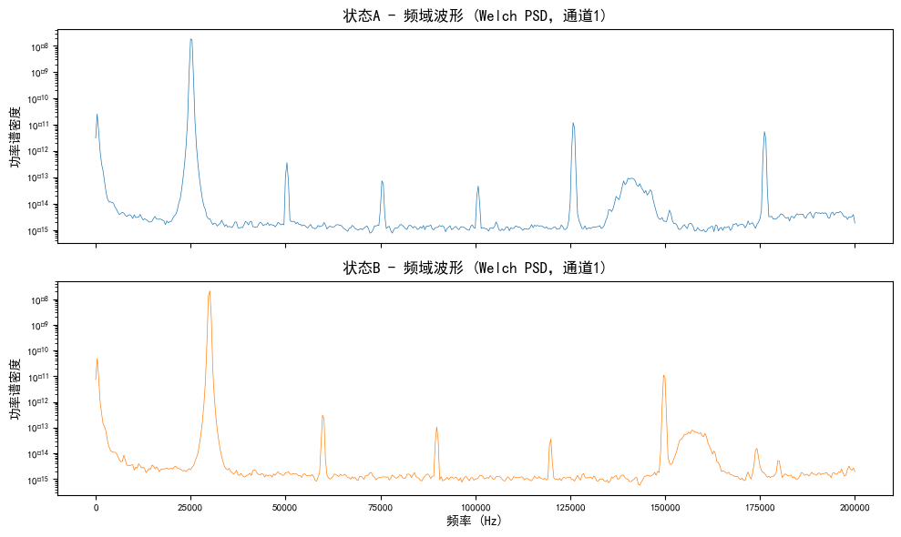
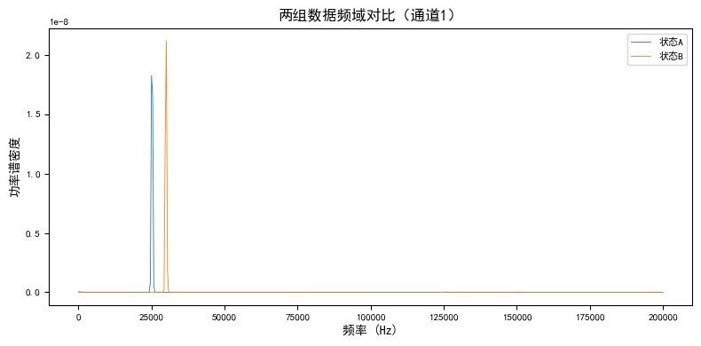

# 两组数据对比实验报告

> 生成时间: 2026-07-01 08:54:58

**数据文件A**: 20260615170256.394205-1.tdms

**数据文件B**: 20260615170339.919846-1.tdms

**采样频率**: 400000 Hz

**数据长度**: 20000 点

**实验状态A**: α=0.3, KW=100, 电压=20V

**实验状态B**: α=0.7, KW=200, 电压=30V

---

## 第一章：时域分析

### 1.1 时域波形对比

### 1.2 时域相似性计算结果

| 算法 | 相似性值 |
|------|----------|
| 互相关系数 | 0.860429 |
| 互相关峰值 | 0.860429 |
| 协方差 | 0.013988 |
| 欧几里得距离 | 46.183480 |
| 曼哈顿距离 | 10417.780144 |
| 余弦相似度 | 0.860429 |
| 最大信息系数(MIC) | 0.192263 |

---

## 第二章：频域分析

### 2.1 频域波形对比

### 2.2 频域叠加对比

**频域变换算法**: Welch功率谱密度估计（使用FFT计算）

### 2.3 频域相似性计算结果

| 算法 | 相似性值 |
|------|----------|
| 频谱欧几里得距离 | 0.133671 |
| 频谱曼哈顿距离 | 1.600057 |
| 频谱余弦相似度 | 0.879677 |
| 频谱皮尔逊相关 | 0.879754 |
| 频谱MSE | 0.000000 |
| 频谱RMSE | 0.000386 |
| 频谱MAE | 0.000013 |
| 频谱互相关 | 0.879754 |
| 频谱能量差 | 0.646166 |
| 频谱熵差 | 2.226994 |
| 频谱相干性 | 0.000552 |

---

## 第三章：矩阵分析

### 3.1 时域相似度矩阵（2×2）

| | 状态A | 状态B |
|----|-------|-------|
| 状态A | 1.0000 | 0.8604 |
| 状态B | 0.8604 | 1.0000 |

**注**: 以上矩阵使用互相关系数作为相似度指标

### 3.2 频域相似度矩阵（2×2）

| | 状态A | 状态B |
|----|-------|-------|
| 状态A | 1.0000 | 0.8797 |
| 状态B | 0.8797 | 1.0000 |

**注**: 以上矩阵使用频谱余弦相似度作为相似度指标

### 3.3 各算法相似度汇总

| 算法类型 | 算法名称 | 相似性值 |
|----------|----------|----------|
| 时域 | 互相关系数 | 0.8604 |
| 时域 | 互相关峰值 | 0.8604 |
| 时域 | 协方差 | 0.0140 |
| 时域 | 欧几里得距离 | 46.1835 |
| 时域 | 曼哈顿距离 | 10417.7801 |
| 时域 | 余弦相似度 | 0.8604 |
| 时域 | 最大信息系数(MIC) | 0.1923 |
| 频域 | 频谱欧几里得距离 | 0.1337 |
| 频域 | 频谱曼哈顿距离 | 1.6001 |
| 频域 | 频谱余弦相似度 | 0.8797 |
| 频域 | 频谱皮尔逊相关 | 0.8798 |
| 频域 | 频谱MSE | 0.0000 |
| 频域 | 频谱RMSE | 0.0004 |
| 频域 | 频谱MAE | 0.0000 |
| 频域 | 频谱互相关 | 0.8798 |
| 频域 | 频谱能量差 | 0.6462 |
| 频域 | 频谱熵差 | 2.2270 |
| 频域 | 频谱相干性 | 0.0006 |

