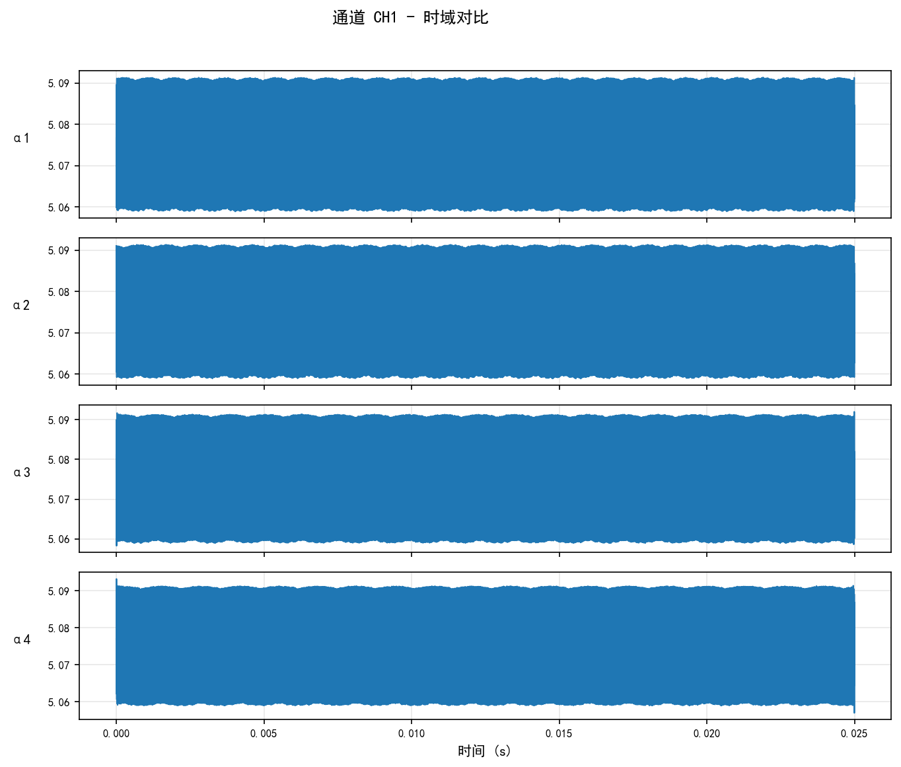
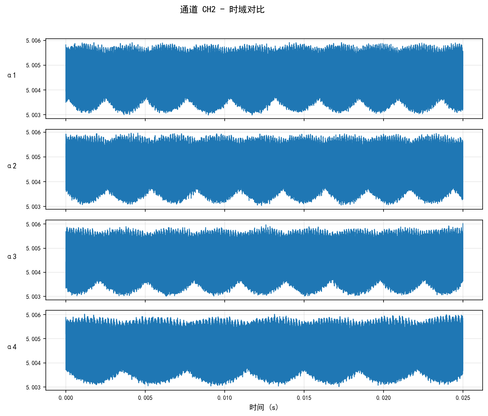
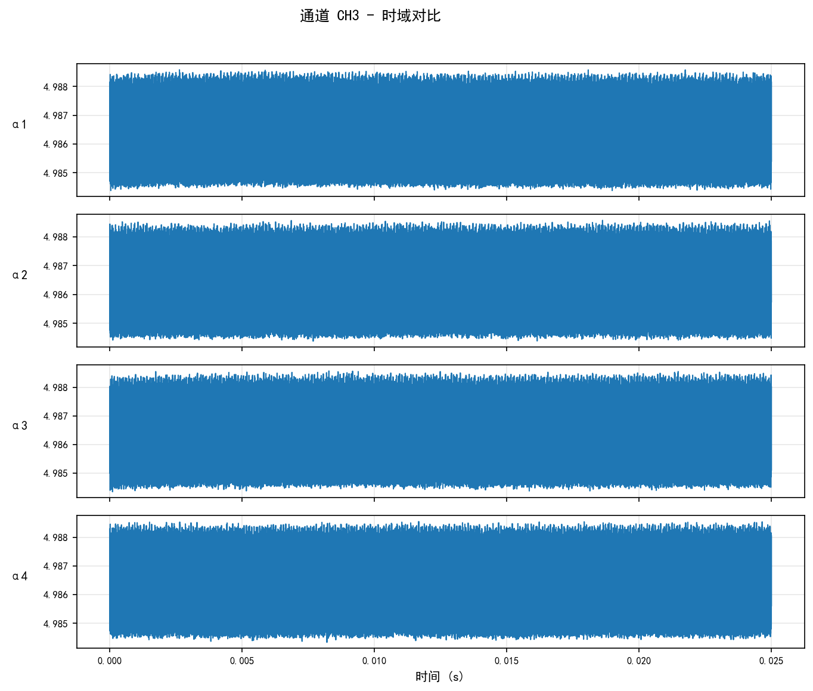
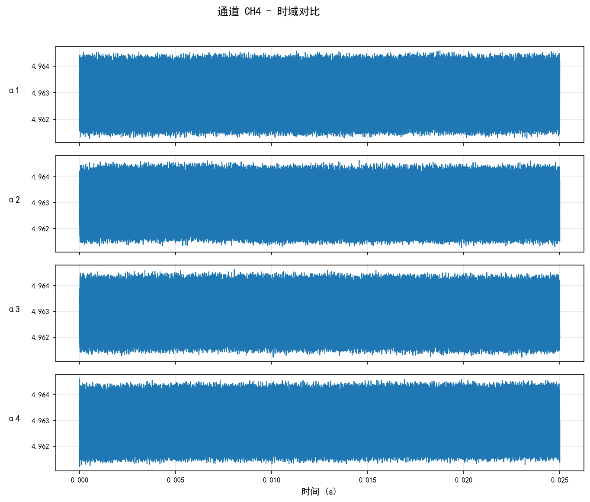
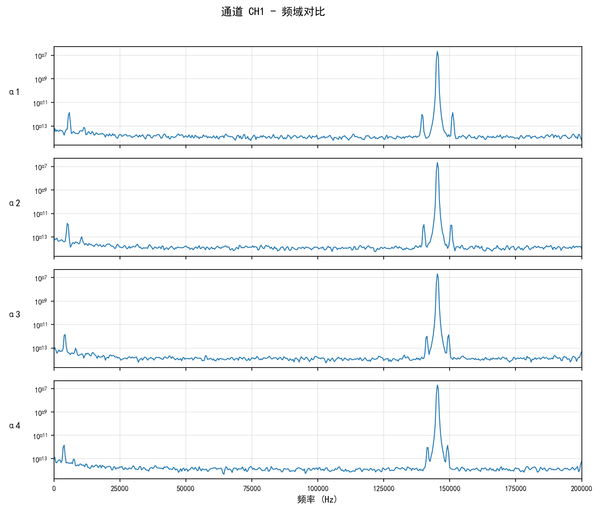
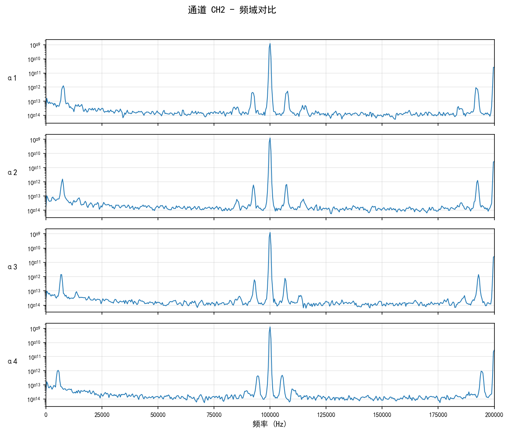
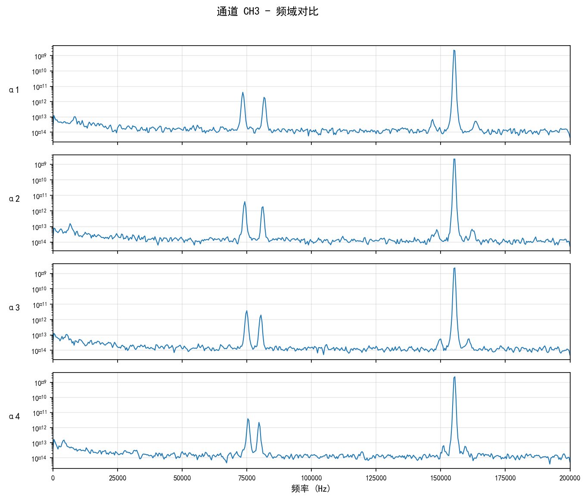
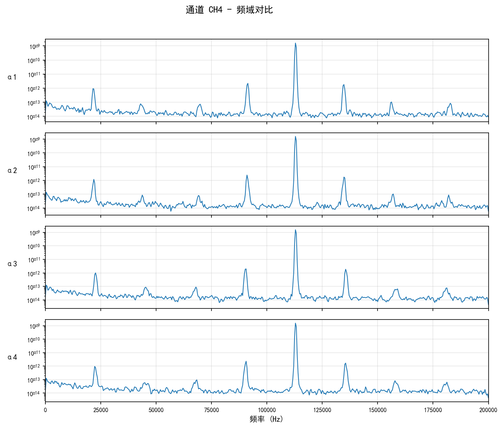

# NPMEMS_TC12 实验报告

> 生成时间: 2026-07-15 17:01:51

---

### BLOCK 1

## 批量对比-α1, α2, α3, α4

> 来源: 批量参数对比 | 生成时间: 2026-07-15 17:01:51

## 批量参数对比报告

### 实验状态定义

| 序号 | 状态名称 | 报告BLOCK序号 | 类型 | α或K | r |
| --- | --- | --- | --- | --- | --- |
| 1 | α1=0.1 | α1=0.1202607151700处理数据 | TC12 | 0.1 | 1.0 |
| 2 | α2=0.2 | α2=0.2202607151700处理数据 | TC12 | 0.2 | 1.0 |
| 3 | α3=0.3 | α3=0.3202607151700处理数据 | TC12 | 0.3 | 1.0 |
| 4 | α4=0.4 | α4=0.4202607151700处理数据 | TC12 | 0.4 | 1.0 |
**数据组数**: 4

**参数标签**: α1, α2, α3, α4

**计算类型**: 时域+频域

**预处理设置**: 切片[0.00-1.00s], 降采样=否

### 时域波形对比

#### 通道 CH1

#### 通道 CH2

#### 通道 CH3

#### 通道 CH4

### 频域波形对比

#### 通道 CH1

#### 通道 CH2

#### 通道 CH3

#### 通道 CH4

### 相关性可视化

#### 通道 CH1

#### 通道 CH2

#### 通道 CH3

#### 通道 CH4

### 通道相关性指标排序

> 各通道中两两互相关系数（权重均匀）加权均值指标，由大到小排序

| 排名 | 通道 | 加权均值 |
|------|------|----------|
| 1 | CH4 | 0.625123 |
| 2 | CH2 | 0.592216 |
| 3 | CH3 | 0.532072 |
| 4 | CH1 | 0.514340 |

---
